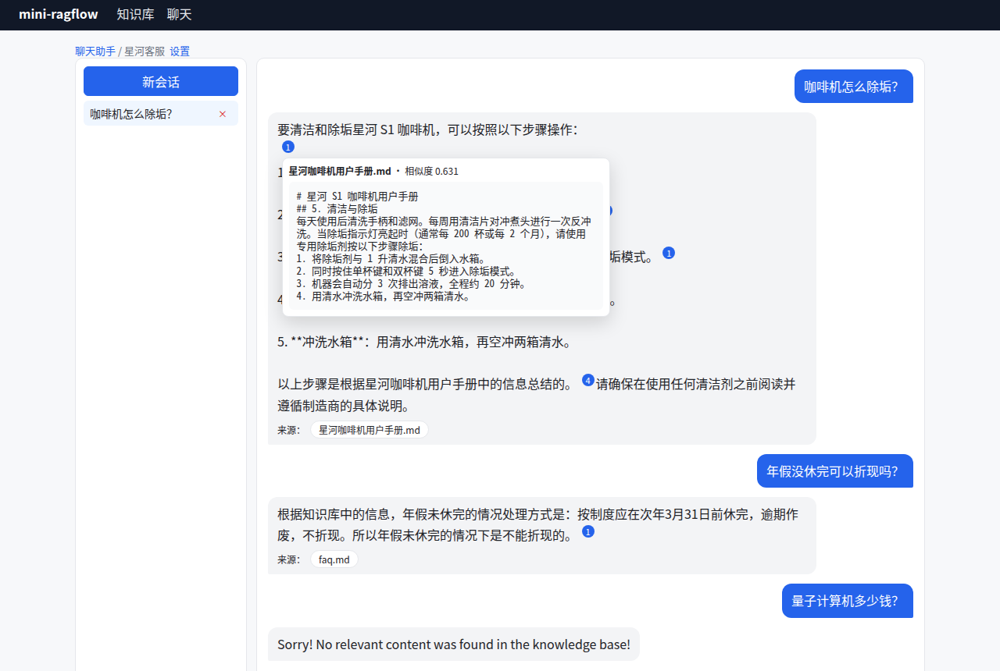

# 第 0 章 本书怎么读

> 本章目标：知道这本书讲什么、配套代码长什么样、需要准备什么环境，以及怎么对照 RAGFlow 源码阅读。

## 0.1 这本书讲什么

RAG（Retrieval-Augmented Generation，检索增强生成）的流程是：先从你自己的资料里找出相关片段，再让大模型基于这些片段作答。原理一句话就能讲完，可要真正做成一个可用的"知识库"，需要解决一长串工程问题：

1. **入库**：PDF、Word、Markdown、表格怎么变成干净的文本？文本切成多大的块？切在哪里？
2. **索引**：每个块要存哪些字段，才能既支持关键词检索，又支持向量检索？
3. **检索**：用户的一句话怎么变成查询？关键词分数和向量分数怎么合在一起？阈值设多少？
4. **生成**：检索到的内容怎么塞进提示词？模型的回答怎么标注引用、让用户能点回原文？
5. **平台**：多个用户、对外 API、后台任务的扩容与容错、数据源同步、部署。

[RAGFlow](https://github.com/infiniflow/ragflow) 是一个开源 RAG 引擎，对上面每个问题都给出了工程化的答案，而且答案写在代码里，我们可以逐行去读。本书的做法是：

- **读**：从 RAGFlow 当前的 Go 实现（`internal/`）出发，沿着真实的调用链读源码，每个结论都附上 `path:line`；
- **写**：从零写一个 mini-ragflow，用同样的概念实现一个前后端都能跑的知识库系统。每个 Part 结束时升一个版本；
- **对照**：写完再回头和 RAGFlow 比较，找出真实存在的差距并修复，然后把修复的过程写进书里。

读完之后，你应该能**从零写出一个知识库 RAG 系统**：上传文档 → 解析 → 切分 → 向量化 → 建索引 → 混合检索与重排 → 带引用的流式问答，并且能把它部署成多进程服务。

本书参照的版本是 `infiniflow/ragflow` main 分支，commit `11e00194b`（2026 年 10 月）。书中所有 `path:line` 都基于这个 commit 校验过。RAGFlow 正在从 Python 迁移到 Go，仓库里仍然留着一部分 Python 代码（`api/`、`rag/` 等），其中一些已经清空（例如 `rag/nlp/` 里只剩 `__pycache__`）。本书只读 Go 这一侧。少数地方 Go 代码仍在运行时读取 `rag/prompts/*.md` 里的提示词文件，书中会单独指出。

## 0.2 mini-ragflow 长什么样

配套代码放在 `code/mini-ragflow/`（GitHub：`luxiang0412/mini-ragflow`），共有六个版本：

| 版本 | 能力 | 对应 Part |
|---|---|---|
| v0.1 | 知识库与文档管理、异步解析任务、简单切分、前端文档表 | Part II |
| v0.2 | 入库流水线 DSL、六种格式解析、五种切分策略、分词与向量化 | Part III |
| v0.3 | 自研混合检索引擎、两阶段重排、检索测试页 | Part IV |
| v0.4 | 带引用的流式知识库问答、会话、聊天 UI | Part V |
| v0.5 | LLM 抽取关键词/问题/元数据、元数据过滤、RAPTOR | Part VI |
| v1.0 | 账号与 API Key、OpenAI/Dify/MCP 接口、多进程、数据源同步、Docker | Part VII |



*图 0-1：mini-ragflow 的聊天界面。回答里的蓝色数字是引用，鼠标悬停会显示原文分块。（真实模型：bge-m3 + qwen2.5:3b）*

技术栈选择"和 RAGFlow 概念一致，复杂度降一档"：

| | RAGFlow | mini-ragflow |
|---|---|---|
| 后端 | Go + gin + GORM | Go 标准库 `net/http` |
| 关系数据库 | MySQL / PostgreSQL | SQLite（纯 Go 驱动，免 CGO） |
| 对象存储 | MinIO | 本地目录 |
| 消息队列 | NATS JetStream | SQLite 任务表 + 租约 |
| 检索引擎 | Elasticsearch / Infinity / OceanBase… | 自己写的内存倒排索引 + 向量扫描 |
| 文档理解 | DeepDoc（ONNX 版面/OCR/表格模型） | 文本层解析 + poppler `pdftotext` |
| 前端 | React + Vite + TypeScript | React + Vite + TypeScript |
| 模型 | 几十家厂商 | mock + 任意 OpenAI 兼容接口 |

被"降档"的地方，书里都会说明省掉了什么、为什么省、省掉的代价是什么。

## 0.3 环境准备

| 工具 | 用途 | 版本 |
|---|---|---|
| Go | 后端 | 1.26+ |
| Node.js | 前端 | 22+ |
| poppler-utils | PDF 解析（`pdftotext`） | 任意 |
| Chrome | 可选，跑 `web/e2e` 里的 UI 脚本 | 任意 |
| Docker | 可选，Part VII 部署 | 24+ |
| Ollama | 可选，接真实模型 | 任意 |

不装 Ollama 也可以读完全书：mini-ragflow 自带一套确定性的 mock 模型，包括"哈希 embedding"和一个会流式输出、会写引用的"假 LLM"，全部测试都能离线跑通。书里凡是写着"真实模型"的输出，都是作者在本机用 Ollama 跑出来的（embedding 用 `bge-m3`，对话用 `qwen2.5:3b`）。

```bash
git clone https://github.com/luxiang0412/mini-ragflow code/mini-ragflow
cd code/mini-ragflow
git checkout v0.1                        # 从第一个版本开始
cd backend && go test ./... && go run ./cmd/mini-ragflow
```

## 0.4 怎么读

- 主线是 **3 → 6 → 9 → 13 → 16** 这几章（★ 越多越重要）。第 3 章把一份文档从上传到被引用的全过程走一遍，后面每一章都在拆这条链路上的某一段。
- 每章的结构都一样：**问题与概念 → RAGFlow 怎么做 → 从零实现 → 运行与验证 → 练习 → 延伸阅读**。
- 每个 Part 结尾有一个 Lab，带你把 mini-ragflow 升到下一个版本。用 `git diff v0.2 v0.3` 就能看到每一版改了什么。
- "踩坑记录"里只写**真实发生过**的问题，都附有当时的报错或输出。靠自查发现、还没来得及触发的问题，书里会明确标注。

本书对照阅读 RAGFlow 源码时用到的工具：

```bash
git clone https://github.com/infiniflow/ragflow && cd ragflow && git checkout 11e00194b
grep -n "func (s \*RetrievalService) Retrieval" internal/service/nlp/retrieval.go   # 按书中的 path:line 定位
```

附录 A 是"概念 → 源码路径"的索引表，读源码迷路时可以去查。

## 0.5 练习

1. **巩固**：在本机跑通 `v0.1`，上传 `samples/` 里的三份文档，看它们被切成几块。
2. **扩展**：列出你自己工作中最常检索的三类文档，想一想它们各自的"结构"是什么（标题、条款、表格、问答……）。读第 9 章时再回来对照。
3. **读源码**：在 RAGFlow 的 `cmd/ragflow_server.go` 里找出它支持的所有 `--mode` 开关，猜猜每个模式负责什么。第 2 章会给出答案。
