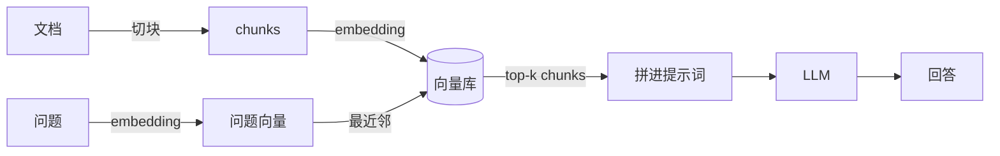
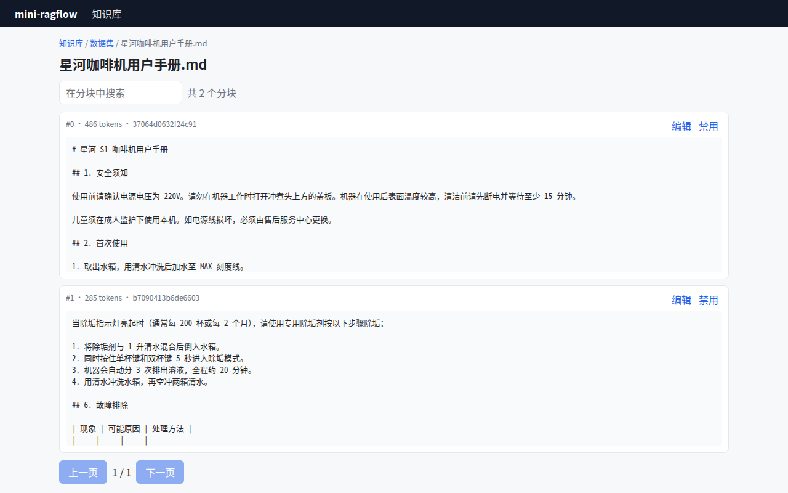

# 第 1 章 RAG 要解决什么问题，RAGFlow 押注在哪

> 本章目标：说清楚一个"能用"的知识库要过哪几关、在每一关会怎么失败，以及 RAGFlow 选择在哪几处下重注。
> 前置：第 0 章。对应代码：无（本章用后面各版本里真实跑出来的结果举例）。

## 1.1 最朴素的 RAG



这条链路二十行代码就能搭出来：按固定长度切块，算 embedding，取余弦最高的 k 块拼进提示词。它能跑出 demo，但一旦换成真实文档，就会在三个地方出错。下面三个例子都来自本书配套代码在真实运行中的输出，不是虚构的。

## 1.2 第一类失败：切坏了

mini-ragflow v0.1 的切分很朴素：在换行和句号处切开，然后按 token 预算往一块里塞。用它切《星河咖啡机用户手册》，第 1 块装下了第 1~5 节的开头，第 2 块从"当除垢指示灯亮起时……"开始：



*图 1-1：v0.1 的朴素切分。#1 块从小节中间开始，"## 5. 清洁与除垢"这个标题被留在了 #0 块里。*

问题在于：#1 块讲的是除垢步骤，但它的文本里既没有"清洁与除垢"，也没有"咖啡机"。用户问"咖啡机怎么除垢"，关键词匹配会被 #0 块里的标题吸走，向量相似度也因为缺少上下文而变低。**文档的结构（标题、条款、表格、问答对）是检索质量的上限**，切块时一旦丢掉，后面靠任何排序技巧都补不回来。

第 9 章会换上按标题层级切分的方法：每一块都带上自己所属的标题路径（`# 星河 S1 咖啡机用户手册 / ## 5. 清洁与除垢`）。

## 1.3 第二类失败：找不到

v0.3 的检索引擎刚写好时，有一个问题怎么问都搜不到：

```text
Q: 工作满10年年假有几天
top = <none>   (pass 1: kNN filtered by full-text, min_match=0.3, 1 hits)
```

原因藏在分词里：mini-ragflow 没有中文词典，用二字切分（bigram）来近似。"年假有几天"被切成"年假 / 假有 / 有几 / 几天"，其中"假有""有几"是跨词的伪词。它们在语料里从没出现过，按 IDF 公式反而拿到了最高的权重，结果把真正的关键词"年假"的分量稀释掉了（第 12 章会讲修法）。

另一个"找不到"来自 embedding 模型本身。同一句"咖啡机怎么除垢？"，分别和三段文本算余弦：

```text
nomic-embed-text  q·[除垢步骤, 年假规定, 咖啡粉说明] = [0.726, 0.711, 0.719]
bge-m3            q·[除垢步骤, 年假规定, 咖啡粉说明] = [0.654, 0.335, 0.509]
```

`nomic-embed-text` 对中文几乎没有区分度：相关和不相关的文本得分一样高。**检索要关键词和向量两条腿走路**，任何一条腿都不能单独信任。

## 1.4 第三类失败：答不准

v0.5 里有两份手册：S1 和 S2，型号不同，保修条款也不同。问"S1 的保修期多久？"，真实模型（qwen2.5:3b）是这样回答的：

```text
星河 S1 咖啡机的保修期如下：- 整机保修期为 2 年。- 研磨器保修期为 5 年。
```

"研磨器保修 5 年"是 S2 的条款。检索把两份手册的保修段落一起送进了提示词，模型就把它们混在了一起。修法不在模型上，而在检索上：给文档打上"产品型号"元数据，问题里提到 S1，就只在 S1 的文档里检索（第 19 章）。

还有一种"答不准"更隐蔽：模型回答"The answer is not found in the dataset."，系统却用向量相似度给这句拒答挂上了一条引用。用户看到引用会以为答案有出处（第 16 章）。

## 1.5 RAGFlow 押注在哪

RAGFlow 的 README（`README.md:104` 起）列出了它的核心特性。和上面三类失败对照着看：

| README 的说法 | 对应的失败 | 本书章节 |
|---|---|---|
| **"Quality in, quality out"**：基于深度文档理解，从格式复杂的非结构化数据里抽取知识 | 切坏了 | 第 8 章 DeepDoc |
| **Template-based chunking**：可解释、可选的切分模板 | 切坏了 | 第 7、9 章 |
| **Multiple recall paired with fused re-ranking** | 找不到 | 第 12、13 章 |
| **Grounded citations with reduced hallucinations**：切块可视化、可追溯的引用 | 答不准 | 第 14、16、17 章 |
| **Knowledge Compilation**：Wiki、图谱、树（RAPTOR）、思维导图…… | 找不到（宏观问题） | 第 20 章 |
| **Agentic Retrieval**：多步检索、拆解问题、核验证据 | 答不准（复杂问题） | 第 21 章 |
| **Go-native service architecture**：API、Admin、Ingestor、Syncer 统一由 Go 服务提供 | 平台化 | 第 2、24、25 章 |

可以把 RAGFlow 的取舍概括成一句话：**把力气花在入库这一侧**。DeepDoc 用 ONNX 模型做版面识别、OCR 和表格结构识别；切分不是一个固定算法，而是一组可选模板（通用、书籍、法规、问答、表格……），而且每个模板都是一张可编辑的流水线图。检索和生成这一侧，则用"关键词 + 向量"两阶段打分和"强制引用"来兜底。

这也决定了本书的篇幅分配：入库（Part II、III）和检索（Part IV）占了一半。

## 1.6 本书怎么覆盖这些押注

| 押注 | mini-ragflow 做到什么程度 |
|---|---|
| 深度文档理解 | 只做文本层解析（docx/html/md/xlsx/pdf 文本层），不复刻 DeepDoc 的模型；第 8 章读源码 |
| 模板化切分 | 6 个模板，5 种切分算法，DSL 可配置 |
| 融合重排 | 完整复刻 RAGFlow ES 路径的两阶段打分，另外实现 Infinity 式加权融合作对照 |
| 可溯源引用 | `[ID:n]` 协议、格式修复、向量回填、拒答不引用、前端悬浮 |
| 知识编译 | 实现 RAPTOR（树），其余读源码 |
| Agentic 检索 | 只读源码 |

## 1.7 练习

1. **巩固**：用自己的话解释，为什么"给每个 chunk 带上标题路径"既能帮关键词检索，也能帮向量检索。
2. **扩展**：设计一个能让 1.4 节"型号混淆"重现的最小数据集（两份文档、一个问题），再想想除了元数据过滤，还有哪些办法能缓解。
3. **读源码**：RAGFlow 的 `internal/ingestion/pipeline/template/` 下有 12 个模板 JSON。打开 `ingestion_pipeline_laws.json` 和 `ingestion_pipeline_general.json`，比较它们的切分组件和参数有什么不同。

## 1.8 延伸阅读

- RAGFlow `README.md` 的 Key Features 一节
- Lewis et al., *Retrieval-Augmented Generation for Knowledge-Intensive NLP Tasks*, 2020
- Sarthi et al., *RAPTOR: Recursive Abstractive Processing for Tree-Organized Retrieval*, 2024
