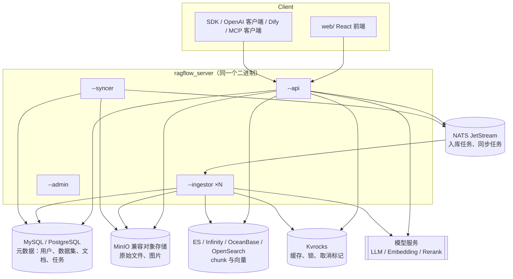

# 第 2 章 RAGFlow 架构鸟瞰

> 本章目标：画出 RAGFlow 的进程与依赖拓扑，认识 `internal/` 的目录分工，并把每个外部依赖对应到 mini-ragflow 里的替代品。
> 前置：第 1 章。对应代码：`v1.0` 的 `backend/cmd/mini-ragflow/main.go`（本章只看结构）。

## 2.1 一个二进制，五种模式

RAGFlow 的 Go 服务只编译出一个可执行文件 `ragflow_server`，用命令行开关决定它在本进程里扮演什么角色。`cmd/ragflow_server.go:165` 起的参数解析是这样写的：

```go
switch arg {
case "--admin":
    serverMode = "admin"
    args.mode = &serverMode
case "--ingestor":
    serverMode = "ingestor"
    args.mode = &serverMode
case "--api":
    serverMode = "api"
    args.mode = &serverMode
case "--syncer":
    serverMode = "syncer"
    args.mode = &serverMode
case "--deepdoc":
    serverMode = "deepdoc"
    args.mode = &serverMode
```

帮助信息（`cmd/ragflow_server.go:380` 起）里写了各自的职责：

| 模式 | 职责 | 本书章节 |
|---|---|---|
| `--api` | HTTP API（数据集、文档、检索、聊天、Agent……），同时在进程内提供 MCP | 第 3~23 章 |
| `--ingestor` | 入库 worker：从 NATS 拉任务，跑解析/切分/向量化流水线，写进检索引擎 | 第 6、24 章 |
| `--syncer` | 数据源同步：S3、Confluence、Notion、GitHub……同步到数据集 | 第 25 章 |
| `--admin` | 管理后台（用户、服务状态） | 第 22、26 章 |
| `--deepdoc` | 把 DeepDoc 作为独立推理服务运行 | 第 8 章 |
| `--migrate` | 只跑数据库迁移然后退出（独立动作，不是常驻模式） | 第 26 章 |

容器里这些角色是怎么启动的？看 `docker/entrypoint.sh`：先跑一次 `bin/ragflow_server --migrate`，再按环境变量在后台拉起 `--syncer`、`--admin`、`--api`，最后按 `WORKERS` 的数量循环启动多个 `--ingestor`：

```bash
echo "Starting ${WORKERS} task executor(s) on host '${HOST_ID}'..."
for (( i=0; i<WORKERS; i++ ))
do
    echo "Starting go ingestor..."
    run_with_restart "ingestor" bin/ragflow_server --ingestor &
done
```

"一个二进制、多种角色"带来两个好处：部署时可以按负载单独扩某一个角色（入库慢就多开 ingestor）；开发时所有角色共享同一套代码和配置。mini-ragflow v1.0 照搬了这种形态：

```bash
mini-ragflow --mode api      --data ./data --static web/dist
mini-ragflow --mode ingestor --data ./data --workers 2
mini-ragflow --mode syncer   --data ./data --sync-root ./sync
mini-ragflow --mode all      # 开发时三合一
```

## 2.2 运行时拓扑



`docker/docker-compose-base.yml` 列出了所有可选依赖（检索引擎 `elasticsearch`、`opensearch`、`infinity`、`oceanbase`、`seekdb`、`serenedb`，关系库 `mysql`，对象存储 `minio`，缓存 `kvrocks`，消息队列 `nats:357`，链路追踪 `jaeger`，本地 embedding 服务 `tei-cpu/tei-gpu`，日志分析 `clickhouse`），通过 compose 的 `profiles` 按需启用。

这张图里最值得注意的是：**chunk 不进 MySQL**。MySQL 只存"有哪些数据集、哪些文档、文档处理到哪一步"；chunk 的正文、分词结果和向量全部写进检索引擎（第 4、11 章）。

## 2.3 目录地图

`internal/` 下和知识库相关的部分（commit `11e00194b`）：

| 目录 | 职责 | 典型入口 |
|---|---|---|
| `internal/router/` | 路由注册 | `router.go:387` 上传文档，`:399` 启动解析，`:331` 检索 |
| `internal/handler/` | HTTP 处理：参数校验、权限、调用 service | `document.go:982 UploadDocuments` |
| `internal/service/` | 业务逻辑 | `ingestion_task_service.go`、`chat_pipeline.go` |
| `internal/service/nlp/` | 查询构造、检索、重排 | `retrieval.go:94 Retrieval` |
| `internal/dao/`、`internal/entity/` | GORM 数据访问与实体 | `entity/dataset.go:99 Knowledgebase` |
| `internal/ingestion/` | 入库：任务服务、流水线、组件 | `service/ingestion_service.go`、`pipeline/`、`component/` |
| `internal/parser/` | 各种格式的解析器和切分算子 | `parser/markdown_parser.go` |
| `internal/deepdoc/` | DeepDoc：PDF 版面/OCR/表格（CGO + ONNX Runtime） | `parser/pdf/parser.go` |
| `internal/engine/` | 存储引擎抽象：检索引擎、消息队列、KV | `engine.go:41 DocEngine` |
| `internal/storage/` | 对象存储 | |
| `internal/syncer/` | 数据源同步 | `README.md` |
| `internal/rag/` | 提示词、Agentic RAG | `agentic-rag/agentic_rag.go` |
| `internal/agent/` | Agent 画布运行时（入库流水线也跑在它上面） | |
| `web/` | 前端 | `src/pages/dataset/`、`src/pages/next-chats/` |

一次请求的分层很规整：`router → handler → service → dao / engine`。mini-ragflow 用了同样的分层，只是层数少一些：

| mini-ragflow | 对应 RAGFlow |
|---|---|
| `internal/api` | `router` + `handler` |
| `internal/store` | `dao` + `entity`（MySQL） |
| `internal/storage` | `storage`（MinIO） |
| `internal/docengine` | `engine` 的 DocEngine（ES/Infinity） |
| `internal/ingest` | `ingestion/service` 的 Ingestor |
| `internal/pipeline` | `ingestion/pipeline` + `ingestion/component` |
| `internal/parser`、`internal/chunker` | `parser` + `ingestion/component/chunker` |
| `internal/retrieval` | `service/nlp` |
| `internal/chat` | `service/chat_pipeline.go` + `citation.go` |
| `internal/syncer` | `syncer` |

## 2.4 外部依赖 → mini 替代品

| RAGFlow 依赖 | 作用 | mini-ragflow 的替代 | 省掉了什么 |
|---|---|---|---|
| MySQL / PostgreSQL | 元数据、事务 | SQLite（WAL 模式，多进程共享一个文件） | 多机部署、大并发写入 |
| MinIO | 原始文件 | 本地目录 `data/blobs/<kb_id>/<object>` | 多机共享、断点续传 |
| NATS JetStream | 任务投递、ack、重投递 | SQLite 任务表 + 租约 + 心跳（第 6、24 章） | 推送式唤醒、跨机 |
| Kvrocks | 缓存、取消标记、锁 | SQLite 表（embedding 缓存、LLM 缓存） | 低延迟、TTL |
| Elasticsearch / Infinity | chunk 存储与检索 | 内存倒排索引 + 向量暴力扫描（第 11 章） | 规模、分片、ANN 索引 |
| DeepDoc（ONNX） | PDF 版面/OCR/表格 | `pdftotext` 文本层 | 扫描件、表格、多栏 |
| 几十家模型厂商 | LLM、Embedding、Rerank | mock + OpenAI 兼容接口 | 厂商适配 |

替代品的选择原则只有一条：**同样的接口形状，换一个零依赖的实现**。比如 `docengine.Engine` 的方法签名和 RAGFlow `DocEngine` 的 `InsertChunks / DeleteChunks / Search` 是一一对应的。换成 Elasticsearch 只需要再写一个实现。

## 2.5 动手：把 mini-ragflow 跑起来看拓扑

```bash
cd code/mini-ragflow && git checkout v1.0
docker compose up -d --build
docker compose ps --format '{{.Name}} {{.Status}}'
```

作者本机的输出：

```text
mrtest-api-1 Up 12 seconds (healthy)
mrtest-ingestor-1 Up 6 seconds
mrtest-ingestor-2 Up 6 seconds
mrtest-syncer-1 Up 6 seconds
```

登录后打开"系统"页，能看到每个进程的心跳：


*图 2-1：v1.0 的"系统"页。两个 ingestor 和一个 syncer 的心跳都在刷新（这张截图来自本地多进程部署）。*

## 2.6 练习

1. **巩固**：画一张表，写清楚"上传一个文件"会写到 RAGFlow 的哪几个存储里（MySQL 哪张表、MinIO 哪个桶、检索引擎什么时候写）。读完第 3 章再核对。
2. **扩展**：如果要把 mini-ragflow 的 SQLite 换成 PostgreSQL，哪些地方要改？哪些 SQL 写法（`RETURNING`、`INSERT OR REPLACE`、`pragma_table_info`）需要换成等价的形式？
3. **读源码**：`docker/entrypoint.sh` 为什么要在启动任何服务之前单独跑一次 `--migrate`？如果每个进程启动时各自迁移，会出什么问题？（第 26 章会讲到 mini-ragflow 是怎么处理这个问题的。）

## 2.7 延伸阅读

- `cmd/ragflow_server.go`、`docker/entrypoint.sh`、`docker/docker-compose-base.yml`
- `internal/engine/engine.go`：`DocEngine` 和 `MessageQueue` 两个接口
- RAGFlow 仓库根目录的 `AGENTS.md`：Go 迁移的现状和目录约定
