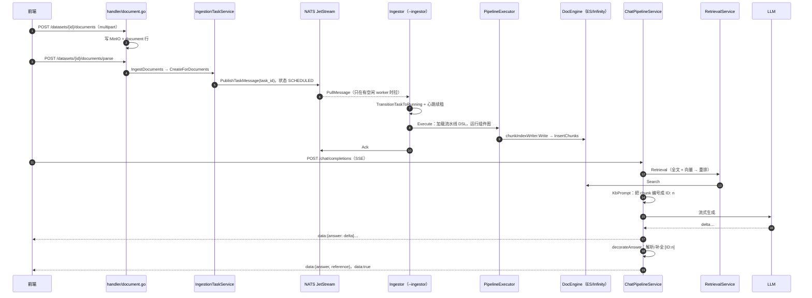
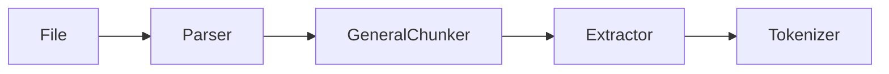

# 第 3 章 一份文档的一生：从上传到被引用 ★

> 本章目标：把一份文档从"上传"到"在回答里被引用"的全过程走一遍，画出一张时序图。后面所有章节，都在拆这张图上的某一段。
> 前置：第 2 章。对应代码：`v0.4` 起完整（本章只读，不写代码）。

## 3.1 鸟瞰：一张时序图

先给结论。下图是 RAGFlow 里一份文档的一生，每个参与者都标了源码位置：



整条链路分成两条互不阻塞的"传送带"：

1. **入库带**（①~⑩）：HTTP 请求只负责登记任务，真正的解析发生在另一个进程（ingestor）里，靠消息队列衔接；
2. **问答带**（⑪~⑱）：一次请求内同步完成检索，然后流式输出。

它们之间唯一的交汇点是**检索引擎**：入库带往里写 chunk，问答带从里面读。

下面按编号逐段读源码。

## 3.2 ①②：上传——文件进 MinIO，文档进 MySQL

路由在 `internal/router/router.go:387`：

```go
datasets.POST("/:dataset_id/documents", r.documentHandler.UploadDocuments)
```

`UploadDocuments`（`internal/handler/document.go:982`）先查数据集、校验团队权限，再按 `type` 参数分发到 `local / web / empty` 三种上传方式：

```go
kb, err := h.datasetService.GetKnowledgebaseByID(ctx, datasetID)
if err != nil || kb == nil {
    common.ResponseWithCodeData(c, common.CodeDataError, nil, fmt.Sprintf("Can't find the dataset with ID %s!", datasetID))
    return
}
if !h.datasetService.CheckKBTeamPermission(ctx, kb, tenantID) {
    common.ResponseWithCodeData(c, common.CodeAuthenticationError, nil, "no authorization")
    return
}

switch uploadType {
case "web":
    h.uploadWebDocument(c, kb, tenantID)
case "empty":
    h.uploadEmptyDocument(c, kb, tenantID)
case "local":
    h.uploadLocalDocuments(c, kb, tenantID)
```

`uploadLocalDocuments`（`:1015`）逐个校验文件名（不能为空、不超过 255 字节），然后调用 `DocumentService.UploadLocalDocuments`（`internal/service/document/document_upload.go:29`）：先 `storage.Put` 把字节写进 MinIO（桶名就是数据集 id），再 `InsertDocument` 插入一行文档记录；插入失败时会把刚写进去的对象删掉，避免留下孤儿文件。

这一行文档记录**继承数据集的 `parser_id` 和 `parser_config`**，也就是说，一份文档"会被怎么切"在上传时就已经定好了（第 4、7 章）。例外是图片、音频、演示文稿和邮件：`defaultDocumentParserID`（`document_parser_selection.go`）会把它们分到专门的 `picture / audio / presentation / email` 流水线。

注意，这一步结束后**什么都没解析**：文档的 `run` 状态是"未开始"，chunk 数为 0。

## 3.3 ③~⑤：启动解析——只登记任务，不干活

路由 `router.go:399`：

```go
datasets.POST("/:dataset_id/documents/parse", r.documentHandler.StartIngestionTask)
```

`StartIngestionTask`（`internal/handler/document.go:1588`）只做参数校验，然后调用 `documentService.IngestDocuments`（`internal/service/document/document_ingest.go:18`），后者再把工作交给 `IngestionTaskService.CreateForDocuments`（`internal/service/ingestion_task_service.go:105`）。核心是对每个文档建一个任务并入队：

```go
task := &entity.IngestionTask{
    DocumentID: docID,
    UserID:     userID,
    DatasetID:  datasetID,
    Schema:     nil,
    Status:     common.CREATED,
}
task, err = s.createAndEnqueueWithKBCache(ctx, task, kbCache)
...
responses = append(responses, &ParseDocumentResponse{
    DocumentID: docID,
    Result:     fmt.Sprintf("task_id: %s", task.ID),
})
```

`createAndEnqueueWithKBCache`（`:573`）有一个容易被忽略的细节：**每个文档只有一行任务**。如果已经存在一个 `FAILED` 或 `STOPPED` 的任务，它会把这一行重置回 `CREATED` 再入队，而不是新建一行；如果任务还在运行，就直接报错"already exists"。入队本身只有几行（`:740`）：

```go
func (s *IngestionTaskService) enqueueTask(taskID string) error {
    taskMessage := common.TaskMessage{
        TaskID:   taskID,
        TaskType: common.TaskTypeIngestionTask,
    }
    return s.taskPublisher.PublishTaskMessage(common.TaskSubject, taskMessage)
}
```

消息里**只有任务 id**，没有文档内容，也没有配置。worker 拿到 id 后再去数据库查。这样消息很小，而且"任务的真实状态"永远以数据库为准。发布成功后，任务被标记为 `SCHEDULED`（`markScheduledAfterPublish`，`:657`）。

HTTP 请求到这里就返回了：

```json
{"code": 0, "data": {"success_count": 1}, "message": "success"}
```

## 3.4 ⑥~⑩：Ingestor——拉任务、跑流水线、写索引

### 只在有空闲 worker 时才拉

`Ingestor.consumeLoop`（`internal/ingestion/service/ingestion_service.go:302`）是 ingestor 的调度循环。它的写法值得细看：

```go
for {
    var w *worker
    select {
    case <-e.dispatchCtx.Done():
        return
    case w = <-e.workerQueue:      // ① 先等到一个空闲 worker
    }
    ...
    pullCtx, cancel := context.WithTimeout(e.dispatchCtx, taskPullRequestTimeout)
    handle, err := msgQueueEngine.PullMessage(pullCtx)   // ② 再拉一条消息
    cancel()
    ...
    select {
    case w.inbox <- handle:          // ③ 交给这个 worker
```

**先拿到空闲 worker，再拉消息**。这样一个忙碌的 ingestor 永远不会"囤"消息：如果它先拉了 10 条，自己却只有 2 个 worker，另外 8 条就会在它手里排队，而别的空闲 ingestor 拿不到。函数注释写得很直白："preventing prefetch"。

### 认领、心跳、执行、结算

worker 收到消息后进入 `handleAndExecute`（`:449`）：

```go
hb := NewHeartbeat(taskMessage.TaskID, handle, e.heartbeatInterval).
    WithContext(context.Background())
hb.Start()
...
task, err := e.ingestionTaskSvc.TransitionTaskToRunning(e.ctx, taskMessage.TaskID)
...
switch task.Status {
case common.COMPLETED, common.STOPPED, common.FAILED:
    common.Info(fmt.Sprintf("task %s is already %s", taskMessage.TaskID, task.Status))
    e.ackHandle(hb, handle, taskMessage.TaskID)
    return
```

三个要点：

1. **心跳**。心跳定时调用 NATS 的 `InProgress()`，告诉 broker"我还活着，别把这条消息重投给别人"。`ingestion_service.go:45` 的注释写明了心跳间隔必须明显小于 ack 截止时间（5 秒），否则 broker 会在任务半途就重投。
2. **状态以数据库为准**。消息可能因为网络抖动被重投；如果数据库里这个任务已经结束，就直接 ack 掉。
3. **结算**。`settleMessage`（`:964`）在执行结束后查数据库里的真实状态，终态就 Ack，否则 Nack 让 broker 重投。

### 流水线

真正干活的是 `PipelineExecutor.Execute`（`internal/ingestion/task/pipeline_executor.go:204`）：

```go
dsl, correctedID, err := s.loadDSLFunc(ctx, s.canvasID)
if err != nil {
    return nil, err
}
...
pipelineOutput, pipelineDSL, err := s.runPipelineFunc(ctx, dsl)
if err != nil {
    return nil, err
}
...
result, err := s.processOutput(ctx, pipelineOutput, start)
```

三步：加载流水线 DSL（一张组件图，第 7 章）→ 在 Agent 画布运行时上执行它 → 处理输出。默认的"通用"流水线长这样：



`File` 读文件，`Parser` 解析成带版面信息的文本块，`GeneralChunker` 切块，`Extractor` 可选地用 LLM 补关键词/问题，`Tokenizer` 做分词和向量化。

`processOutput`（`:268`）给每个 chunk 计算 id（`xxhash(文本 + 文档id)`），再交给 `chunkIndexWriter.Write`（`internal/ingestion/task/chunk_index_writer.go:71`）分批写进检索引擎，失败时指数退避重试 3 次：

```go
for attempt := 1; attempt <= chunkInsertAttempts; attempt++ {
    _, err = insert(ctx, chunks[b:end], w.baseName, w.datasetID)
    if err == nil {
        break
    }
    ...
    delay := chunkInsertRetryBaseDelay << (attempt - 1)
```

到这一步，文档的状态变成"成功"，chunk 可以被检索了。

## 3.5 ⑪~⑱：提问——检索、拼提示词、流式生成、补引用

### 入口

`router.go:324` 的 `POST /api/v1/chat/completions` 进入 `ChatSessionHandler.ChatCompletions`（`internal/handler/chat_session.go:160`）。流式模式下，handler 设置 SSE 响应头（`:251`）：

```go
c.Header("Content-Type", "text/event-stream")
c.Header("Cache-Control", "no-cache")
c.Header("Connection", "keep-alive")
c.Header("X-Accel-Buffering", "no")
```

然后开一个 goroutine 调 service 层，service 把结果一段段推进 channel，handler 从 channel 读出来写给客户端。service 层的 `ChatCompletions`（`internal/service/chat_session.go:1233`）负责会话的读写，再调用核心管线 `ChatPipelineService.AsyncChat`（`internal/service/chat_pipeline.go:204`）。

### AsyncChat 的阶段

`AsyncChat` 是一个 5000 多行文件里最重要的函数，源码里按 `=== Phase N ===` 分段注释。和知识库相关的阶段：

| 阶段 | 位置 | 做什么 |
|---|---|---|
| Phase 5 | | 取最近 3 个用户问题、解析附件 |
| Phase 8 | `chat_pipeline.go:596` | 问题改写：多轮合并（`refine_multiturn`）、跨语言翻译、元数据过滤、关键词扩展 |
| Phase 9 | `:685` | 检索 |
| Phase 10 | `:1047` | 拼提示词：`kbPrompt` 装填知识、空结果回复、引用规则、`messageFitIn` 控制 token |
| Phase 11 | `:1241` | 驱动 LLM 流式生成，结束后 `decorateAnswer` 补引用 |

### 检索

`RetrievalService.Retrieval`（`internal/service/nlp/retrieval.go:94`）做两件事：先让检索引擎做一次"全文 + 向量"的混合召回，再在内存里按 `sim = (1-w)·关键词相似度 + w·向量相似度` 重新打分、过阈值、分页（第 13 章细讲）。

### 拼提示词

`KbPrompt`（`internal/service/kb_prompt.go:61`）把检索到的 chunk 渲染成带编号的树形文本块，装到 token 预算的 97% 为止：

```text
ID: 0
├── Title: 星河咖啡机用户手册.md
└── Content:
# 星河 S1 咖啡机用户手册
## 5. 清洁与除垢
...
```

编号 `0, 1, 2…` 就是这些 chunk 在引用列表里的下标，模型写出的 `[ID:0]` 指向的就是第 0 块（`formatChunkEntry`，`:96`）。

### 补引用

生成结束后，`decorateAnswer`（`chat_pipeline.go:3056`）检查答案：如果模型自己写了 `[ID:n]`，先修正格式不规范的写法；如果一个都没写，就调用 `InsertCitations`（`internal/service/citation.go:68`）：把答案拆成句子、算向量，和每个 chunk 的向量比对，把相似度最高的 chunk 编号补到句末（第 16 章）。

最后一帧带上完整答案和 `reference`（被编号的那些 chunk），再发一帧 `data:{"code":0,"message":"","data":true}` 表示结束（`chat_session.go:1546`）。

### 前端

前端在 `web/src/pages/next-chats/chat-stream/run-stream.ts` 里读这条流，用 `citationMarkerReg`（`web/src/utils/citation-utils.ts:47`）把 `[ID:n]` 替换成可悬停的引用标记：

```ts
export const citationMarkerReg =
  /\[(?:ID:)?([0-9a-fA-F٠-٩۰-۹]+)\]/g;
```

## 3.6 同一条链路在 mini-ragflow 里

mini-ragflow 完全照这张图实现，只是把 NATS 换成了 SQLite 任务表。下面是 v0.4 里同一份手册的真实日志。

入库带：文档的"解析日志"（`progress_msg`），每一行都由流水线的某个组件写下：

```text
Task claimed by ingestor-a4a985c2/1.
Start book pipeline for 星河咖啡机用户手册.docx (attempt 1).
Parsed as docx: 23 sections map[list:7 table:1 text:7 title:8].
Chunked by title into 7 chunks.
Embedded 7 chunks with mock-embedding@mock (dim 256, 0 cache hits).
Indexed 7 chunks, 830 tokens in 0.00s.
Done.
```

问答带：聊天页"本轮执行轨迹"里展开的内容：

```text
retrieved 4 of 6 chunks (pass 1: kNN filtered by full-text, min_match=0.3, 6 hits)
prompt: 680 tokens, 2 messages, 4 knowledge blocks
model cited [0]
```

SSE 帧和 RAGFlow 的格式一致（来自 `TestChatCompletionsSSE`）：

```text
data:{"code":0,"message":"","data":{"answer":"根据知识","id":"…","session_id":"…"}}
data:{"code":0,"message":"","data":{"answer":"库：当除","id":"…","session_id":"…"}}
...
data:{"code":0,"message":"","data":{"answer":"根据知识库：……[ID:0]。","final":true,"reference":{"chunks":[…]},…}}
data:{"code":0,"message":"","data":true}
```

两边的对应关系：

| 步骤 | RAGFlow | mini-ragflow |
|---|---|---|
| 上传 | `handler/document.go:982` | `internal/api/documents.go: uploadDocuments` → `internal/docs` |
| 登记任务 | `IngestionTaskService.CreateForDocuments` + NATS | `store.CreateTask`（SQLite 行） |
| 拉任务 | `consumeLoop`（空闲才拉） | `ingest.Pool.loop`（每个 worker 自己 `ClaimTask`） |
| 心跳 | NATS `InProgress()` | `store.Heartbeat` 续租约 |
| 流水线 | `PipelineExecutor.Execute` | `ingest.Runner.Run` → `pipeline.Run` |
| 写索引 | `chunkIndexWriter.Write` | `docengine.SQLite.InsertChunks` |
| 检索 | `nlp.RetrievalService.Retrieval` | `retrieval.Retriever.Retrieve` |
| 拼提示词 | `KbPrompt` | `chat.KbPrompt` |
| 补引用 | `decorateAnswer` / `InsertCitations` | `chat.Pipeline.Run` 第 7 步 / `chat.InsertCitations` |

## 3.7 练习

1. **巩固**：在时序图上标出哪些步骤是同步的（调用方等结果），哪些是异步的（只投递）。为什么解析要异步，检索却同步？
2. **扩展**：如果消息里不放任务 id，而是直接放文档内容，会带来哪些问题？（提示：大小、重投、配置变更。）
3. **读源码**：在 `createAndEnqueueWithKBCache` 里找到"一个文档只有一行任务"的证据。mini-ragflow 每次解析都新建一行任务，这样做有什么好处和坏处？

## 3.8 延伸阅读

- `internal/ingestion/service/ingestion_service.go` 文件头的注释：心跳与 ack 截止时间的关系
- `internal/service/chat_pipeline.go` 的 `=== Phase` 注释
- `web/src/pages/next-chats/chat-stream/run-stream.ts`：前端怎么合并高频的流式更新
