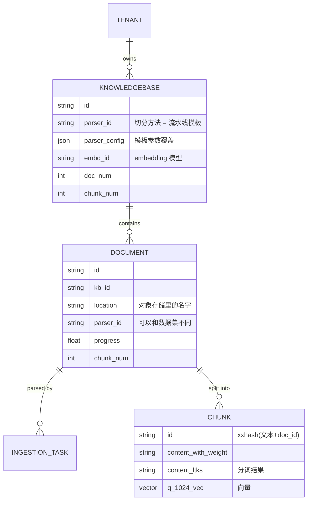

# 第 4 章 数据模型：Tenant / Knowledgebase / Document / Chunk

> 本章目标：弄清知识库系统里有哪几类核心对象、各自存在哪里、谁来维护它们之间的计数，并为 mini-ragflow 定好实体。
> 前置：第 3 章。对应代码：`v0.1` 的 `backend/internal/model/model.go`、`backend/internal/store/`。

## 4.1 四个核心对象



- **Tenant（租户）**：数据的归属方。RAGFlow 里一个用户就是一个租户，id 相同；团队成员可以访问租户共享的数据集。
- **Knowledgebase（数据集 / 知识库）**：一组文档的容器。它定义了"怎么处理这些文档"：用哪个切分方法（`parser_id`）、哪些参数（`parser_config`）、哪个 embedding 模型（`embd_id`）。
- **Document（文档）**：上传的一个文件。它记录文件在对象存储里的位置，以及解析进度。
- **Chunk（分块）**：检索的最小单元。它**不在关系数据库里**，而是存在检索引擎中。

## 4.2 RAGFlow 是怎么定义的

### Knowledgebase

`internal/entity/dataset.go:99`，节选：

```go
type Knowledgebase struct {
	ID                     string     `gorm:"column:id;primaryKey;size:32" json:"id"`
	TenantID               string     `gorm:"column:tenant_id;size:32;not null;index" json:"tenant_id"`
	Name                   string     `gorm:"column:name;size:128;not null;index" json:"name"`
	EmbdID                 string     `gorm:"column:embd_id;size:128;not null;index" json:"embd_id"`
	Permission             string     `gorm:"column:permission;size:16;not null;default:me;index" json:"permission"`
	DocNum                 int64      `gorm:"column:doc_num;default:0;index" json:"doc_num"`
	TokenNum               int64      `gorm:"column:token_num;default:0;index" json:"token_num"`
	ChunkNum               int64      `gorm:"column:chunk_num;default:0;index" json:"chunk_num"`
	SimilarityThreshold    float64    `gorm:"column:similarity_threshold;default:0.2;index" json:"similarity_threshold"`
	VectorSimilarityWeight float64    `gorm:"column:vector_similarity_weight;default:0.3;index" json:"vector_similarity_weight"`
	ParserID               string     `gorm:"column:parser_id;size:32;not null;default:general;index" json:"parser_id"`
	PipelineID             *string    `gorm:"column:pipeline_id;size:32;index" json:"pipeline_id,omitempty"`
	ParserConfig           JSONMap    `gorm:"column:parser_config;type:json" json:"parser_config"`
	Pagerank               int64      `gorm:"column:pagerank;default:0" json:"pagerank"`
	...
```

有几个字段值得注意：

- `SimilarityThreshold`（默认 0.2）和 `VectorSimilarityWeight`（默认 0.3）是**检索参数**，却存在数据集上。这两个默认值在检索代码里还会再出现一次（第 13 章）。
- `ParserID` 默认是 `general`；`PipelineID` 指向用户自定义的流水线（在画布里编辑），两者二选一。
- `Pagerank` 是一个加到检索分数上的常数，用来在多数据集检索时让某个数据集整体靠前（第 13 章）。
- 再往下还有一长串 `GraphragTaskID`、`RaptorTaskID`、`MindmapTaskID`、`WikiTaskID`…… 这些是"知识编译"任务的状态（第 20 章）。

### Document

`internal/entity/document.go:22`：

```go
type Document struct {
	ID              string     `gorm:"column:id;primaryKey;size:32" json:"id"`
	KbID            string     `gorm:"column:kb_id;size:256;not null;index" json:"kb_id"`
	ParserID        string     `gorm:"column:parser_id;size:32;not null;index" json:"parser_id"`
	PipelineID      *string    `gorm:"column:pipeline_id;size:32;index" json:"pipeline_id,omitempty"`
	ParserConfig    JSONMap    `gorm:"column:parser_config;type:longtext;not null" json:"parser_config"`
	SourceType      string     `gorm:"column:source_type;size:128;not null;default:local;index" json:"source_type"`
	Location        *string    `gorm:"column:location;size:255;index" json:"location,omitempty"`
	Size            int64      `gorm:"column:size;default:0;index" json:"size"`
	TokenNum        int64      `gorm:"column:token_num;default:0;index" json:"token_num"`
	ChunkNum        int64      `gorm:"column:chunk_num;default:0;index" json:"chunk_num"`
	Progress        float64    `gorm:"column:progress;default:0;index" json:"progress"`
	ProgressMsg     *string    `gorm:"column:progress_msg;type:longtext" json:"progress_msg,omitempty"`
	ContentHash     *string    `gorm:"column:content_hash;size:32;index;default:''" json:"content_hash,omitempty"`
	...
```

文档也有自己的 `ParserID` 和 `ParserConfig`：上传时从数据集复制过来，之后可以单独修改。这是 RAGFlow 的一个实用设计：同一个数据集里，制度文件可以用"法规"切分，FAQ 可以用"问答"切分。

`Progress` 是一个 0~1 的浮点数，失败时写成 -1；`ProgressMsg` 是一段不断追加的多行文本，前端点开"解析日志"看到的就是它。

### IngestionTask

`internal/entity/ingestion_task.go:19`：

```go
type IngestionTask struct {
	ID         string  `gorm:"column:id;primaryKey;size:32" json:"id"`
	UserID     string  `gorm:"column:user_id;size:32;not null" json:"user_id"`
	DocumentID string  `gorm:"column:document_id;size:32;not null;uniqueIndex:idx_ingestion_task_document_id" json:"document_id"`
	DatasetID  string  `gorm:"column:dataset_id;size:32;not null;index:idx_ingestion_task_dataset_status,priority:1" json:"dataset_id"`
	Schema     JSONMap `gorm:"column:schema;type:longtext" json:"schema"`
	Status     string  `gorm:"column:status;size:32;not null;index:idx_ingestion_task_dataset_status,priority:2" json:"status"`
	ComponentTotal int `gorm:"column:component_total;default:0" json:"component_total"`
```

`DocumentID` 上有一个**唯一索引**，这在数据库层面保证了第 3 章说的"每个文档只有一行任务"。`ComponentTotal` 是流水线里的组件数，前端用它当进度的分母。

### Chunk：只在检索引擎里

chunk 不是 GORM 实体，而是写进检索引擎的一份文档（JSON 字典）。它有哪些字段，看 Elasticsearch 的 mapping（`conf/mapping.json`）最清楚。RAGFlow 没有逐个声明字段，而是用 `dynamic_templates`，**按字段名后缀决定类型**：

| 后缀 | ES 类型 | 例子 | 用途 |
|---|---|---|---|
| `*_ltks` | `text`，空格分词，BM25 | `content_ltks` | 正文分词，全文检索 |
| `*_tks` | `text`，空格分词，**自定义相似度** `scripted_sim` | `title_tks`、`question_tks` | 标题/问题分词 |
| `*_kwd` | `keyword` | `docnm_kwd`、`important_kwd` | 精确匹配、聚合 |
| `*_with_weight` | `keyword`，不分词 | `content_with_weight` | 原文，展示用 |
| `*_int` / `*_flt` | 数值 | `available_int`、`page_num_int` | 过滤、排序 |
| `q_*_vec` | `dense_vector`，cosine | `q_1024_vec` | 向量 |
| `*_fea` / `*_feas` | `rank_feature(s)` | `pagerank_fea`、`tag_feas` | 排序特征 |

所以看到 `q_768_vec` 就知道这是 768 维向量；看到 `available_int` 就知道它是可以拿来过滤的整数。向量字段名里带着维度，是因为同一个索引可能存放不同 embedding 模型（维度不同）生成的 chunk。

`*_tks` 用的 `scripted_sim` 定义在同一个文件的 `settings` 里：

```json
"scripted_sim": {
  "type": "scripted",
  "script": {
    "source": "double idf = Math.log(1+(field.docCount-term.docFreq+0.5)/(term.docFreq + 0.5))/Math.log(1+((field.docCount-0.5)/1.5)); return query.boost * idf * Math.min(doc.freq, 1);"
  }
}
```

归一化的 IDF 乘以 `min(词频, 1)`：标题里一个词出现一次和出现三次得分一样，而且没有长度归一。标题和关键词描述的是"这块讲什么"，重复次数不代表更相关。第 11 章会在 mini-ragflow 的引擎里实现同样的规则。

### 为什么 chunk 不进 MySQL

1. **查询方式不同**：chunk 的主要读法是全文检索和向量近邻，关系数据库都不擅长；
2. **数量级不同**：一个数据集几百份文档，chunk 却可能有几十万；
3. **生命周期不同**：chunk 是可以随时重建的派生数据。改一下切分参数，所有 chunk 都要删掉重来；而文档和数据集是用户数据。

代价是要维护两边的一致性：删文档时要同时删 chunk，`chunk_num` 这类计数要两边对得上。

## 4.3 计数是怎么维护的

数据集上的 `doc_num / chunk_num / token_num` 是冗余字段，目的是列表页不用每次都 `COUNT(*)`。RAGFlow 用原子增量更新它们，例如 `internal/dao/document.go:90`：

```go
func (dao *DocumentDAO) IncrementCounts(ctx context.Context, db *gorm.DB, id string, kbID string, chunkNum int64, tokenNum int64, duration float64) error {
	return db.WithContext(ctx).Model(&entity.Document{}).
		Where("id = ? AND kb_id = ?", id, kbID).
		Updates(map[string]interface{}{
			"chunk_num":        gorm.Expr("chunk_num + ?", chunkNum),
			"token_num":        gorm.Expr("token_num + ?", tokenNum),
			"process_duration": gorm.Expr("process_duration + ?", duration),
		}).Error
}
```

数据集这一侧是 `KnowledgebaseDAO.AtomicIncreaseDocNumByID`（`internal/dao/kb.go:451`）和 `DecreaseDocumentNum`（`:461`）。`gorm.Expr("chunk_num + ?")` 生成的是 `SET chunk_num = chunk_num + 7`，而不是"读出来、加上、再写回去"，所以两个 worker 同时更新也不会丢数。

还有一个容易出错的地方：**chunk 的计数应该是去重后的数量**。第 6 章会看到，mini-ragflow v0.1 就在这里栽了跟头。

## 4.4 从零实现

### 实体

`backend/internal/model/model.go` 定义了同样的四类对象。字段名用 RAGFlow API 返回的 JSON 名字（数据集的切分方法在 API 里叫 `chunk_method`，chunk 的原文叫 `content_with_weight`），这样后面的前端和测试可以直接对照 RAGFlow 的接口文档：

```go
type Knowledgebase struct {
	ID                     string         `json:"id"`
	TenantID               string         `json:"tenant_id"`
	Name                   string         `json:"name"`
	ParserID               string         `json:"chunk_method"`
	ParserConfig           map[string]any `json:"parser_config"`
	EmbdID                 string         `json:"embedding_model"`
	DocNum                 int64          `json:"document_count"`
	ChunkNum               int64          `json:"chunk_count"`
	SimilarityThreshold    float64        `json:"similarity_threshold"`
	VectorSimilarityWeight float64        `json:"vector_similarity_weight"`
	...
}
```

id 和 RAGFlow 一样，是 32 位十六进制字符串（`util.NewID`，等价于 Python 的 `uuid1().hex` 的形状）。

### 存储分工

| 对象 | mini-ragflow 存在哪里 |
|---|---|
| Knowledgebase、Document、Task | SQLite 的 `knowledgebase / document / task` 表（`internal/store`） |
| 原始文件 | `data/blobs/<kb_id>/<object>`（`internal/storage`） |
| Chunk | 同一个 SQLite 文件里的 `chunk` 表，但只通过 `docengine.Engine` 接口访问 |

`chunk` 表和其他表放在同一个文件里，只是为了少一个依赖。代码上，chunk 只能通过 `docengine` 包访问，`store` 包碰不到它。这个边界和 RAGFlow 的"MySQL / 检索引擎"分工完全一致，后面换成 Elasticsearch 时不用动业务代码。

### 计数

`store.SetDocumentCounts` 在一个事务里做两件事：更新文档的 chunk/token 数，再把**差值**加到数据集上：

```go
if _, err := tx.Exec(`UPDATE document SET chunk_num = ?, token_num = ?, updated_at = ? WHERE id = ?`,
	chunks, tokens, util.Now(), id); err != nil {
	return err
}
if _, err := tx.Exec(`UPDATE knowledgebase SET chunk_num = chunk_num + ?, token_num = token_num + ?, updated_at = ?
  WHERE id = ?`, chunks-d.ChunkNum, tokens-d.TokenNum, util.Now(), d.KbID); err != nil {
	return err
}
```

用差值，是为了支持"重新解析"：第二次解析得到 7 块、第一次也是 7 块，数据集的 `chunk_num` 应该加 0，而不是再加 7。`TestUploadParseAndListChunks` 专门验证了这一点：

```go
// Re-parsing replaces chunks instead of doubling the counters.
e.do("POST", "/api/v1/datasets/"+kb.ID+"/documents/parse", ...)
...
if kbOut.ChunkCount != doc.ChunkCount {
	t.Fatalf("after re-parse chunk_count %d, want %d", kbOut.ChunkCount, doc.ChunkCount)
}
```

### 与 RAGFlow 的差异

| 项 | RAGFlow | mini-ragflow | 原因 |
|---|---|---|---|
| 任务 | 每个文档一行，重跑时重置 | 每次解析新建一行 | 更容易看到历史；代价是表会变大 |
| 文档状态 `run` | 由任务状态推导 | 文档上单独存一个 `run` 字段 | 少一次 join，列表页简单 |
| 团队权限 | `permission: me/team` | 只有拥有者（v1.0 加租户） | 篇幅 |
| 知识编译任务字段 | 十几个 `*_task_id` | 无 | 第 20 章只实现 RAPTOR，作为流水线组件 |

## 4.5 运行与验证

```bash
cd code/mini-ragflow && git checkout v0.1
cd backend && go test ./internal/store/ ./internal/api/ -run 'Claim|Upload' -v 2>&1 | grep -E '^(---|ok)'
```

```text
--- PASS: TestClaimIsExclusiveAndRejectsDuplicates (0.00s)
--- PASS: TestStopBeforeAndAfterClaim (0.00s)
ok  	mini-ragflow/internal/store	0.008s
--- PASS: TestUploadParseAndListChunks (0.33s)
ok  	mini-ragflow/internal/api	0.336s
```

## 4.6 练习

1. **巩固**：为什么数据集上的 `chunk_num` 要用 `chunk_num + ?` 而不是先读后写？构造一个两个 worker 交错执行的时间线，说明后者会丢数。
2. **扩展**：给 mini-ragflow 的文档加一个 `tags` 字段（字符串数组）。它应该存在 `document` 表里，还是写进每个 chunk？两种做法分别适合什么样的查询？
3. **读源码**：在 `conf/infinity_mapping.json` 里找到和 `q_*_vec`、`*_ltks` 对应的写法。Infinity 和 ES 表达"向量字段"的方式有什么不同？

## 4.7 延伸阅读

- `internal/entity/dataset.go`、`internal/entity/document.go`、`internal/entity/ingestion_task.go`
- `conf/mapping.json`（ES）、`conf/infinity_mapping.json`（Infinity）
- RAGFlow 根目录 `AGENTS.md` 的 "Shared database schema (Go + Python)" 一节：Go 和 Python 两个运行时共用一套表时，索引名怎么对齐
