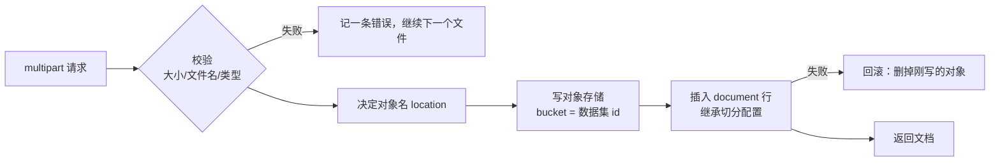

# 第 5 章 文件存储与上传

> 本章目标：理解上传这一步到底做了哪些事（校验、存储、建档、回滚），以及对象存储里的名字为什么不能直接用用户给的文件名。
> 前置：第 4 章。对应代码：`v0.1` 的 `backend/internal/storage/`、`backend/internal/api/documents.go`（v1.0 起抽到 `internal/docs/`）。

## 5.1 上传要做的五件事



一次上传可能包含多个文件。RAGFlow 的策略是**逐个处理、错误收集**：一个文件不合格，不影响其他文件，最后把成功的文档和错误信息一起返回。

## 5.2 RAGFlow 是怎么做的

### 存储抽象

`internal/storage/types.go:59` 定义了对象存储接口：

```go
type Storage interface {
	Type() string
	Health(ctx context.Context) bool
	Put(ctx context.Context, bucket, fnm string, binary []byte, tenantID ...string) error
	Get(ctx context.Context, bucket, fnm string, tenantID ...string) ([]byte, error)
	...
```

同一个目录下有 `minio.go`、`s3.go`、`oss.go`（阿里云）、`gcs.go`（Google Cloud），以及测试用的 `memory.go`。业务代码只认识 `Storage` 接口，通过 `storage.GetStorageFactory().GetStorage()` 拿到当前配置的实现。

**bucket 用数据集 id**。删除数据集时，可以直接把整个 bucket 清掉。

### 主循环

`DocumentService.UploadLocalDocuments`（`internal/service/document/document_upload.go:29`）是上传的主体。几个关键步骤：

```go
names, err := s.documentDAO.ListNamesByKbID(ctx, dao.DB, kb.ID)
...
for _, fh := range files {
	blob, err = readFileHeaderBytes(fh)              // ① 读入内存，有大小上限
	...
	filename := uniqueUploadName(fh.Filename, taken) // ② 重名自动改名
	filetype := utility.FilenameType(filename)
	if filetype == utility.FileTypeOTHER {           // ③ 类型白名单
		errMsgs = append(errMsgs, fh.Filename+": This type of file has not been supported yet!")
		continue
	}
	location := filename
	...
	for storageImpl.ObjExist(ctx, kb.ID, location) { // ④ 对象名冲突就追加 "_"
		location += "_"
	}
	if err = storageImpl.Put(ctx, kb.ID, location, blob); err != nil {
	...
	parserID, parserConfig := resolveDocumentParser(ctx, kb, filename, filetype, merged)
	doc := s.newDatasetDocument(kb, tenantID, filename, location, string(filetype), parserID, parserConfig, "local", int64(len(blob)), blob)
	if err = s.InsertDocument(doc); err != nil {
		// Roll back the orphaned blob so a failed insert doesn't leak storage.
		rmErr := removeObjectBestEffort(ctx, storageImpl, kb.ID, location)
```

逐条看：

1. **大小上限**。`readFileHeaderBytes` 拒绝超过 `maxUploadDocSize` 的文件（`document.go:260`，128 MiB），并且用 `io.LimitReader(src, maxUploadDocSize+1)` 读取，就算客户端谎报大小也读不超。
2. **重名改名**。`uniqueUploadName`（`:404`）在同一数据集里遇到重名时，生成 `手册(1).pdf`、`手册(2).pdf`……
3. **类型白名单**。不认识的扩展名直接拒绝，不进存储。
4. **对象名**。对象名就是文件名，冲突时在后面追加 `_`。
5. **回滚**。文档行插入失败时，把刚写进去的对象删掉。后面还有一步"关联到文件管理器"（`addFileFromKB`），如果失败，会把文档行和对象一起回滚。

此外还有两个细节：`contentHashHex`（`document_upload_helpers.go:10`）用 xxh3-128 计算内容哈希，存进 `document.content_hash`，数据源同步时用它判断文件变没变（第 25 章）；`utility.SanitizeFilename`（`internal/utility/file.go:174`）把 `parent_path` 里的 `..`、`.` 和空段去掉。

### 为什么"写存储"在"插数据库"之前

如果顺序反过来，先插文档行再写存储，那么写存储失败时，数据库里会多出一个"指向不存在文件"的文档，解析时才会报错。先写存储再插行，失败时最多留下一个孤儿对象，而且这个对象马上会被回滚删掉。**副作用重的操作放前面、能回滚的放后面**，这是处理两个存储时常用的顺序。

## 5.3 从零实现

### 本地对象存储

`backend/internal/storage/storage.go` 用目录模拟 bucket，接口形状和 RAGFlow 一致：

```go
type Blob interface {
	Put(bucket, name string, data []byte) error
	Get(bucket, name string) ([]byte, error)
	Delete(bucket, name string) error
	DeleteBucket(bucket string) error
}

func (l *Local) path(bucket, name string) (string, error) {
	if bucket == "" || name == "" || strings.Contains(bucket, "..") || strings.ContainsAny(name, "/\\") || name == ".." {
		return "", errors.New("invalid object path")
	}
	return filepath.Join(l.Root, bucket, name), nil
}
```

`path` 是本地实现必须有的一道防线：对象名一旦能带 `../`，就能写到数据目录以外的任何地方。MinIO 本身会处理这件事，本地目录却不会。

### 对象名不用用户的文件名

mini-ragflow 和 RAGFlow 在这里做了不同的选择：对象名是随机 id 加扩展名，用户给的文件名只存在 `document.name` 里：

```go
// Location is the object name inside the KB bucket; a fresh id avoids
// clashes and keeps user-controlled names out of the storage path.
doc.Location = strings.TrimSuffix(fmt.Sprintf("%s.%s", newObjectName(), suffix), ".")
```

好处是对象名永远不会冲突，也不会出现奇怪字符；代价是直接在存储里翻文件时看不出哪个是哪个。

重名时，RAGFlow 自动改名，mini-ragflow 直接拒绝，两种产品取向都说得通。v1.0 的数据源同步依赖"文件名唯一"来做幂等（第 25 章），所以 mini 选了拒绝。

### 上传处理

`uploadDocuments`（v0.1 在 `internal/api/documents.go`，v1.0 抽到 `internal/docs.Service.Create`）的结构和 RAGFlow 一样：逐个文件校验 → 写存储 → 插行 → 失败回滚，错误收集到 `message` 里。整个请求体用 `http.MaxBytesReader` 限制在 64 MiB：

```go
r.Body = http.MaxBytesReader(w, r.Body, max)
if err := r.ParseMultipartForm(8 << 20); err != nil {
	fail(w, CodeArgument, "No file part! ("+err.Error()+")")
	return
}
```

`ParseMultipartForm(8 << 20)` 的意思是：小于 8 MiB 的部分留在内存里，更大的落到临时文件。

## 5.4 运行与验证

在 v0.1 上起一个服务，上传一个合法文件、一个 `.exe`，再重复上传同名文件：

```bash
git checkout v0.1 && cd backend && go run ./cmd/mini-ragflow --data /tmp/d01 --addr :9391 &
KB=$(curl -s -XPOST localhost:9391/api/v1/datasets -H 'Content-Type: application/json' \
     -d '{"name":"demo"}' | python3 -c 'import sys,json;print(json.load(sys.stdin)["data"]["id"])')
curl -s -F file=@a.txt -F file=@tool.exe localhost:9391/api/v1/datasets/$KB/documents | python3 -m json.tool
curl -s -F file=@a.txt localhost:9391/api/v1/datasets/$KB/documents
```

真实输出（节选）：

```text
--- upload a.txt + tool.exe
    "code": 0,
    "message": "tool.exe: this type of file has not been supported yet",
            "name": "a.txt",
            "size": 26,
            "location": "970ec72ac97cd067183a7ed9261a7e98.txt",
            "content_hash": "9b50799e935cdcb5ad5c8d5e95f5c8f0",
            "chunk_method": "general",
            "run": "UNSTART",
--- upload a.txt again
{"code":102,"message":"a.txt: a document with the same name already exists","data":null}
```

`code` 为 0 但 `message` 不为空，表示"部分成功"。`run` 是 `UNSTART`：上传不会触发解析。再看存储目录：

```text
$ ls /tmp/d01/blobs/$KB
970ec72ac97cd067183a7ed9261a7e98.txt
```

## 5.5 练习

1. **巩固**：在 mini-ragflow 的 `Local.path` 里删掉 `strings.ContainsAny(name, "/\\")` 这个检查，写一个测试证明 `name = "../../evil"` 能写到 `Root` 外面。然后把检查加回去。
2. **扩展**：把 mini-ragflow 的重名策略改成 RAGFlow 的"自动改名"（`a(1).txt`）。数据源同步（v1.0 `internal/syncer`）有哪些地方需要跟着改？
3. **读源码**：RAGFlow 的 `uploadLocalDocuments` 在 handler 层支持一个 `parser_config` 表单字段，只放行"允许列表"里的键（`internal/handler/document.go:1035` 附近）。为什么不让客户端覆盖任意参数？

## 5.6 延伸阅读

- `internal/service/document/document_upload.go`（还有 web 上传、空文档的写法）
- `internal/storage/minio.go`：bucket 不存在时的自动创建
- `internal/service/document/file2document.go`：文档和"文件管理器"的关联
