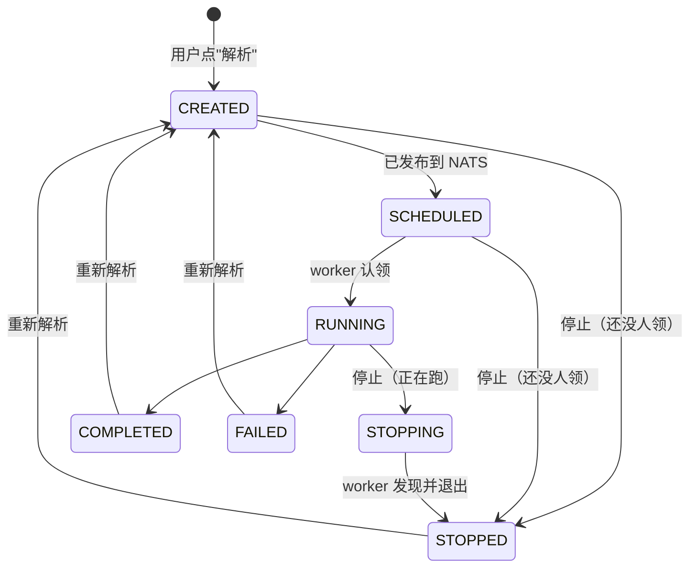
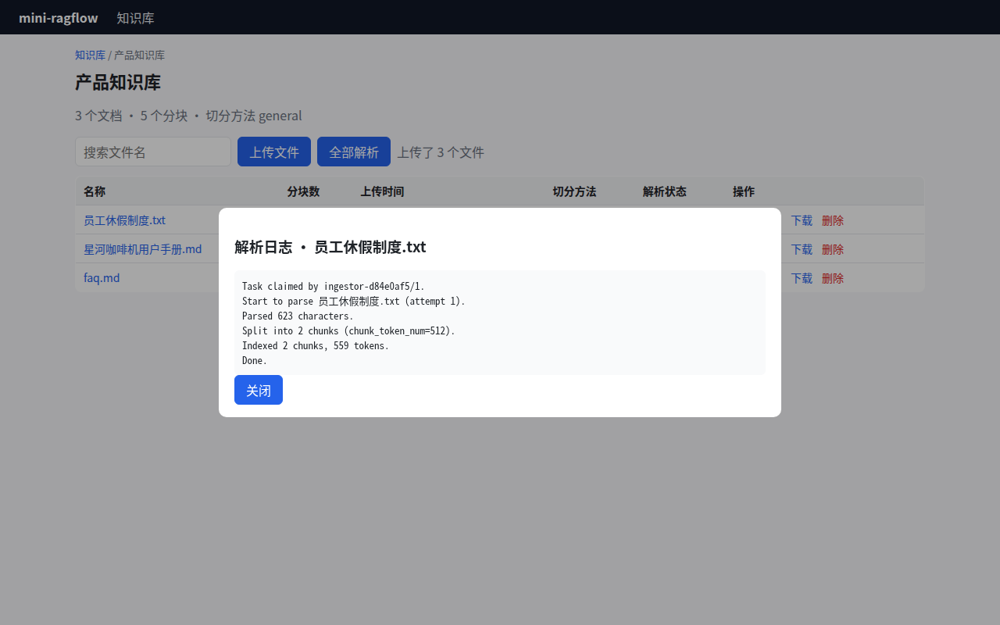

# 第 6 章 异步入库任务：状态机与工作分发 ★

> 本章目标：设计一个"能停、能重试、worker 挂了也不丢"的后台任务系统，理解任务状态机、租约/心跳和进度上报。
> 前置：第 3、4 章。对应代码：`v0.1` 的 `backend/internal/store/task.go`、`backend/internal/ingest/worker.go`。

## 6.1 问题

解析一份 300 页的 PDF 可能要几分钟：OCR、版面识别、调 embedding 模型都很慢。所以解析不能放在 HTTP 请求里做，只能**交给后台执行**。交给后台以后，马上会冒出四个问题：

1. **分发**：多个 worker（甚至多台机器）怎么分任务，才能做到不重复、不遗漏？
2. **崩溃**：worker 做到一半进程挂了，任务怎么办？
3. **停止**：用户点了"停止"，正在跑的任务怎么知道？
4. **进度**：前端怎么知道做到哪一步了？

## 6.2 状态机

RAGFlow 的入库任务有 7 个状态（`common.CREATED / SCHEDULED / RUNNING / STOPPING / STOPPED / COMPLETED / FAILED`）：



关键在 `STOPPING`：**停止一个正在运行的任务，不能由 API 直接改成 STOPPED**。API 进程并不知道 worker 进行到哪一步了。如果它直接改成 STOPPED、再删掉 chunk，而 worker 还在跑，worker 下一秒就会把 chunk 又写回去。所以 API 只能"请求停止"，由 worker 自己收尾。

`IngestionTaskService.RequestStop`（`internal/service/ingestion_task_service.go:298`）把这两种情况分得很清楚：

```go
switch task.Status {
case common.CREATED, common.SCHEDULED:
	stopped, err := s.transitionFrom(ctx, taskID, []string{common.CREATED, common.SCHEDULED}, common.STOPPED)
	...
case common.RUNNING:
	task, err = s.transition(ctx, taskID, common.STOPPING)
	...
	// Mirror Python's cancel_all_task_of: set Redis cancel flag so the
	// running worker's pollCancel detects the stop on its next 500ms
	// tick instead of the slower DB fallback path.
	if rc := kvrocks.Get(); rc != nil {
		rc.Set(ctx, fmt.Sprintf("%s-cancel", taskID), "x", 1*time.Hour)
	}
```

还没被认领的任务直接 STOPPED；正在运行的改成 STOPPING，同时在 Kvrocks 里写一个 `<task_id>-cancel` 标记。worker 每 500 毫秒检查一次这个标记（`pollCancelInterval`，`internal/ingestion/service/ingestion_service.go:1064`），标记不存在时再退回去查数据库。

`transitionFrom(..., []string{CREATED, SCHEDULED}, STOPPED)` 是一种**条件更新**：只有当前状态在给定集合里时才改。它防止了并发竞争：如果 API 读状态时任务还是 SCHEDULED，写回之前 worker 恰好把它改成了 RUNNING，这次更新就不会生效。

## 6.3 分发：消息队列 + 心跳

RAGFlow 用 NATS JetStream 分发任务（第 3 章 `consumeLoop`）。JetStream 的 pull consumer 提供"至少一次"的投递语义：

- worker 拉到一条消息后，broker 在 **ack 截止时间**（5 秒）内不会把它交给别人；
- worker 定期调用 `InProgress()` 续期（心跳）。`ingestion_service.go:45` 的注释说明了心跳间隔必须"明显小于"ack 截止时间，实际值是 2 秒（`defaultHeartbeatInterval`）；
- worker 做完就 `Ack()`，消息被删除；
- worker 挂了，心跳就断了，截止时间一过，broker 会把消息**重投**给别的 worker。

`Heartbeat`（`internal/ingestion/service/heartbeat.go`）的注释里写着一条约定："Callers must Stop before Acking/Nacking the message so settlement never races an InProgress on the same message"，即先停掉心跳，再 ack。否则可能出现消息已经 ack 了、还有一个 `InProgress` 调用在路上的情况。

"至少一次"意味着同一个任务**可能被执行两次**（比如 worker 没挂，只是网络慢了，心跳没赶上）。所以 `handleAndExecute` 拿到消息后，第一件事是去数据库确认状态：已经是终态的就直接 ack（第 3 章 3.4 节）。**消息只是"叫醒"worker 的手段，任务真实的状态以数据库为准。**

## 6.4 进度

`ReportComponentFraction`（`internal/agent/runtime/helpers.go:296`）让任何组件都能在执行中上报"我自己完成了百分之几"：

```go
func ReportComponentFraction(ctx context.Context, fraction float64) {
	if ctx == nil {
		return
	}
	if report, ok := ctx.Value(componentFractionReporterKey{}).(func(float64)); ok && report != nil {
		report(fraction)
	}
}
```

组件不需要知道自己是第几个组件、总共有几个，只管报自己的比例。外层的 `progressSink`（`internal/ingestion/service/progress_sink.go`）把它换算成整体进度，先记在内存里，再由一个 flusher 协程**每秒最多写一次**数据库（`progressFlushInterval = time.Second`，`:38`）。embedding 组件处理几千个 chunk 时，每批都会报一次进度；如果每次都写库，数据库就被压垮了。

## 6.5 从零实现

mini-ragflow 没有 NATS，用一张 SQLite 表来模拟"可重投的消息队列"。思路是：**把 ack 截止时间变成表里的一列 `lease_until`**。

### 表

```sql
CREATE TABLE IF NOT EXISTS task (
  id TEXT PRIMARY KEY,
  doc_id TEXT NOT NULL,
  kb_id TEXT NOT NULL,
  status TEXT NOT NULL,
  attempts INTEGER NOT NULL DEFAULT 0,      -- 第几次投递
  lease_owner TEXT NOT NULL DEFAULT '',     -- 谁领走的
  lease_until INTEGER NOT NULL DEFAULT 0,   -- 租约到期时间（毫秒）
  error TEXT NOT NULL DEFAULT '',
  ...
);
```

### 认领：一条 SQL 搞定

`store.ClaimTask`（`backend/internal/store/task.go`）：

```go
row := s.DB.QueryRow(`UPDATE task SET status = 'RUNNING', lease_owner = ?, lease_until = ?,
    attempts = attempts + 1, updated_at = ?
  WHERE id = (SELECT id FROM task
              WHERE status = 'CREATED' OR (status = 'RUNNING' AND lease_until < ?)
              ORDER BY created_at LIMIT 1)
  RETURNING `+taskColumns, owner, now+ttl.Milliseconds(), now, now)
```

一条 `UPDATE … WHERE id = (SELECT …) RETURNING` 同时完成三件事：

1. **找**：选出最早的一个"新任务"，或者"租约已过期的运行中任务"。后者就是重投：原来的 worker 挂了；
2. **抢**：改成 RUNNING，写上自己的名字和新的租约；
3. **拿**：用 `RETURNING` 把这一行带回来。

SQLite 的写操作是串行的，两个 worker 同时执行这条语句，只有一个能抢到。

### 心跳：续租 + 顺便看看要不要停

```go
func (s *Store) Heartbeat(id, owner string, ttl time.Duration) (status string, ok bool, err error) {
	now := util.Now()
	err = s.DB.QueryRow(`UPDATE task SET lease_until = ?, updated_at = ? WHERE id = ? AND lease_owner = ?
	  AND status IN ('RUNNING','STOPPING') RETURNING status`, now+ttl.Milliseconds(), now, id, owner).Scan(&status)
	if errors.Is(err, sql.ErrNoRows) {
		return "", false, nil
	}
	return status, err == nil, err
}
```

`WHERE lease_owner = ?` 保证只有持有者能续租。如果返回 0 行，说明租约已经被别人抢走了（比如我卡了很久，被判定为死亡）。这时 worker 要立刻放弃，不能再写任何东西。返回的 `status` 如果是 STOPPING，说明用户要求停止。RAGFlow 用 Kvrocks 标记加 500 毫秒轮询来传递停止信号，mini-ragflow 把它合并进了心跳，代价是响应慢一些（心跳间隔是租约的 1/3，默认 5 秒）。

### worker 循环

`ingest.Pool`（`backend/internal/ingest/worker.go`）里每个 worker 是一个 goroutine：

```go
for ctx.Err() == nil {
	_ = p.Store.ReapStopping()
	t, err := p.Store.ClaimTask(owner, p.LeaseTTL)
	...
	if t == nil {
		select {
		case <-ctx.Done():
			return
		case <-p.wake:              // API 刚入队时叫醒
		case <-time.After(p.Poll):  // 否则每秒看一眼
		}
		continue
	}
	p.execute(ctx, owner, t)
}
```

每个 worker 空闲时才去认领，天然实现了 RAGFlow 那种"不预取"的效果。`p.wake` 是一个容量为 1 的 channel：同一进程里的 API 入队后调用 `Notify()`，worker 立刻醒来，不用等一秒的轮询。

`execute` 为任务启动一个心跳协程，再根据**取消的原因**结算：

```go
err := p.Runner.Run(ctx, t)
cause := context.Cause(ctx)
...
switch {
case errors.Is(cause, errLeaseLost):
	// Someone else owns the task now; do not touch it.
case err == nil:
	_, _ = p.Store.FinishTask(t.ID, owner, model.TaskCompleted, "")
	...
case errors.Is(cause, errStopped):
	_, _ = p.Store.FinishTask(t.ID, owner, model.TaskStopped, "")
	...
default:
	_, _ = p.Store.FinishTask(t.ID, owner, model.TaskFailed, err.Error())
```

`context.WithCancelCause` 是 Go 1.20 加入的，正好用来区分"为什么被取消"：用户停止、租约丢失、普通错误，三种情况的收尾完全不同。

> 自查提示：v0.1 的这段 switch 少了一种取消原因，就是"进程正在关闭"。v1.0 在多进程实验中把它补上了（第 24 章）。

### 进度

v0.1 的进度很直接：流水线每完成一步，就往 `document.progress_msg` 追加一行，并更新 `progress`。前端每秒轮询一次。v0.2 有了组件化的流水线以后，换成了 RAGFlow 那种"组件报比例、外层换算、限频写库"的做法（第 7 章）。

## 6.6 运行与验证

```bash
git checkout v0.1 && cd backend && go test ./internal/store/ ./internal/ingest/ -v | grep -E '^(---|ok)'
```

```text
--- PASS: TestClaimIsExclusiveAndRejectsDuplicates (0.00s)
--- PASS: TestExpiredLeaseIsRedelivered (0.00s)
--- PASS: TestStopBeforeAndAfterClaim (0.00s)
ok  	mini-ragflow/internal/store	0.011s
--- PASS: TestRunDeduplicatesIdenticalChunks (0.00s)
--- PASS: TestStopRunningTask (0.06s)
--- PASS: TestFailureIsRecorded (0.02s)
ok  	mini-ragflow/internal/ingest	0.087s
```

`TestExpiredLeaseIsRedelivered` 模拟 worker 死亡：用一个已经过期的租约认领任务，第二个 worker 应该能以 `attempts = 2` 把它抢过来，而原来的 worker 再心跳、再结算都应该失败：

```go
first, _ := s.ClaimTask("w1", -time.Second) // already expired
second, _ := s.ClaimTask("w2", time.Minute)
if second == nil || second.ID != first.ID || second.Attempts != 2 || second.LeaseOwner != "w2" {
	t.Fatalf("expected redelivery to w2, got %+v", second)
}
if _, ok, _ := s.Heartbeat(first.ID, "w1", time.Minute); ok {
	t.Fatal("w1 heartbeat should fail after takeover")
}
```

在 UI 里点击"解析"，再点开状态，可以看到解析日志：



*图 6-1：v0.1 的解析日志。每一行都是流水线某一步写下的。*

```text
Task claimed by ingestor-d84e0af5/1.
Start to parse 员工休假制度.txt (attempt 1).
Parsed 623 characters.
Split into 2 chunks (chunk_token_num=512).
Indexed 2 chunks, 559 tokens.
Done.
```

### 踩坑记录：重复的 chunk 让计数对不上

v0.1 第一次跑 API 测试时失败了：

```text
--- FAIL: TestUploadParseAndListChunks (0.04s)
    api_test.go:129: chunks total 1, doc chunk_count 4
```

测试文本是同一句话重复 12 遍。切分后得到 4 个**内容完全相同**的 chunk。chunk id 由"内容 + 文档 id"哈希而来，所以 4 个 chunk 的 id 也相同，写进存储时 `INSERT OR REPLACE` 把它们合并成了 1 个。可是文档上记录的 `chunk_count` 是 4。

RAGFlow 也有同样的问题，`countOriginalChunkIDs`（`internal/ingestion/task/pipeline_executor.go:475`）的注释写得很清楚：

```go
// After ProcessChunksForPipeline, every chunk carries an "id" field computed
// from xxhash(text+docID). Chunks with identical text share the same id and
// the search engine treats them as upserts, so the effective stored chunk count
// is the number of unique ids — not len(chunks).
```

mini-ragflow 的修法是在写入之前就按 id 去重，并加了回归测试 `TestRunDeduplicatesIdenticalChunks`。

## 6.7 练习

1. **巩固**：画出 mini-ragflow 任务表上"worker A 认领 → A 卡住 → 租约过期 → B 认领 → A 醒来想结算"的时间线，标出每一步 `lease_owner`、`attempts` 的值，以及 A 的结算为什么会失败。
2. **扩展**：mini-ragflow 的停止信号最长要等一个心跳间隔（5 秒）才生效。仿照 RAGFlow 的"取消标记 + 500ms 轮询"，用一个内存里的 `map[taskID]bool`（同进程时）加上数据库字段（跨进程时）把延迟降下来。
3. **读源码**：`settleMessage`（`internal/ingestion/service/ingestion_service.go:964`）结算前会再查一次数据库。为什么不直接按函数返回值来决定 Ack 还是 Nack？

## 6.8 延伸阅读

- NATS JetStream 文档：Consumers 的 `AckWait`、`MaxDeliver`、`InProgress`
- `internal/ingestion/service/heartbeat.go`、`progress_sink.go`
- Martin Kleppmann, *How to do distributed locking*：关于租约与 fencing token
