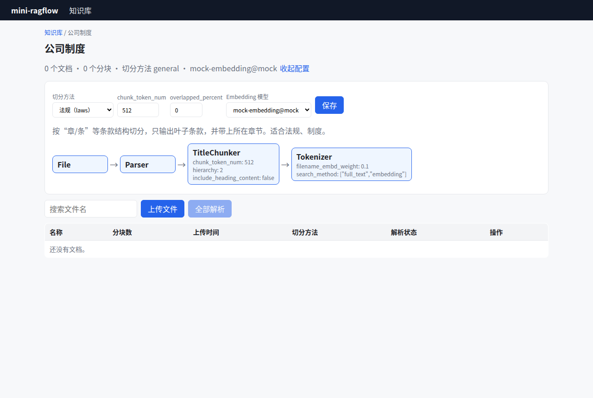
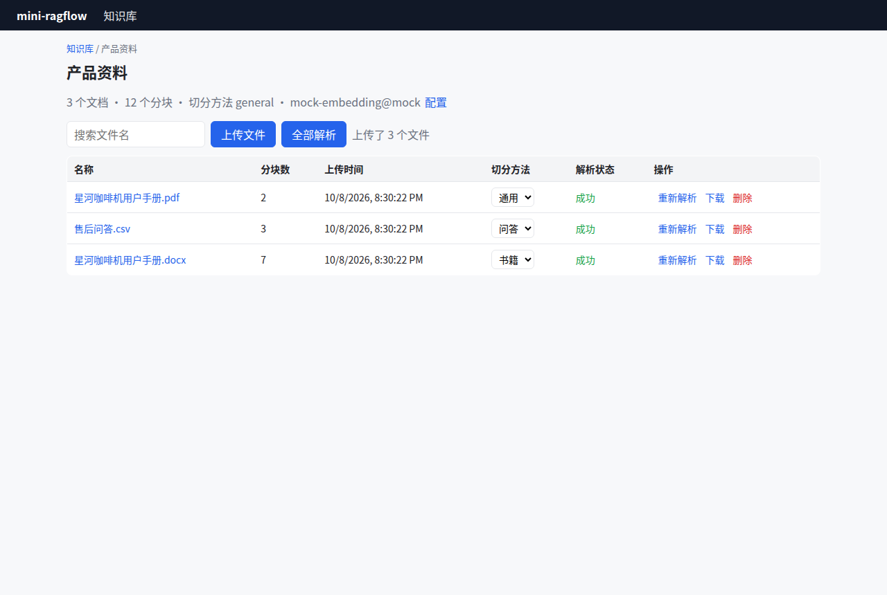

# 第 7 章 入库流水线：把入库写成一张 DSL 图 ★

> 本章目标：理解 RAGFlow 为什么把"解析 → 切分 → 抽取 → 分词向量化"做成一张可编辑的组件图，并实现一个最小的流水线执行器。
> 前置：第 6 章。对应代码：`v0.2` 的 `backend/internal/pipeline/`。

## 7.1 问题：处理逻辑写死在代码里

v0.1 的 `Runner.Run` 是一段直线代码：读文件 → 解析 → 切分 → 写入。这种写法有三个问题：

1. **不能按数据集配置**：法规要按条款切，FAQ 要按问答切，手册要按标题切。如果写成 `if parser_id == "laws" … else if …`，分支会越来越多；
2. **不能插入新步骤**：想在切分之后加一步"用 LLM 抽关键词"，就得改核心代码；
3. **看不见**：用户不知道自己的文档到底经过了哪些处理。

RAGFlow 的做法是：**把入库流程描述成一份数据（DSL），由一个通用的执行器来跑**。

## 7.2 RAGFlow 的模板

`internal/ingestion/pipeline/template/` 下有 12 个内置模板：`general / qa / manual / table / paper / book / laws / presentation / picture / one / audio / email`。每个模板是一份 JSON，例如 `ingestion_pipeline_general.json`：

```json
{
  "id": 33,
  "title": {"en": "General", "zh": "通用"},
  "canvas_type": "Ingestion Pipeline",
  "canvas_category": "dataflow_canvas",
  "dsl": {
    "components": {
      "File": {
        "downstream": ["Parser:HipSignsRhyme"],
        "obj": {"component_name": "File", "params": {}},
        "upstream": []
      },
      "Parser:HipSignsRhyme": {
        "downstream": ["GeneralChunker:SixApplesFall"],
        "obj": {"component_name": "Parser", "params": {"pdf": {...}, "docx": {...}, "markdown": {...}}}
      },
      "GeneralChunker:SixApplesFall": {
        "downstream": ["Extractor:AutoExtractDefault"],
        "obj": {"component_name": "GeneralChunker", "params": {
          "chunk_token_size": 512,
          "delimiters": ["\n", "!", "?", ";", "。", "；", "！", "？"],
          "overlapped_percent": 0, ...}}
      },
      "Extractor:AutoExtractDefault": {"downstream": ["Tokenizer:LegalReadersDecide"], ...},
      "Tokenizer:LegalReadersDecide": {"downstream": [], "obj": {"component_name": "Tokenizer",
          "params": {"fields": "text", "filename_embd_weight": 0.1, "search_method": ["embedding", "full_text"]}}}
    }
  }
}
```

（为了可读性，上面删掉了 Parser 那一大段按文件类型分开的参数。）

几个设计要点：

- **组件 id 是 `类型:随机名`**（`Parser:HipSignsRhyme`）。这是画布编辑器生成的，同一种组件可以在图里出现多次；
- **边存在节点上**：`downstream / upstream` 列出相邻节点。这种格式和 Agent 画布完全一样（`canvas_category: dataflow_canvas`），入库流水线就跑在 Agent 的画布运行时上（`internal/agent/runtime`）；
- **参数和组件放在一起**：切分大小、分隔符、标题权重……都是组件的 `params`。

不同模板的差别主要在切分组件上：

| 模板 | 切分组件 | 关键参数 |
|---|---|---|
| general | `GeneralChunker` | `chunk_token_size: 512`、`delimiters` |
| email | `TokenChunker` | 同上 |
| book | `TitleChunker` | `hierarchy: 5`、`include_heading_content: true`、`levels` 正则族 |
| laws | `TitleChunker` | `hierarchy: 2`、`include_heading_content: false` |
| paper | `TitleChunker` | `hierarchy: 0` |
| manual | `ManualChunker` | |
| qa | `QAChunker` | |
| table | `TableChunker` | |
| one / picture / audio | `OneChunker` | |
| presentation | `PageChunker` | |

### parser_id 怎么找到模板

模板用 `go:embed` 编进二进制（`internal/ingestion/pipeline/builtin_registry.go`）：

```go
const builtinTemplatePrefix = "ingestion_pipeline_"

var builtinParserOrder = map[string]int{
	"general":      0,
	"qa":           1,
	"manual":       2,
	...
}

//go:embed template/ingestion_pipeline_*.json
var builtinTemplateFS embed.FS
```

数据集的 `parser_id` 就是模板文件名去掉前缀和后缀的部分：`general` 对应 `ingestion_pipeline_general.json`。如果数据集设置了 `pipeline_id`，就改用用户在画布里保存的自定义流水线。执行器的第一步 `loadDSLFunc(ctx, s.canvasID)`（第 3 章）做的就是这个选择。

### 用户参数怎么覆盖模板参数

用户在数据集设置里改了"块大小 = 256"，这个值要落到切分组件的 `chunk_token_size` 上。RAGFlow Go 版的 `parser_config` 是**按组件 id 分键的**，`CleanComponentParams`（`internal/ingestion/pipeline/pipeline_params.go:158`）的注释写得很清楚：

```go
// CleanComponentParams filters rawConfig against the DSL schema given by dslJSON.
// Keys containing ':' are treated as component IDs; they are kept only when both
// the cpnID AND the param name exist in one of the accepted-key sources: ...
// Keys without ':' (legacy flat fields) are dropped
// with a warning.
```

也就是说，配置长这样：`{"GeneralChunker:SixApplesFall": {"chunk_token_size": 256}}`，只有"组件存在且参数名合法"的才会保留。`BuildParserConfig`（`:336`）再以模板默认值为底，把清洗过的覆盖值叠上去。此外还有一个特例：`ApplyComponentScopedParserConfig`（`internal/service/component_scoped_parser_config.go`）会把数据集级的元数据配置下发到图里**每一个** `Extractor` 节点。

### 组件注册

组件通过 `runtime.MustRegister / RegisterWithMeta`（`internal/agent/runtime/registry.go:204`）注册到全局表里，按名字（`GeneralChunker`）查找工厂函数。所有切分组件都通过 `MustRegisterChunker`（`internal/ingestion/component/chunker/register.go:34`）注册，并共享同一套输入输出契约（`schema.ChunkerOutputs`）。这样画布里任意两个切分组件可以互换。

## 7.3 从零实现

### DSL 类型

`backend/internal/pipeline/pipeline.go` 定义了和 RAGFlow 同形的结构：

```go
type DSL struct {
	Components map[string]Node `json:"components"`
}

type Node struct {
	Obj struct {
		ComponentName string         `json:"component_name"`
		Params        map[string]any `json:"params"`
	} `json:"obj"`
	Downstream []string `json:"downstream"`
	Upstream   []string `json:"upstream"`
}
```

### 组件接口

RAGFlow 的组件之间传的是 `map[string]any`。mini-ragflow 改成一个有类型的 `State`，用 Go 写起来更清楚：

```go
type State struct {
	KB     *model.Knowledgebase
	Doc    *model.Document
	Data   []byte         // File
	Parsed *parser.Result // Parser
	Chunks []model.Chunk  // Chunker, then enriched by Extractor/Tokenizer
	Meta   map[string]any // Extractor (v0.5)
	Log    func(msg string)
}

type Component interface {
	Invoke(ctx context.Context, st *State, report func(float64)) error
}
```

`report` 对应 RAGFlow 的 `ReportComponentFraction`：组件只报告自己完成了多少。

### 执行器

RAGFlow 的画布运行时支持分支和汇合。入库模板全是直线链，所以 mini-ragflow 只支持线性流水线，遇到分支就报错：

```go
func (d DSL) Order() ([]string, error) {
	...
	for id := "File"; id != ""; {
		...
		switch len(n.Downstream) {
		case 0:
			id = ""
		case 1:
			id = n.Downstream[0]
		default:
			return nil, fmt.Errorf("component %s has %d downstreams; only linear pipelines are supported", id, len(n.Downstream))
		}
	}
	if len(order) != len(d.Components) {
		return nil, fmt.Errorf("pipeline has components not reachable from File")
	}
```

`Run` 把每个组件的局部比例换算成整体进度。第 i 个组件（共 n 个）报告 f 时，整体进度是 `0.05 + 0.85 × (i + f) / n`，开头和结尾各留一点余量给"认领"和"写索引"：

```go
for i, c := range comps {
	base := float64(i) / float64(len(comps))
	span := 1 / float64(len(comps))
	report := func(f float64) {
		...
		progress(0.05+0.85*(base+span*f), "")
	}
	if err := c.Invoke(ctx, st, report); err != nil {
		return fmt.Errorf("%s: %w", name, err)
	}
	report(1)
}
```

外层的 `ingest.Runner` 对进度写库做了**限频**（300 毫秒一次），道理和 RAGFlow 的 `progressFlushInterval` 一样。

### 模板与覆盖

模板同样用 `go:embed` 编进二进制（`backend/internal/pipeline/templates/*.json`），v0.2 一共 6 个：`general / book / laws / qa / table / one`，结构是 `File → Parser → *Chunker → Tokenizer`（v0.5 中间加了 `Extractor`，末尾加了 `Raptor`）。

参数覆盖这里，mini-ragflow 走了一条**更简单的路**：`parser_config` 用扁平键，一个键会覆盖**所有声明了同名参数的组件**：

```go
// WithOverrides returns a copy whose component params are overridden by the
// document's parser_config: a key replaces the param of the same name in every
// component that declares it.
func (d DSL) WithOverrides(cfg map[string]any) DSL {
	...
	for k, v := range cfg {
		if _, ok := params[k]; ok {
			params[k] = v
		}
	}
```

"只覆盖声明过的参数"和 RAGFlow 的白名单思路一致：用户传一个不存在的键，不会被悄悄塞进组件里。代价是没法只改某一个组件（比如图里有两个 Extractor 时）。这正是 RAGFlow 改用按组件分键的原因。

### 组件注册

```go
func init() {
	Register("File", ...)
	Register("Parser", ...)
	Register("GeneralChunker", ...)
	Register("TitleChunker", ...)
	Register("QAChunker", ...)
	Register("TableChunker", ...)
	Register("OneChunker", ...)
	Register("Tokenizer", newTokenizer)
}
```

切分组件统一包装成 `chunkerComp{cut func(*parser.Result) []chunker.Piece}`。真正的切分算法放在 `internal/chunker` 包里，是纯函数，不依赖流水线，可以单独测试（第 9 章）。

## 7.4 运行与验证

```bash
git checkout v0.2 && cd backend && go test ./internal/pipeline/ -v | grep -E '^(---|ok)|pipeline_test.go'
```

```text
--- PASS: TestTemplatesAreValid (0.00s)
--- PASS: TestOverridesOnlyTouchDeclaredParams (0.00s)
--- PASS: TestOrderRejectsBranches (0.00s)
    pipeline_test.go:95: general/星河咖啡机用户手册.md: Parsed as markdown: 18 sections map[list:2 table:1 text:7 title:8]. | Chunked by general into 4 chunks. | Embedded 4 chunks with mock-embedding@mock (dim 256, 0 cache hits).
    pipeline_test.go:103: book/星河咖啡机用户手册.md: Parsed as markdown: 18 sections map[list:2 table:1 text:7 title:8]. | Chunked by title into 7 chunks. | Embedded 7 chunks with mock-embedding@mock (dim 256, 0 cache hits).
    pipeline_test.go:108: laws/员工休假制度.txt: Parsed as text: 6 sections map[text:6]. | Chunked by title into 14 chunks. | Embedded 14 chunks with mock-embedding@mock (dim 256, 0 cache hits).
    pipeline_test.go:111: qa/faq.md: Parsed as markdown: 6 sections map[text:5 title:1]. | Chunked by qa into 5 chunks. | Embedded 5 chunks with mock-embedding@mock (dim 256, 0 cache hits).
    pipeline_test.go:115: one/faq.md: Parsed as markdown: 6 sections map[text:5 title:1]. | Chunked by one into 1 chunks. | Embedded 1 chunks with mock-embedding@mock (dim 256, 0 cache hits).
    pipeline_test.go:118: general/星河咖啡机用户手册.md: Parsed as markdown: 18 sections map[list:2 table:1 text:7 title:8]. | Chunked by general into 14 chunks. | Embedded 14 chunks with mock-embedding@mock (dim 256, 0 cache hits).
--- PASS: TestRunEachTemplate (0.03s)
--- PASS: TestEmbedCacheHits (0.00s)
ok  	mini-ragflow/internal/pipeline	0.038s
```

同一份手册，`general` 切成 4 块，`book` 切成 7 块；把 `chunk_token_num` 覆盖成 64 后，`general` 切成了 14 块（最后一行）。

在 UI 上，数据集"配置"面板会把当前模板的组件图画出来，参数实时跟着表单变化：



*图 7-1：选择"法规（laws）"模板后，组件图里出现 `TitleChunker`，参数为 `hierarchy: 2, include_heading_content: false`。*

单个文档也可以单独选模板。下图同一个数据集里，PDF 用通用，DOCX 用书籍，CSV 用问答：



*图 7-2：同一个数据集里的三份文档用了三种切分方法。*

## 7.5 练习

1. **巩固**：写一个自定义模板 `manual-small.json`：通用切分，但 `chunk_token_num = 128`、`overlapped_percent = 20`，放进 `templates/` 后不改任何 Go 代码就能在 UI 里选到它。为什么能做到这一点？
2. **扩展**：给 `DSL.Order` 加上分支支持：一个 Parser 后面接两个 Chunker，各自产出 chunk 再合并。`State` 需要怎么改？
3. **读源码**：在 RAGFlow 里找到用户自定义流水线（`pipeline_id`）是从哪张表、以什么格式加载的。提示：从 `PipelineExecutor` 的 `loadDSLFunc` 往上追。

## 7.6 延伸阅读

- `internal/ingestion/pipeline/template/*.json`：12 个模板逐个对比
- `internal/ingestion/pipeline/pipeline_params.go`：参数清洗与合并
- `internal/agent/runtime/registry.go`：组件注册表（Agent 和入库共用）
