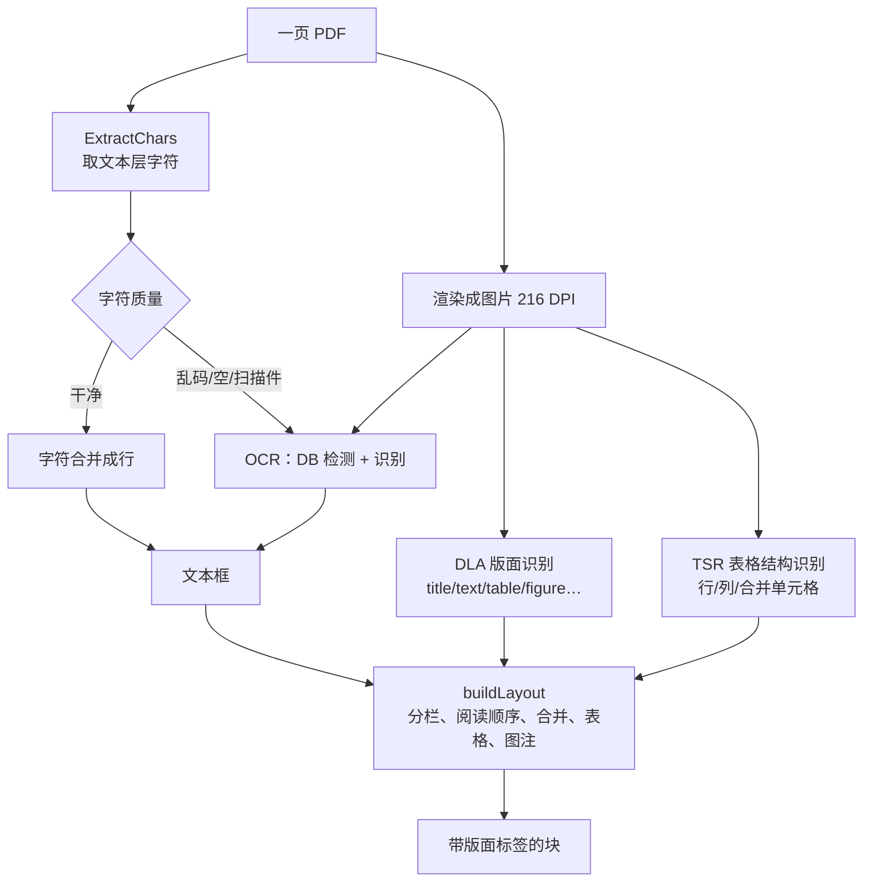
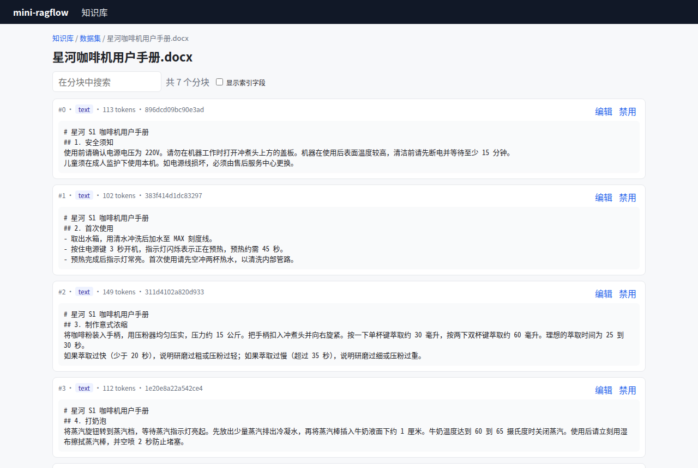

# 第 8 章 解析器家族与 DeepDoc ★

> 本章目标：理解"解析"这一步要产出什么、各种格式该怎么解析，以及 RAGFlow 的 DeepDoc 在 PDF 上做了哪些事；再实现一组文本层解析器，并说清楚它们离 DeepDoc 还差多远。
> 前置：第 7 章。对应代码：`v0.2` 的 `backend/internal/parser/`。

## 8.1 解析要产出什么

解析器的输出不是"一大段纯文本"，而是**一串带版面标签的块**：

```text
[title, level=1]  # 星河 S1 咖啡机用户手册
[title, level=2]  ## 1. 安全须知
[text]            使用前请确认电源电压为 220V。……
[list]            1. 取出水箱……\n2. 按住电源键……
[table]           | 现象 | 可能原因 | 处理方法 | ...
```

切分器（第 9 章）需要这些标签：标题决定层级，表格不能切开，列表最好整体保留。**解析阶段丢掉的结构，后面就找不回来了**，这正是 RAGFlow README 里"Quality in, quality out"的意思。

RAGFlow 的 Parser 组件输出（`internal/ingestion/component/schema/parser.go` 的 `ParserOutputs`）里，`JSON []map[string]any` 字段就是这样一串块。每块有 `text`、`layout`（DeepDoc 的版面标签：title、text、table、figure……）、页码和坐标。

## 8.2 RAGFlow 的解析器家族

Parser 组件先按扩展名把文件归到一个"族"（`internal/ingestion/component/parser_dispatch.go:190` 的 `familyToExt`），每个族对应 `internal/parser/parser/` 下的一个解析器：

| 族 | 扩展名 | 解析器 | 要点 |
|---|---|---|---|
| pdf | pdf | DeepDoc / MinerU / Docling / PaddleOCR / 视觉大模型 | 下面细讲 |
| docx / doc | docx、doc | `docx_parser.go`（经 CGO 调原生 office 库） | 标题样式、表格、图片 |
| slides | ppt、pptx | | 按页 |
| spreadsheet / csv | xls、xlsx、csv | `csv_parser.go` 等 | 行列结构 |
| markdown | md、markdown、mdx | `markdown_parser.go` | 标题、表格、代码块 |
| html | htm、html | `html_parser.go` | 去导航/页脚（`main_content` 预处理） |
| text&code | txt、py、js、go… | | 纯文本 |
| email、epub、json、audio、video、picture | | | 音视频走转写，图片走 OCR/视觉模型 |

PDF 的 `parse_method` 有好几种选择（`internal/parser/parser/pdf_parser_common.go:61`：`ParserType string // DeepDoc, PaddleOCR, MinerU`），配置里还有 MinerU、PaddleOCR 服务的地址和密钥，以及 Docling（`pdf_parser_docling.go`）。也就是说，RAGFlow 既有自研的 DeepDoc，也能把 PDF 交给外部的文档解析服务。

## 8.3 DeepDoc：把 PDF"看"一遍

PDF 是最难解析的格式：它只记录"在坐标 (x, y) 画一个字"，没有段落、标题、表格的概念。扫描件更麻烦，连字都没有，只有图片。DeepDoc（`internal/deepdoc/`）的思路是**像人一样看页面**：把每一页渲染成图片，用视觉模型识别版面，再把文字重新组织起来。



`Parser.processPage`（`internal/deepdoc/parser/pdf/parser.go:169`）负责单页的处理。它先取文本层字符，判断这一页是不是扫描件：

```go
chars, extractErr := engine.ExtractChars(pg)
...
medianH := util.MedianCharHeight(chars)
medianW := util.MedianCharWidth(chars)
isEnglish := util.DetectEnglishPage(chars, nil)
isScanNoise := util.IsScanNoise(util.FullTextFromChars(map[int][]pdf.TextChar{pg: chars}))
```

然后渲染页面，做 OCR 和版面/表格识别：

```go
pageImg, renderErr := p.renderPageToImage(ctx, engine, pg)
...
ocrBoxes, updatedChars, ocrUsed = p.processPageBoxes(ctx, pageImg, chars, pg, renderErr, isScanNoise, docAnalyzer, pageZoom)
annotated, pageTables, dlaRegions = p.enrichOnePageWithDeepDoc(
	ctx, pageImg, ocrBoxes, pg, renderErr, docAnalyzer, tb, pageZoom)
```

`processPageBoxes` 的注释（`:274` 起）说明了 OCR 策略是**逐页决定**的：

> - Clean embedded chars (count > 0 and not garbled): use ocrMergeChars, which detect-merges chars into boxes and falls back to single-image OCR recognize for empty boxes.
> - Garbled or empty chars: use ocrDetectAndRecognize for full OCR …

文本层干净，就用文本层的字符（准确、快）；文本层乱码或为空，就整页 OCR。同一份 PDF 里，有的页可以是扫描件，有的页可以是电子版。如果某一页一个版面框都没识别出来，还会把页面放大到最多 9 倍重新渲染，再试一次。

### 三个模型

`internal/deepdoc/native/` 里是三类视觉模型的 Go 实现，通过 `onnxruntime_go`（`session.go`）调用 ONNX Runtime 推理：

| 文件 | 模型 | 作用 |
|---|---|---|
| `det.go`、`ocr_rec.go` | OCR 检测（DB）+ 识别 | 找出文字区域并识别文字 |
| `dla.go` | DLA，YOLOv10 版面识别 | 每个区域是标题、正文、表格、图片、页眉页脚…… |
| `tsr.go` | TSR，表格结构识别 | 表格的行、列、表头、合并单元格 |

这些文件的注释写明了它们是从 Python 版 `deepdoc/vision/*.py` 移植过来的，而且移植得非常仔细。例如 `det.go` 的注释记录了和 Python 版逐阶段比对的结果："the raw pred map matches to mean|Δ|≈1.3e-3"，"On mp_physics_p5 Go yields 21 == 21 final boxes"。

### 版面重建

拿到每页的文本框、版面区域和表格以后，`buildLayout`（`parser.go:521`）在全文档范围内做最后的组装。注释里列出了步骤："AssignColumn, TextMerge, FinalReadingOrderMerge, NaiveVerticalMerge, table merge, figure consolidation, BoxesToSections, and caption merge"，也就是分栏、合并同一行、确定阅读顺序、合并跨行段落、合并跨页表格、整理图片、生成段落、挂上图注。`layout/` 目录下还有 `dehyphen.go`（处理英文的断词连字符）、`combined_column.go`（多栏判断）等细节。

**这就是 RAGFlow 押注的"深度文档理解"**：它付出的代价是一整套视觉模型、CGO、原生库（pdfium、pdf_oxide、office_oxide）和 ONNX Runtime；换来的是扫描件、多栏论文和复杂表格都能被正确地切成段落和表格。

## 8.4 从零实现：文本层解析器

mini-ragflow **不复刻 DeepDoc**，需要的模型和原生依赖超出了本书的范围。它实现了一组只读文本层的解析器，输出和 RAGFlow 同形的"带版面标签的块"。

### 统一的输出

```go
type Section struct {
	Text   string   `json:"text"`
	Layout string   `json:"layout"`           // title / text / list / code / table / table_row
	Level  int      `json:"level,omitempty"`  // heading level for titles (1 = "#")
	Page   int      `json:"page,omitempty"`   // 1-based page for paginated formats
	Cells  []string `json:"cells,omitempty"`  // table_row values
	Header []string `json:"header,omitempty"` // table_row column names
}
```

一个关键约定：**不管源格式是什么，标题一律写成 markdown 形式**（`## 4. 打奶泡`）。这样第 9 章的标题切分器只需要一套正则（RAGFlow 的 `levels` 参数里第一族就是 `^#[^#]`、`^##[^#]`……），就能同时处理 markdown、html 和 docx。

### 各格式

| 格式 | 实现 | 做法 |
|---|---|---|
| markdown | `markdown.go` | 按行扫描：标题、围栏代码块、管道表格、列表、段落 |
| html | `html.go` | 用 `golang.org/x/net/html` 遍历 DOM，`h1-h6 → 标题`，`table → 管道表格`，丢掉 `script/style/nav/footer/header` |
| docx | `docx.go` | 解压读 `word/document.xml`，用 `styles.xml` 把样式 id 映射成"heading N"，`w:tbl → 表格` |
| xlsx / csv | `sheet.go` | 第一行当表头，每行渲染成 `列名: 值; 列名: 值` |
| pdf | `pdf.go` | 调 poppler 的 `pdftotext`，按页拆分，再修复硬换行 |
| txt / 代码 | `text.go` | 按空行分段 |

docx 的标题识别是一个典型的细节：Word 里标题的样式 id 可能是 `Heading1`，也可能是中文版 Word 生成的 `1`、`2`。真正可靠的是 `styles.xml` 里样式的 **name**（`heading 1`、`标题 1`）：

```go
var headingName = regexp.MustCompile(`(?i)^(heading|标题)\s*(\d)$`)
...
for _, s := range root.all("style") {
	id := s.Attr["styleId"]
	if name := s.find("name"); name != nil {
		v := name.Attr["val"]
		if strings.EqualFold(v, "title") {
			styleLevel[id] = 1
		} else if m := headingName.FindStringSubmatch(v); m != nil {
			styleLevel[id], _ = strconv.Atoi(m[2])
		}
	}
}
```

xlsx 和 docx 都是 zip 包，解压时给每个文件的读取量加了上限（`io.LimitReader(rc, 64<<20)`），防止"压缩炸弹"：几 KB 的 zip 解压出几 GB。

### 测试用的真实文件

解析器的测试不用手写的假文件，而是用工具从同一份 markdown 生成的真实文件：

```bash
pandoc samples/星河咖啡机用户手册.md -o testdata/manual.docx
pandoc -s samples/星河咖啡机用户手册.md -o testdata/manual.html
google-chrome --headless=new --print-to-pdf=testdata/manual.pdf file://.../manual.html
```

`TestDocxHTMLPDFAgree` 断言三种格式解析出的标题和表格一致。

### 踩坑记录 1：纯 Go 的 PDF 库输出乱码

PDF 解析最初用的是纯 Go 库 `github.com/ledongthuc/pdf`（不需要 CGO，看上去很合适）。测试结果是这样的：

```text
--- FAIL: TestDocxHTMLPDFAgree (0.02s)
    parser_test.go:74: pdf text: "ã\v#ù\x15Õngø\u009d¨ÿ\u0099\x1ePs 2 !ý³Ë×{\n\u009d¨ÿo·L¶pV;M 1 -\u009d{L¶Gt\x10è 60 è 65 ..."
```

数字（`60`、`65`、`2`）是对的，中文全是乱码，行的顺序也是倒的。Chrome 和 Word 导出中文 PDF 时会嵌入 CID 字体（Identity-H 编码），要通过字体里的 ToUnicode 表才能把字形编号翻译回汉字，这个库没处理好这一步。换成 poppler 的 `pdftotext` 以后，同一个文件输出正常：

```text
星河 S1 咖啡机用户手册
1.    安全须知
使用前请确认电源电压为 220V。请勿在机器工作时打开冲煮头上方的盖板。机器
在使用后表面温度较高，清洁前请先断电并等待至少 15 分钟。
```

RAGFlow 选择链接 pdfium 这样的原生库，避开的也是这类问题。mini-ragflow 改为调用外部命令，并在找不到 `pdftotext` 时**直接报错**，不再悄悄退回一个会输出乱码的实现：

```go
bin, err := exec.LookPath(PDFToText)
if err != nil {
	return nil, errors.New("PDF parsing needs poppler's pdftotext (apt install poppler-utils)")
}
```

### 踩坑记录 2：硬换行把句子切断

换成 `pdftotext` 之后，测试还是失败：

```text
理想的萃取\n时间为 25 到 30 秒。
```

PDF 里的换行是排版造成的，不是语义上的断句。"理想的萃取时间为 25 到 30 秒"被拆成了两行。断开的句子会让切分器在错误的位置切开，也会让关键词匹配失败（"萃取时间"变成了"萃取\n时间"）。

DeepDoc 用版面框解决这个问题。mini-ragflow 用一个只基于文本的启发式规则：**一行如果几乎和本页最宽的行一样宽，并且没有以句末标点结尾，那就是被排版折断的，下一行应该接上来**：

```go
for i, l := range lines {
	if i > 0 {
		prev := lines[i-1]
		last, _ := utf8.DecodeLastRuneInString(prev)
		full := float64(width(prev)) >= 0.85*float64(max)
		if full && !strings.ContainsRune("。！？：；.!?:;", last) {
			first, _ := utf8.DecodeRuneInString(l)
			if last < 0x2E80 && first < 0x2E80 {
				b.WriteString(" ")   // 英文之间补空格，中文直接拼
			}
		} else {
			b.WriteString("\n")
		}
	}
	b.WriteString(l)
}
```

"1."、"安全须知"这样的短行（标题、列表编号、表格单元格）不满足"满行"条件，会被保留下来。

## 8.5 和 DeepDoc 的差距

| 场景 | DeepDoc | mini-ragflow |
|---|---|---|
| 电子版 PDF 的正文 | ✅ | ✅（经过换行修复） |
| PDF 里的标题层级 | ✅ DLA 识别 title | ❌ 只有文本，没有层级 |
| PDF 里的表格 | ✅ TSR 还原成 HTML 表格 | ❌ 变成一行行的文字 |
| 多栏排版 | ✅ AssignColumn | ❌ pdftotext 自己猜阅读顺序 |
| 扫描件 | ✅ OCR | ❌ 直接报错"no text layer" |
| 页眉页脚 | ✅ DLA 识别后丢弃 | ❌ 混在正文里 |

在 Lab 2 里可以亲眼看到这些差距：同一份手册，docx 版用"书籍"模板切成了 7 个按标题划分的块（下图），PDF 版用通用切分只得到 2 块。



*图 8-1：docx 版手册用"书籍"模板切分，每一块都带着自己的标题路径。PDF 版没有标题信息，做不到这一点。*

## 8.6 运行与验证

```bash
git checkout v0.2 && cd backend && go test ./internal/parser/ -v | grep -E '^(---|ok)'
```

```text
--- PASS: TestMarkdown (0.00s)
--- PASS: TestDocxHTMLPDFAgree (0.02s)
--- PASS: TestCSVAndXLSX (0.00s)
--- PASS: TestRejectsBinaryText (0.00s)
ok  	mini-ragflow/internal/parser	0.025s
```

在 UI 里上传 `samples/formats/` 下的 PDF、DOCX、CSV，看各自的解析日志（真实输出）：

```text
--- .pdf log:
Parsed as pdf: 2 sections map[text:2].
Chunked by general into 2 chunks.
--- .docx log:
Parsed as docx: 23 sections map[list:7 table:1 text:7 title:8].
Chunked by title into 7 chunks.
--- .csv log:
Parsed as spreadsheet: 3 sections map[table_row:3].
Chunked by qa into 3 chunks.
```

PDF 解析出 2 个 section（每页一个），只有正文；DOCX 解析出 8 个标题、7 段正文、7 个列表、1 个表格。

## 8.7 练习

1. **巩固**：给 markdown 解析器加上对 `> 引用块` 的支持，输出 `layout = "quote"`。切分器需要改吗？
2. **扩展**：用 `pdftotext -bbox-layout` 拿到每个词的坐标，根据字号判断哪些行是标题（字号明显大于正文中位数），让 PDF 也能用"书籍"模板。这就是 DeepDoc 中 `MedianCharHeight` 的用途之一。
3. **读源码**：`internal/deepdoc/parser/pdf/parser.go` 里的 `enrichOnePageWithDeepDoc` 怎么把 DLA 的版面标签贴到 OCR 文本框上？如果一个文本框跨了两个版面区域，会怎么处理？

## 8.8 延伸阅读

- `internal/deepdoc/parser/pdf/parser.go`、`internal/deepdoc/parser/pdf/layout/`
- `internal/deepdoc/native/*.go` 的文件头注释：每个模型的输入输出与移植验证方法
- PaddleOCR 的 DB 文本检测论文：*Real-time Scene Text Detection with Differentiable Binarization*
- MinerU、Docling：另两种开源 PDF 解析方案，RAGFlow 都能接入
