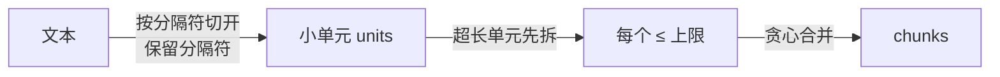
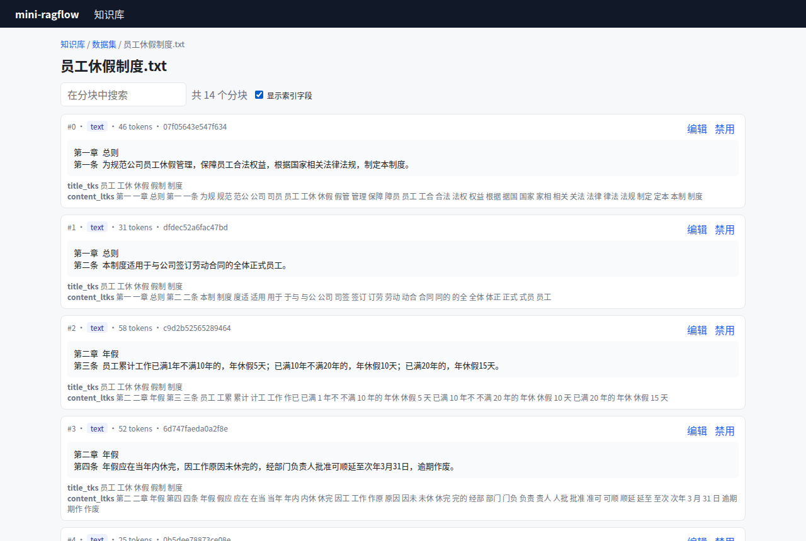

# 第 9 章 切分策略 ★★

> 本章目标：掌握 RAGFlow 的几种切分算法：按 token 合并（含重叠与硬上限）、按标题层级、问答、表格、整篇，知道每种算法适合哪类文档，并用纯函数把它们实现出来。
> 前置：第 7、8 章。对应代码：`v0.2` 的 `backend/internal/chunker/`。

## 9.1 切分要解决的三个矛盾

1. **大小**：块太大，检索时一大段里只有一句相关，噪声多、浪费 token；块太小，上下文不完整，"它"指的是什么都不知道；
2. **边界**：切在句子中间，语义就断了；切在标题和正文之间，正文就丢了它的主题（第 1 章图 1-1）；
3. **结构**：表格切开就没法读，问答对拆开就答非所问，法规条款混在一起就无法精确引用。

RAGFlow 不追求"一个万能算法"，而是**按文档类型选算法**（第 7 章的模板）。本章逐个拆解。

## 9.2 通用切分：先切开，再合并

### 思路



1. 按分隔符（换行、句号、问号……）把文本切成小单元，**分隔符留在左边的单元里**，这样合并回去和原文一字不差；
2. 某个单元本身就超过上限（一整段没有标点的长文本），先按句子拆，还不行就硬切；
3. 从左到右把单元往当前块里塞，塞不下就开新块。

### RAGFlow 的 mergeUnits

核心在 `internal/ingestion/component/chunker/token.go:1063`：

```go
func mergeUnits(units []schema.ChunkDoc, target int, overlapPct float64, joinSep string) []schema.ChunkDoc {
	...
	// Expand oversized text units into <= target pieces BEFORE merging so the
	// UNDER_CAP merge can never exceed target (hard cap). Non-text units pass
	// through unchanged.
	units = expandOversizedUnits(units, target)
	// Scaled threshold reserves room for the unconditional overlap prefix.
	threshold := float64(target) * (100.0 - overlapPct) / 100.0
	...
	for i := range units {
		ck := units[i]
		if ck.CKType != "text" {
			merged = append(merged, cloneChunkDoc(ck))
			mergedItems = append(mergedItems, nil)
			prevIdx = -1
			continue
		}
		...
		// UNDER_CAP: a projected join that would exceed target starts a fresh
		// chunk. The scaled threshold reserves room for the overlap prefix.
		startNew := float64(intValue(prev.TKNums)) > threshold || intValue(prev.TKNums)+tk > target
```

有三处设计值得细看：

**① 硬上限。** `expandOversizedUnits`（`:1216`）先保证每个单元都不超过 `target`。超长单元交给 `splitOversizedText`，注释里写着："Sentence boundaries are preferred; a boundary-less run that still exceeds target is hard token-split. Delimiters are preserved so the concatenated pieces reproduce the unit text exactly (lossless)."，即优先在句子边界拆，实在不行硬切，而且无损。有了这一步，后面的合并永远不会产生超限的块。这对 embedding 很重要：模型有输入长度限制，超长的块会被截断，后半段的信息就丢了。

**② 缩放阈值。** 开新块的条件有两个："当前块已经超过 `target × (100 − overlap%) / 100`"，或者"再加这个单元就超过 `target`"。第一个条件是为重叠预留空间：如果设置了 20% 的重叠，新块开头要放上一块的尾巴，那么每块的"正文"只能装到 80%。

**③ 非文本单元打断合并。** 表格、图片这类 `CKType != "text"` 的单元原样输出成独立的块，并且 `prevIdx = -1`，下一个文本单元不会和表格之前的文本合并。表格就这样保持完整。

### 重叠

`computeOverlapPrefix`（`:403`）按**字符比例**从上一块的尾部截取：

```go
func computeOverlapPrefix(prevText string, overlappedPct float64) (string, int) {
	visible := removeTag(prevText)
	if visible == "" {
		return "", 0
	}
	runes := []rune(visible)
	cut := overlapCut(prevText, overlappedPct)
	if cut >= len(runes) {
		return "", 0
	}
	overlap := string(runes[cut:])
	return overlap, tokenizeStr(overlap)
}
```

重叠的作用是：一个关键句恰好落在块边界上时，两边的块都能把它完整地带上。代价是存储和 embedding 的开销增加，检索结果里也会出现内容相近的块。RAGFlow 的通用模板默认 `overlapped_percent: 0`。

### 表格/图片的上下文

`attachMediaContext`（`token.go:877`）给表格和图片块收集前后若干 token 的文本，放进 `ContextAbove / ContextBelow`。一张表格单独成块时，经常只剩一堆数字，有了上下文就知道"这是第几季度的销售表"。参数是 `table_context_size / image_context_size`，默认 0（关闭）。

## 9.3 按标题层级切分

### 思路

手册、书籍、法规都有清晰的层级结构。按层级切分，每一块正好是一个小节，并且带上它的**标题路径**：

```text
# 星河 S1 咖啡机用户手册
## 5. 清洁与除垢
每天使用后清洗手柄和滤网。……
```

这样即使正文里没有出现"咖啡机"，这一块也能被"咖啡机怎么除垢"命中。

### 步骤一：识别标题

不同文档的标题写法不同：markdown 用 `#`，中文法规用"第X章 / 第X条"，英文书用"Chapter / Section"。RAGFlow 的 book/laws 模板在 `levels` 参数里给了好几"族"正则，每族从上到下对应各级标题：

```json
"levels": [
  ["^#[^#]", "^##[^#]", "^###[^#]", "^####[^#]"],
  ["第[零一二三四五六七八九十百0-9]+(分?编|部分)", "第[零一二三四五六七八九十百0-9]+章",
   "第[零一二三四五六七八九十百0-9]+节", "第[零一二三四五六七八九十百0-9]+条", "[\\(（][零一二三四五六七八九十百]+[\\)）]"],
  ["第[0-9]+章", "第[0-9]+节", "[0-9]{1,2}[\\. 、]", ...],
  ["PART (ONE|TWO|...)", "Chapter (I+V?|...)", "Section [0-9]+", "Article [0-9]+"]
]
```

`selectLevelGroup`（`internal/ingestion/component/chunker/title.go:139`）统计每一族能命中多少行，**命中最多的那一族胜出**：

```go
for i, group := range rawLevels {
	for _, line := range lines {
		text := trim(line)
		...
		// Mirror common.py:select_level_group — a bullet-looking
		// line cannot count as a heading hit for any family.
		if notBullet(text) {
			continue
		}
		for _, pattern := range group {
			if re := compileLevelPattern(pattern); re != nil {
				if re.MatchString(text) {
					hits[i]++
					break
```

注意 `notBullet`：像"1. 取出水箱"这样的列表项不能算作标题。

### 步骤二：决定深度

`hierarchy` 参数决定切到第几级。它不是"正则族里的第几个"，而是**文档里实际出现的第 N 种标题级别**。`resolveTargetLevel`（`internal/ingestion/component/chunker/group.go:66`）把出现过的级别去重排序，取第 N 个：

```go
for _, l := range levels {
	if l > 0 && l < bodyLevel && !seen[l] {
		seen[l] = true
		tiers = append(tiers, l)
	}
}
...
if hierarchy > len(tiers) {
	hierarchy = len(tiers)
}
return tiers[hierarchy-1]
```

对《员工休假制度》来说，中文族里"编、章、节、条、（一）"五级中只出现了"章"和"条"，所以 `hierarchy: 2` 意思是切到"条"。

### 步骤三：建树、按路径输出

`chunkNode.getPaths`（`internal/ingestion/component/chunker/hierarchy.go:103`）用栈建出标题树，再深度优先遍历，为每个节点输出一个"路径 + 正文"的块。`include_heading_content` 控制两种输出方式：

```go
if includeHeading {
	...
	if len(n.bodyIndexes) > 0 && n.level >= 1 && n.level <= depth {
		combined := append(append([]int(nil), pathTitles...), n.bodyIndexes...)
		*paths = append(*paths, combined)
	} else if len(n.children) == 0 && n.level >= 1 && n.level <= depth {
		...
	}
} else {
	if n.level >= 1 && n.level <= depth {
		pathTitles = append(append(append([]int(nil), titles...), n.titleIndexes...), n.bodyIndexes...)
	} else {
		pathTitles = titles
	}
	if len(n.children) == 0 && n.level >= 1 && n.level <= depth {
		combined := append([]int(nil), pathTitles...)
		*paths = append(*paths, combined)
	}
}
```

- `true`（book 模板）：**每个有正文的标题节点**都输出一块，内容是"祖先标题 + 自己的标题 + 自己的正文"；
- `false`（laws 模板）：**只有叶子节点**输出，但祖先节点的标题**和正文**会一路带下来。比如某一章开头有一段总述，这段总述会出现在该章每一条里。

## 9.4 问答、表格、整篇

**问答**（`qa.go`）：输入可以是两列表格、`Q:/A:` 文本、或"标题当问题、正文当答案"的 markdown。每个问答对是一块，正文写成 `"Question: " + q + "\tAnswer: " + a`（`qa.go:108`）。关键在于**只对问题建全文索引**：

```go
contentLTKS, _ := tok.Tokenize(pair.Question)
```

用户的提问和 FAQ 里的问题措辞最接近，答案里的词反而会带来噪声。

**表格**（`table.go`）：注释直接引用了 Python 版的一句话："Every row in table will be treated as a chunk."。每一行重复列名，写成 `- 字段: 值`，这样单独一行也能读懂。

**整篇**（`one.go`）：整个文档作为一块，适合很短、必须整体召回的文档（一页的公告、一张图片的 OCR 结果）。

## 9.5 从零实现

`backend/internal/chunker/` 是一组纯函数，输入 `[]parser.Section`，输出 `[]Piece`，不依赖流水线和存储：

```go
type Piece struct {
	Text      string
	CKType    string   // text | table | code | qa | row
	Page      int
	IndexText string   // QA：只对问题建索引
	Questions []string // QA：写进 question_kwd
}

func General(secs []parser.Section, cfg Config) []Piece
func Title(secs []parser.Section, cfg TitleConfig) []Piece
func QA(secs []parser.Section) []Piece
func Table(secs []parser.Section) []Piece
func One(secs []parser.Section) []Piece
```

### MergeUnits

照搬 RAGFlow 的三条规则：先展开超长单元、缩放阈值、非文本单元打断合并：

```go
func MergeUnits(units []unit, cfg Config) []Piece {
	target := cfg.ChunkTokenNum
	units = expandOversized(units, target)
	threshold := float64(target) * (100 - cfg.OverlappedPercent) / 100
	...
	for _, u := range units {
		...
		if u.atomic {   // 表格、代码块
			out = append(out, Piece{Text: strings.TrimSpace(u.text), CKType: u.ckType, Page: u.page})
			open = -1
			continue
		}
		...
		if float64(counts[open]) > threshold || counts[open]+u.tokens > target {
			text := u.text
			if cfg.OverlappedPercent > 0 {
				tail := overlapTail(out[open].Text, cfg.OverlappedPercent)
				if room := target - u.tokens; room > 0 {
					tail = lastTokens(tail, room)   // 重叠也不能突破上限
					text = tail + text
				}
			}
			...
```

`lastTokens(tail, room)` 对应 RAGFlow 的 `overlapFitPrefix`：如果加上重叠就会超过上限，就把重叠部分截短。

### Title

`Title` 把同样的三步写在一个函数里：

1. 把文本段拆成行（表格和代码块保持整体），用 `selectFamily` 选出命中最多的正则族，给每一行标上级别；
2. 按"文档里实际出现的第 N 种级别"决定深度；
3. 用栈建树，按 `IncludeHeadingContent` 两种方式遍历输出。正文超过上限时交给 `MergeText` 再切一次，每一段都重复标题路径。

两处和 RAGFlow 不同：没有 PDF 大纲（outline）和版面提示这两条识别标题的辅助路径，因为第 8 章的 PDF 解析拿不到这些信息；表格节点会带着标题路径单独成块。

## 9.6 运行与验证

```bash
git checkout v0.2 && cd backend && go test ./internal/chunker/ -v | grep -E '^(---|ok)'
```

```text
--- PASS: TestSplitKeepsDelimiter (0.00s)
--- PASS: TestGeneralHardCap (0.00s)
--- PASS: TestGeneralOverlapRespectsCap (0.00s)
--- PASS: TestGeneralKeepsTablesWhole (0.00s)
--- PASS: TestTitleOnMarkdown (0.00s)
--- PASS: TestTitleOnChineseLaw (0.00s)
--- PASS: TestQA (0.00s)
ok  	mini-ragflow/internal/chunker	0.002s
```

用同样的示例文档对比几种策略（v0.2，写一个临时测试打印出来）：

```text
hierarchy=1 → 6 chunks; first: "第一章 总则\n第一条 为规范公司员工休假管理，……制定本制度。\n第二条 本制度适用于与公司签订劳动合同的全体正式员工。"
hierarchy=2 → 14 chunks; first: "第一章 总则\n第一条 为规范公司员工休假管理，……制定本制度。"
include_heading_content=true → 7 chunks
include_heading_content=false → 7 chunks
general → 4 chunks: [text 486 tokens] [text 127 tokens] [table 99 tokens] [text 59 tokens]
```

- 《员工休假制度》：`hierarchy=1` 一章一块（6 块），`hierarchy=2` 一条一块（14 块），每一条都带着它所属的章；
- 《星河咖啡机用户手册》：手册只有两级标题，H1 下面没有正文，所以 `include_heading_content` 取 true 或 false 结果一样，都是 7 块。差别要在"上级标题下面也有正文"的文档里才看得出来（练习 2）；
- 通用切分得到 4 块，其中表格单独成块，第一块有 486 个 token，把前五节都装了进去。

在 UI 里打开"显示索引字段"，可以看到法规文档被切成一条一块：



*图 9-1："法规"模板把《员工休假制度》切成 14 块，每块是一条，并带着所属的章。*

## 9.7 怎么选

| 文档 | 推荐模板 | 理由 |
|---|---|---|
| 没有结构的长文、聊天记录、邮件 | general | 只能靠分隔符 |
| 产品手册、书籍、技术文档 | book | 标题清楚，按小节检索 |
| 法规、制度、合同 | laws | 要精确到条，引用时能定位 |
| FAQ、客服问答 | qa | 问题对问题匹配 |
| 商品表、价目表 | table | 一行就是一个实体 |
| 很短的公告 | one | 整体召回 |

## 9.8 练习

1. **巩固**：把 `TestGeneralOverlapRespectsCap` 里的 `OverlappedPercent` 改成 50，数一数块数会怎么变，验证"缩放阈值"那条规则。
2. **扩展**：构造一份"上级标题下面也有正文"的 markdown（比如 `# 总则` 下面有一段说明，再接 `## 第一条`），分别用 `include_heading_content` 为 true 和 false 切一次，说出两种结果的区别。
3. **读源码**：RAGFlow 的 `ManualChunker`（`chunker/manual.go`）和 `TitleChunker` 有什么不同？它为什么需要 PDF 的版面信息？

## 9.9 延伸阅读

- `internal/ingestion/component/chunker/token.go`：合并、重叠、超长拆分，以及 PDF 坐标在合并时怎么跟着走
- `internal/ingestion/component/chunker/hierarchy.go`、`group.go`：两种标题切分（hierarchy 与 group）
- Greg Kamradt, *5 Levels of Text Splitting*：常见切分策略的直观对比
