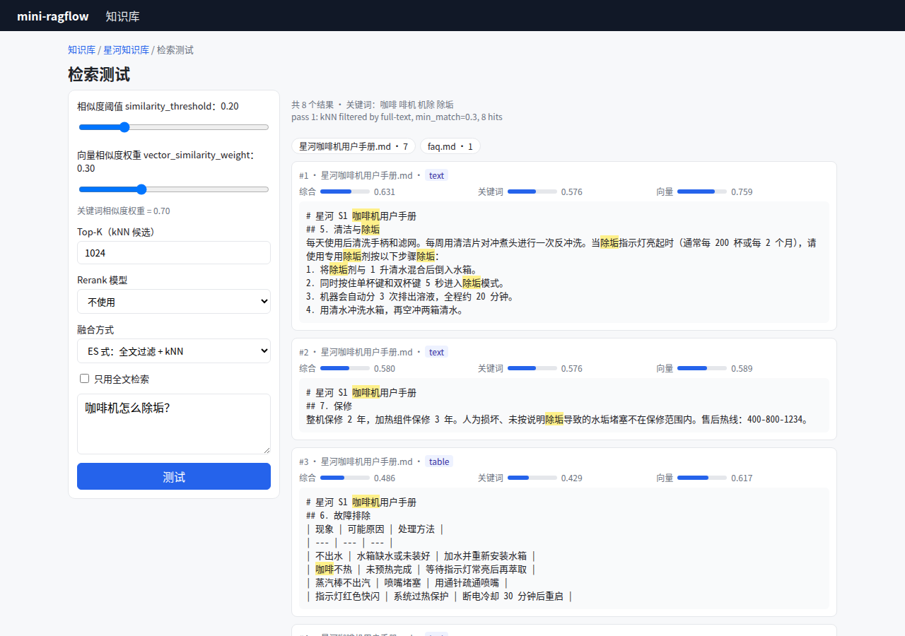

# 第 14 章 检索测试页（前端）

> 本章目标：做一个"调参台"，让用户直接看到每个参数怎么影响检索结果、每条结果的分数由哪几部分组成。
> 前置：第 13 章。对应代码：`v0.3` 的 `web/src/pages/Testing.tsx`。

## 14.1 为什么要有这一页

第 13 章的检索公式里有好几个旋钮：阈值、向量权重、Top-K、rerank 模型、融合方式。用户的直觉往往是"结果不好就把阈值调低"，其实可能该调的是向量权重，或者该换 embedding 模型。**检索测试页的作用，是让每一次检索的计算过程变得可见。**

RAGFlow 在数据集页面里有一个"检索测试"标签页（`web/src/pages/dataset/testing/`），由三部分组成：

- `testing-form.tsx`：参数表单。相似度阈值和"关键词相似度权重"两个滑块（`SimilaritySliderFormField`）、rerank 模型（`RerankFormFields`）、跨语言（`CrossLanguageFormField`）、元数据过滤、rerank 候选数（`RerankCandidatesCountFormField`）。表单校验里写着候选数必须不小于每页条数（`:72`），对应第 13 章的分页约束；
- `testing-result.tsx`：结果列表。每条结果显示三个分数（`:15`）：

  ```ts
  const similarityList: Array<{ field: keyof ITestingChunk; label: string }> = [
    { field: 'similarity', label: 'Hybrid Similarity' },
    { field: 'term_similarity', label: 'Term Similarity' },
    { field: 'vector_similarity', label: 'Vector Similarity' },
  ];
  ```

  以及高亮后的正文、按文档聚合的筛选器（`doc_aggs`）。

注意两个权重的关系：前端表单里的字段是 `keywords_similarity_weight`（`web/src/components/similarity-slider/index.tsx`，默认 0.7），检索接口两个都接受。handler 用 `service.ResolveVectorSimilarityWeight` 把它换算成 `vector_similarity_weight = 1 − 关键词权重`（`internal/handler/dataset.go:1204`），后面的检索代码只认后者。

## 14.2 高亮与 XSS

检索结果的高亮是 HTML（`<em>除垢</em>`），只能用 `dangerouslySetInnerHTML` 渲染。但 chunk 的正文来自用户上传的文档，如果文档里写着 ``，直接渲染就是一个 XSS 漏洞。

RAGFlow 在**前端**清洗：

```tsx
dangerouslySetInnerHTML={{
  __html: sanitizeHtmlWithImagesAsText(
    x.highlight || x.content,
  ),
}}
```

mini-ragflow 在**后端**处理：先 HTML 转义整段正文，再插入 `<em>` 标签（`backend/internal/retrieval/retrieval.go` 的 `Highlight`）：

```go
for i, r := range orig {
	if mark[i] && !in {
		b.WriteString("<em>")
		in = true
	} else if !mark[i] && in {
		b.WriteString("</em>")
		in = false
	}
	b.WriteString(html.EscapeString(string(r)))
}
```

两种做法都行，关键是两端要约定好"谁负责"。后端转义的好处是所有客户端（包括第三方调用 API 的程序）拿到的都是安全的 HTML；前端清洗的好处是后端返回的是原文，客户端想怎么展示都可以。

## 14.3 从零实现

`web/src/pages/Testing.tsx` 左边是参数面板，右边是结果。每条结果显示三根分数条：

```tsx
<div className="scores">
  <Bar label="综合" value={c.similarity} />
  <Bar label="关键词" value={c.term_similarity} />
  <Bar label={rerank ? 'Rerank' : '向量'} value={c.vector_similarity} />
</div>
```

配置了 rerank 模型时，第三根条显示的是 rerank 分数，因为它在公式里替换的正是向量分。比 RAGFlow 多出来的两项：

1. **执行轨迹**：显示第 13 章 `Retrieve` 留下的 `Trace`，可以看到"第一阶段 0 条 → 放宽后 0 条 → 纯向量 26 条"这样的过程；
2. **融合方式切换**：在 ES 式（全文过滤 + kNN）和 Infinity 式（加权求和）之间切换，对比同一个问题在两种引擎语义下的结果。

文档聚合做成了一排"标签"，点击一个就只看这份文档的结果。这就是请求里的 `document_ids` 参数。

## 14.4 运行与验证

```bash
git checkout v0.3
cd backend && go run ./cmd/mini-ragflow --data /tmp/v03 --static ../web/dist --openai-base-url http://localhost:11434/v1 &
cd ../web && node e2e/ui-v03.mjs http://localhost:9380 /tmp/shots ../samples bge-m3@openai
```



*图 14-1：检索测试页（真实模型 bge-m3）。第一条是"清洁与除垢"：关键词 0.576、向量 0.759，综合 0.3×0.759 + 0.7×0.576 = 0.631。*

可以验算第一条结果：`0.7 × 0.576 + 0.3 × 0.759 = 0.4032 + 0.2277 = 0.631`，和页面上显示的综合分一致。

### 踩坑记录：脚本读到的是上一个问题的结果

第一版 UI 脚本连续问四个问题，用 `waitForSelector('.results .chunk')` 等结果出现。结果后三个问题打印出来的都是第一个问题的答案：上一次的结果元素还在页面上，等待条件立刻就满足了。改成等待 `/api/v1/retrieval` 这个请求的**响应**以后才对：

```js
const resp = page.waitForResponse((r) => r.url().endsWith('/api/v1/retrieval'))
await page.click('button:has-text("测试")')
const data = (await (await resp).json()).data
```

写 UI 自动化时，"等元素出现"往往不够，要等"这一次操作产生的那个变化"。

## 14.5 练习

1. **巩固**：在页面上把向量权重拖到 0，再把阈值调到 0.9，观察结果数量。为什么向量权重为 0 时阈值不起作用（第 13 章 13.4 节）？
2. **扩展**：给结果卡片加一个"为什么命中"的展开区，列出这个 chunk 命中了哪些查询词、各自的权重是多少。需要后端返回哪些额外字段？
3. **读源码**：RAGFlow 的 `sanitizeHtmlWithImagesAsText` 允许哪些标签？为什么要把图片替换成文字？

## 14.6 延伸阅读

- `web/src/pages/dataset/testing/`、`web/src/components/similarity-slider/`
- OWASP XSS Prevention Cheat Sheet：输出编码与 HTML 清洗
