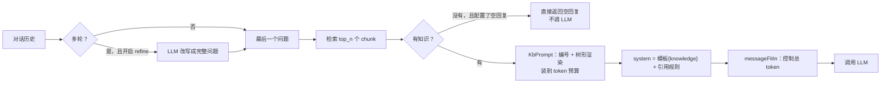

# 第 15 章 Chat 管线：从问题到 prompt

> 本章目标：理解一次知识库问答在调用 LLM 之前要做的所有准备：问题改写、检索、把知识装进提示词、空结果处理、控制 token 预算。
> 前置：第 13 章。对应代码：`v0.4` 的 `backend/internal/chat/{prompt,pipeline}.go`。

## 15.1 准备工作有哪些



## 15.2 RAGFlow 的做法

### 聊天助手的配置

RAGFlow 里聊天助手叫 Dialog（API 里叫 chat），它的 `prompt_config` 定义了提示词相关的一切。默认系统提示词在 `internal/service/chat.go:779`：

```go
pyDefaultSystemPrompt = "You are an intelligent assistant. Please summarize the content of the dataset to answer the question. " +
	"Please list the data in the dataset and answer in detail. " +
	"When all dataset content is irrelevant to the question, your answer must include the sentence " +
	`"The answer you are looking for is not found in the dataset!" ` +
	"Answers need to consider chat history.\n" +
	"      Here is the knowledge base:\n" +
	"      {knowledge}\n" +
	"      The above is the knowledge base."

pyDefaultPrologue      = "Hi! I'm your assistant. What can I do for you?"
pyDefaultEmptyResponse = "Sorry! No relevant content was found in the knowledge base!"
```

`{knowledge}` 是占位符，检索到的知识会被填到这里。如果用户自定义的模板里没有这个占位符，`AsyncChat` 会把知识追加到模板末尾（Phase 10）：

```go
if len(knowledges) > 0 && !strings.Contains(sp, "{knowledge}") {
	if kw, ok := kwargs["knowledge"].(string); ok {
		systemPrompt += kw
	}
}
```

### Phase 8：问题改写

多轮对话里，第二个问题往往是"那多久做一次？"。直接拿它去检索，什么也搜不到。开启 `refine_multiturn` 后，RAGFlow 用 LLM 把整段对话改写成一个完整的问题（`FullQuestion`，提示词模板在 `internal/service/generator.go:223`）：

```text
## Task & Steps
1. Generate a full user question that would follow the conversation.
2. If the user's question involves relative dates, convert them into absolute dates based on today ({{.Today}}).
   - "yesterday" = {{.Yesterday}}, "tomorrow" = {{.Tomorrow}}

## Requirements & Restrictions
- If the user's latest question is already complete, don't do anything — just return the original question.
- DON'T generate anything except a refined question.
...
### Example 1
USER: What is the name of Donald Trump's father?
ASSISTANT: Fred Trump.
USER: And his mother?

**Output:** What's the name of Donald Trump's mother?
```

注意第 2 条：把"昨天""明天"换成绝对日期。"上周的会议纪要"如果不换成具体日期，检索里根本没有"上周"这个词可以匹配。

Phase 8 里还有三步可选的改写：跨语言翻译（`cross_languages`）、元数据过滤（第 19 章）、关键词扩展（`keyword`，用 LLM 抽 3 个关键词追加到问题后面）。

### Phase 10：装填知识

`KbPrompt`（`internal/service/kb_prompt.go:61`）把检索到的 chunk 渲染成编号的树形文本，按顺序装到**模型 max_tokens 的 97%** 为止：

```go
const tokenRatio = 0.97
limit := int(float64(maxTokens) * tokenRatio)
...
for i, ck := range chunks {
	entry := formatChunkEntry(ck, i)
	tokens := tokenizer.NumTokensFromString(entry)
	if used+tokens > limit {
		break
	}
	b.WriteString(entry)
	used += tokens
}
```

`formatChunkEntry`（`:96`）的注释里有一段关于编号的重要说明：

```go
// index is the chunk's position in the list the caller returns as the reference, and
// is 0-based because that list is what a marker's number indexes (see citation.go) —
// a chunk id would come back as a dead marker. Python's kb_prompt numbers the blocks
// 1-based while its own resolver reads 0-based; Go keeps both on 0.
```

编号用的是 chunk 在**引用列表里的下标**（从 0 开始），而不是 chunk id。原因是模型写出来的 `[ID:3]` 要能直接拿去索引引用列表；chunk id 是一串哈希，模型抄错一位就成了"死链接"。注释还顺带指出了 Python 版的一个不一致：渲染时从 1 开始编号，解析时却从 0 开始。

渲染出来的样子：

```text
ID: 0
├── Title: 星河咖啡机用户手册.md
├── URL: …            （有的话）
├── 产品型号: S1      （文档元数据，有的话）
└── Content:
# 星河 S1 咖啡机用户手册
## 5. 清洁与除垢
...
```

### 空结果

一个 chunk 都没检索到时，如果配置了 `empty_response`，就**不调用 LLM**，直接返回这段话。源码里的注释（Phase 10）说明了它会发两帧：一帧带上文本，让流式界面能显示出来；一帧标记结束。这样既省了一次 LLM 调用，也避免模型在没有知识的情况下"自由发挥"。有附件的消息例外：附件本身就是上下文，仍然要交给模型。

### messageFitIn

`messageFitIn`（`chat_pipeline.go:2754`，调用时传入 95% 的预算）控制整个请求的 token 数：

```go
totalTokens := s.countAllTokens(messages)
if totalTokens < maxTokens {
	return totalTokens, messages
}

result := make([]map[string]interface{}, 0)
for _, m := range messages {
	if role, _ := m["role"].(string); role == "system" {
		result = append(result, m)
	}
}
if len(messages) > 1 {
	result = append(result, messages[len(messages)-1])
}
...
if float64(ll)/float64(total) > 0.8 {
	preservedLast := min(ll2, maxTokens)
	result[len(result)-1]["content"] = graph.TrimContentToTokenLimit(..., preservedLast)
	remaining := max(0, maxTokens-preservedLast)
	result[0]["content"] = graph.TrimContentToTokenLimit(..., remaining)
} else {
	...
```

策略很直接：一旦超出预算，**一次性丢掉全部历史**，只保留 system 和最后一条用户消息；还超的话，看谁占大头（system 占 80% 以上就先保住用户消息、截 system，反之截用户消息）。这比"从最早的消息开始逐条删"粗暴，但实现简单，而且知识库问答里，最重要的上下文本来就在 system 的 `{knowledge}` 里。

## 15.3 从零实现

`backend/internal/chat/pipeline.go` 的 `Run` 按上面的流程分成 7 步，每一步都往 `trace` 里写一行：

```go
// 1. The question: the last user turn, or an LLM rewrite of the whole
// conversation when refine_multiturn is on and there is history.
if pc.RefineMultiturn && users > 1 {
	refined, err := llm.Complete(ctx, chatModel, []llm.Message{
		{Role: "system", Content: FullQuestionPrompt(history)}, {Role: "user", Content: "Output: "}}, ...)
	...
}
// 2. Retrieval.
...
// 3. Knowledge block within half the window (the rest is for history and
// the answer).
knowledge, used := KbPrompt(chunks, chatModel.ContextWindow()/2)
...
// 4. Nothing found and an empty_response configured: answer without the LLM.
...
// 5. Prompt: system (+ knowledge + citation rules) and the fitted history.
system := FormatSystem(pc.System, knowledge)
if pc.Quote && len(chunks) > 0 {
	system += CitationPrompt
}
...
msgs, usedTokens := MessageFitIn(msgs, int(float64(chatModel.ContextWindow())*0.95))
```

和 RAGFlow 的差异：

| 项 | RAGFlow | mini-ragflow | 原因 |
|---|---|---|---|
| 知识预算 | max_tokens 的 97% | 上下文窗口的 50% | 给历史和回答留空间；小模型的窗口本来就小 |
| messageFitIn | 超了就丢掉全部历史 | 从最早的历史开始逐条丢弃 | 多轮对话更连贯；代价是多算几次 token |
| 引用规则 | `citation_prompt.md` 全文（含大量示例） | 一段精简版 | 小模型被长提示词淹没的风险更大 |
| 历史里的旧引用 | `cleanCitationMarkers` 去掉 | `StripMarkers` 去掉 | 一致：旧回答里的 `[ID:2]` 对新一轮的知识编号毫无意义 |

最后一行值得多说一句。上一轮回答里的 `[ID:2]` 指的是**上一轮**引用列表里的第 2 块。这一轮重新检索之后，第 2 块可能是另一段内容。如果不清掉，模型很可能照抄旧标记，造成错误引用。

### mock LLM

为了离线测试整条管线，mock 模型会"假装读懂"提示词（`backend/internal/llm/chat.go`）：

- system 里有 `ID: n … └── Content:` 这样的知识块时，挑出和问题共享词最多的那一块，摘出两句最相关的句子作为回答；提示词里出现了引用规则，就在句末加上 `[ID:n]`；
- system 是"改写问题"的模板时，把最后两个用户问题拼起来；
- 抽关键词、出问题、做摘要的提示词也各有一个确定性的应答（第 18 章）。

## 15.4 运行与验证

```bash
git checkout v0.4 && cd backend && go test ./internal/chat/ -v | grep -E '^(---|ok)|answer:|trace:'
```

```text
    chat_test.go:86: answer: 根据知识库：当除垢指示灯亮起时（通常每 200 杯或每 2 个月），请使用专用除垢剂按以下步骤除垢： [ID:0]。1. 将除垢剂与 1 升清水混合后倒入水箱 [ID:0]。
        trace: [retrieved 4 of 6 chunks (pass 1: kNN filtered by full-text, min_match=0.3, 6 hits) prompt: 680 tokens, 2 messages, 4 knowledge blocks model cited [0]]
--- PASS: TestAnswerWithModelCitations (0.01s)
--- PASS: TestInsertCitationsWhenModelDoesNot (0.02s)
--- PASS: TestQuoteOffStripsMarkersFromStream (0.02s)
--- PASS: TestEmptyResponse (0.01s)
--- PASS: TestRefineMultiturn (0.02s)
--- PASS: TestResolveMarkersAndRepair (0.00s)
--- PASS: TestMessageFitIn (0.00s)
--- PASS: TestMarkerFilterAcrossDeltas (0.00s)
--- PASS: TestNoAnswerIsNotCited (0.01s)
ok  	mini-ragflow/internal/chat	0.087s
```

`TestRefineMultiturn` 的对话是：

```text
USER: 咖啡机怎么除垢？
ASSISTANT: 根据知识库：……
USER: 多久做一次？
```

断言执行轨迹里有 `refined question: 咖啡机怎么除垢？ 多久做一次？`，并且答案引用的是"## 5. 清洁与除垢"那一块。如果不改写，"多久做一次"几乎什么也搜不到。

`TestEmptyResponse` 问"量子计算机的价格"：一个 chunk 都检索不到，所以直接返回 `Sorry! No relevant content was found in the knowledge base!`，引用列表为空，也没有调用 LLM。

## 15.5 练习

1. **巩固**：把 mini-ragflow 的知识预算从窗口的 50% 改成 97%，构造一个让 `MessageFitIn` 不得不截断 system 的场景。截断 system 会截到哪部分知识？为什么这比丢掉历史更糟？
2. **扩展**：实现 RAGFlow Phase 8 的 `keyword` 选项：用 LLM 从问题里抽出 3 个关键词，追加到检索问题后面。在"那台机器的除垢剂要放多少水"这种口语化问题上对比效果。
3. **读源码**：RAGFlow 在 Phase 7 里检查 `prompt_config.parameters`：除了 `knowledge`，用户还可以在系统提示词里定义别的占位符。缺少必需参数时会发生什么？

## 15.6 延伸阅读

- `internal/service/chat_pipeline.go` 的 Phase 5~10
- `internal/service/generator.go`：改写问题、关键词抽取、跨语言翻译的提示词
- `internal/rag/prompts/citation_prompt.md`：完整的引用规则与示例
