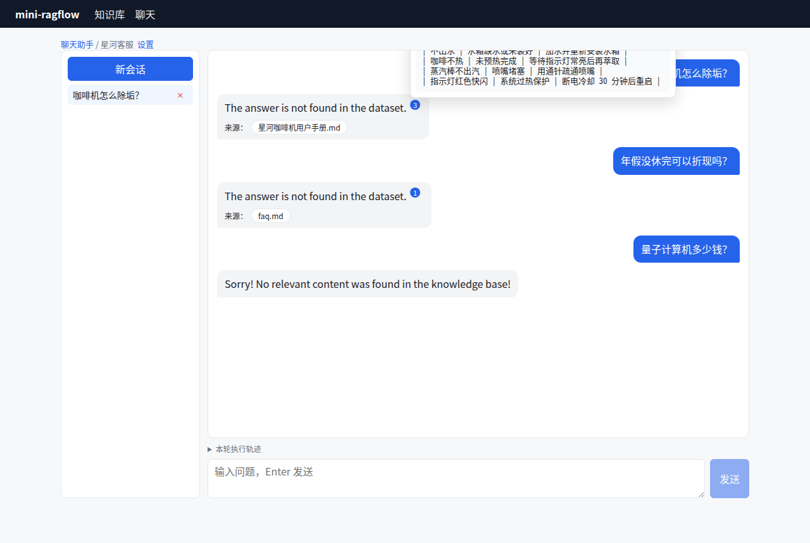

# 第 16 章 流式输出与引用 ★

> 本章目标：把回答一个字一个字地推给浏览器，并让回答里的每个关键结论都能点回原文。涉及 SSE 帧格式、`[ID:n]` 引用协议、格式修复、向量回填引用，以及"拒答不该有引用"这条规则。
> 前置：第 15 章。对应代码：`v0.4` 的 `backend/internal/chat/citation.go`、`backend/internal/api/chats.go`。

## 16.1 两个问题

1. **快**：LLM 生成一段 300 字的回答要好几秒。等全部生成完再返回，用户会以为系统卡死了。要**边生成边显示**；
2. **可信**：回答说"每 200 杯除垢一次"，用户凭什么相信？要能**指出这句话出自哪个 chunk**。

## 16.2 流式：SSE

RAGFlow 用 Server-Sent Events（SSE）。handler 设置响应头（`internal/handler/chat_session.go:251`）：

```go
c.Header("Content-Type", "text/event-stream")
c.Header("Cache-Control", "no-cache")
c.Header("Connection", "keep-alive")
c.Header("X-Accel-Buffering", "no")
```

`X-Accel-Buffering: no` 是写给 nginx 看的：不要缓冲这个响应，否则 nginx 会攒满一块才往外发，"流式"就失效了。RAGFlow 的容器里正好有一个 nginx（第 2 章）。

每一帧是 `data:<JSON>\n\n`，JSON 用的是和普通接口一样的 `{code, message, data}` 信封；中间的帧只带增量，最后一帧带完整答案和引用，然后发一个 `data:true` 表示结束（`internal/service/chat_session.go:1546`）：

```go
wrapper := sseWrapper{Code: 0, Message: "", Data: true}
sendOrCancel(fmt.Sprintf("data:%s\n\n", marshalJSONWithSpaces(wrapper)))
```

为什么用 SSE 而不是 WebSocket？问答是"一问、一个流式回答"，只需要服务端到客户端的单向推送。SSE 就是普通的 HTTP 响应，鉴权、代理、负载均衡都和普通接口一样；WebSocket 要升级协议、要自己维护心跳。

## 16.3 引用：`[ID:n]` 协议

第 15 章说过，知识块被编号为 `ID: 0, ID: 1, …`。引用协议就是让模型在句子末尾写 `[ID:n]`。RAGFlow 的引用规则（`internal/rag/prompts/citation_prompt.md`）开头是这样的：

```text
## Technical Rules:
- Use format: [ID:i] or [ID:i] [ID:j] for multiple sources
- Cite each source INDIVIDUALLY: [ID:i][ID:j]. NEVER merge consecutive citations into a range such as [ID:i-j] or [ID:i~j]
- Place citations at the end of sentences, before punctuation
- Maximum 4 citations per sentence
- DO NOT cite content not from <context></context>
...
## What MUST Be Cited:
1. **Quantitative data**: Numbers, percentages, statistics, measurements
2. **Temporal claims**: Dates, timeframes, sequences of events
...
```

后面还有好几个完整的例子。规则写得这么细，是因为模型的输出千奇百怪。生成结束后，`decorateAnswer`（`chat_pipeline.go:3056`）会分三种情况处理：

```mermaid
flowchart TB
    A[完整回答] --> N{只是在说"没找到"？}
    N -->|是| S[去掉所有引用和参考文档]
    N -->|否| R[修复格式不规范的标记]
    R --> H{里面有标记吗？}
    H -->|有| V[校验：去掉指向不存在块的标记]
    H -->|没有| I[按向量相似度插入引用]
```

### 修复格式

`RepairBadCitationFormats`（`internal/service/citation.go:351`）把模型常写错的几种形状统一成 `[ID:n]`：

```go
var badCitationPatterns = []*regexp.Regexp{
	regexp.MustCompile(`\(\s*ID\s*[:： ]*\s*([0-9...]+)\s*\)`), // (ID: 12)
	regexp.MustCompile(`\[\s*ID\s*[:： ]*\s*([0-9...]+)\s*\]`), // [ID: 12]
	regexp.MustCompile(`【\s*ID\s*[:： ]*\s*([0-9...]+)\s*】`),   // 【ID: 12】
	regexp.MustCompile(`(?i)\bref\s*([0-9...]+)\b`),           // ref12
	// (**ID:5**) / (*ID: 5*) — markdown-asterisk-wrapped parenthetical cites ...
```

字符类里还包含了阿拉伯-印度数字（`\x{0660}-\x{0669}`），因为阿拉伯语的模型可能会写成 `[ID:٣]`。

### 校验

`ResolveCitationMarkers`（`:531`）去掉指向不存在知识块的**规范**标记（比如只有 5 个块，模型却写了 `[ID:9]`）。"规范"两个字很关键：`[2024]` 这种写法也能被引用正则匹配到，但它很可能是正文里的年份，不能乱删。所以只删除带 `ID:` 前缀的标记。

### 回填

模型一个引用都没写时，`InsertCitations`（`:68`）用向量相似度来补。算法写在函数注释里：

```go
// Algorithm mirrors Python Dealer.insert_citations:
//  1. Split into sentences, preserving ``` code blocks.
//  2. Drop sentences shorter than minSentenceLen.
//  3. Encode sentences → sentence vectors.
//  4. Compute cosine similarity between each sentence and each chunk vector.
//  5. Threshold descent (0.63 → 0.3, ×0.8 per round): find chunks where
//     similarity > max*0.99.  Up to 4 chunks per sentence.
//  6. Rebuild answer text with [ID:n] markers inserted after cited sentences,
//     where n is the cited chunk's position in chunks (see applyCitations).
```

核心是 `findCitations`（`:249`）：

```go
func findCitations(sim [][]float64) map[int][]int {
	cites := make(map[int][]int)
	thr := 0.63
	for thr > 0.3 && len(cites) == 0 {
		for i := range sim {
			mx := maxRow(sim[i]) * 0.99
			if mx < thr {
				continue
			}
			var matches []int
			for j, s := range sim[i] {
				if s > mx {
					matches = append(matches, j)
				}
			}
			if len(matches) > 4 {
				matches = matches[:4]
			}
			...
		}
		thr *= 0.8
	}
	return cites
}
```

从 0.63 开始，**整篇回答一个引用都没找到**就把阈值乘以 0.8 再试（0.63 → 0.50 → 0.40 → 0.32），直到 0.3 为止。每句话引用"和它最像的那些块"，范围是最高分的 1% 以内，最多 4 个。阈值逐步下降，让不同 embedding 模型的不同分数尺度都能找到合适的工作点。

### 拒答不该有引用

`reportsNoAnswer`（`:612`）判断回答是不是只在说"知识库里没有答案"：

```go
// notFoundPhrases are the shipped system-prompt lines that instruct the model to
// answer "no answer in the knowledge base" verbatim (web/src/locales/zh.ts,
// systemInitialValue / emptyResponsePlaceholder). They are the fallback signal
// when the dialog configures no empty_response of its own.
var notFoundPhrases = []string{
	"知识库中未找到您要的答案",
	"在知识库中未找到您要寻找的答案",
}
```

如果是，`decorateQuote` 就按"不引用"来处理：没有标记，也没有参考文档。否则，向量回填可能给"没找到"这句话挂上一个看起来很像那么回事的引用。

## 16.4 从零实现

### SSE

`backend/internal/api/chats.go` 的 `completions` 和 RAGFlow 用同样的帧格式：

```go
frame := func(data any) error {
	b, _ := json.Marshal(envelope{Code: 0, Message: "", Data: data})
	if _, err := fmt.Fprintf(w, "data:%s\n\n", b); err != nil {
		return err
	}
	if flusher != nil {
		flusher.Flush()
	}
	return nil
}
```

每一帧都要 `Flush()`，否则 Go 的 `http.ResponseWriter` 会把数据攒在缓冲区里。

### 关掉引用时，不能让半个标记漏出去

`quote` 关闭时，模型偶尔还是会写 `[ID:3]`，必须在流式输出时就过滤掉。难点在于，一个标记可能被拆在两个增量里：`"答案 [ID"` 和 `":3] 结束"`。`markerFilter` 把一个可能是标记开头的 `[` 先扣下来，等看到 `]` 或者攒够 12 个字符再决定（对应 RAGFlow 的 `citationStreamFilter`）：

```go
func (f *markerFilter) write(d string) string {
	f.buf += d
	out := StripMarkers(f.buf)
	if i := strings.LastIndex(out, "["); i >= 0 && len(out)-i < 12 && !strings.Contains(out[i:], "]") {
		f.buf = out[i:]
		return out[:i]
	}
	f.buf = ""
	return out
}
```

`TestMarkerFilterAcrossDeltas` 验证了 `"答案 [ID" + ":3] 结束"` 的输出是 `"答案  结束"`。

### 修复、校验、回填

`backend/internal/chat/citation.go` 移植了 `RepairBadCitationFormats`、`ResolveMarkers` 和 `InsertCitations`（分句正则、最短句长 5、阈值从 0.63 每轮乘以 0.8、1% 以内、最多 4 个，参数全部照搬）。

### 踩坑记录：给拒答挂上了引用

用真实小模型（qwen2.5:0.5b）测试时，界面上出现了这样一幕：



*图 16-1：修复前。模型回答"没找到"，系统却给它挂上了引用 [3] 和一份参考文档。*

模型回答"The answer is not found in the dataset."，没有写任何标记，于是向量回填启动。回填的阈值会从 0.63 一路降到 0.3 以上，只要某个块和这句话的余弦超过了那一轮的阈值，它就会被"引用"。最终，回填给这句拒答挑中了第 3 块。

RAGFlow 的 `reportsNoAnswer` 正是为这种情况准备的，但它的兜底短语列表只有两句中文（见上文）。默认系统提示词是英文的，要求模型说 `"The answer you are looking for is not found in the dataset!"`。而小模型连这句话都没有照抄，说成了 `"The answer is not found in the dataset."`。所以按 RAGFlow 当前的列表，这句话**同样识别不出来**（除非用户把它配置成 `empty_response`）。

mini-ragflow 的修复：移植 `ReportsNoAnswer`，并在短语列表里加上英文默认提示词对应的短语。比较之前先去掉空白和大小写，所以短句版本也能匹配：

```go
var notFoundPhrases = []string{
	"知识库中未找到您要的答案",
	"在知识库中未找到您要寻找的答案",
	"notfoundinthedataset",
	"notfoundintheknowledgebase",
}
```

```go
case ReportsNoAnswer(answer, pc.EmptyResponse):
	// A "not found" reply cites nothing; decorating it would present
	// sources for an answer that has none.
	answer = StripMarkers(answer)
	final.Reference.Chunks = []model.RefChunk{}
	trace("answer reports no answer: citations dropped")
```

回归测试 `TestNoAnswerIsNotCited` 用一个"总是回答这句英文"的假模型来验证。修复后，同样的真实运行输出变成了：

```text
Q: 咖啡机怎么除垢？
A: The answer is not found in the dataset.
   (no sources)
```

（qwen2.5:0.5b 对这些问题一律拒答，模型太小了。换成 qwen2.5:3b 就能正常回答并给出正确引用，见第 17 章。）

## 16.5 运行与验证

```bash
git checkout v0.4 && cd backend && go test ./internal/api/ -run SSE -v | grep -E '^(---|ok)'
```

`TestChatCompletionsSSE` 解析整个 SSE 流，断言：最后一帧是 `data:{"code":0,"message":"","data":true}`；所有增量拼起来等于最终答案；最终答案包含 `[ID:0]`；引用列表非空；这一轮对话已经存进会话（开场白 + 问题 + 回答，共 3 条消息）。

```text
--- PASS: TestChatCompletionsSSE (0.05s)
ok  	mini-ragflow/internal/api	0.049s
```

### 踩坑记录：新会话的帧里 session_id 是空的

这个测试第一次运行时失败了：

```text
--- FAIL: TestChatCompletionsSSE (0.03s)
    api_test.go:350: json: cannot unmarshal number into Go value of type api_test.resp
```

报错信息很迷惑。原因是：没有带 `session_id` 发起的对话会新建一个会话，而会话直到生成**结束**才写进数据库、拿到 id。所以流里每一帧的 `session_id` 都是空字符串。测试拿空的 `session_id` 去查会话，路径变成了 `/sessions/`，返回的是 `404 page not found`，JSON 解码器读到开头的 `404`，就报了"number"。修复方法是在开始流式输出之前先保存会话。

## 16.6 练习

1. **巩固**：用 `curl -N` 调用 completions 接口，数一数一个回答被拆成了多少帧，再计算第一帧到达的时间和最后一帧的时间差。
2. **扩展**：`InsertCitations` 每次都要给回答的每句话算 embedding，这会增加延迟和成本。设计一个"先用词重叠粗筛、只对候选句算向量"的优化。
3. **读源码**：RAGFlow 的 `ExpandRangeCitations`（`citation.go:455`）处理的是什么情况？为什么引用规则明确禁止写 `[ID:1-3]`，代码里还要处理它？

## 16.7 延伸阅读

- `internal/service/citation.go`
- `internal/rag/prompts/citation_prompt.md`
- MDN：Server-sent events；WHATWG HTML 标准里的 EventSource 一节
