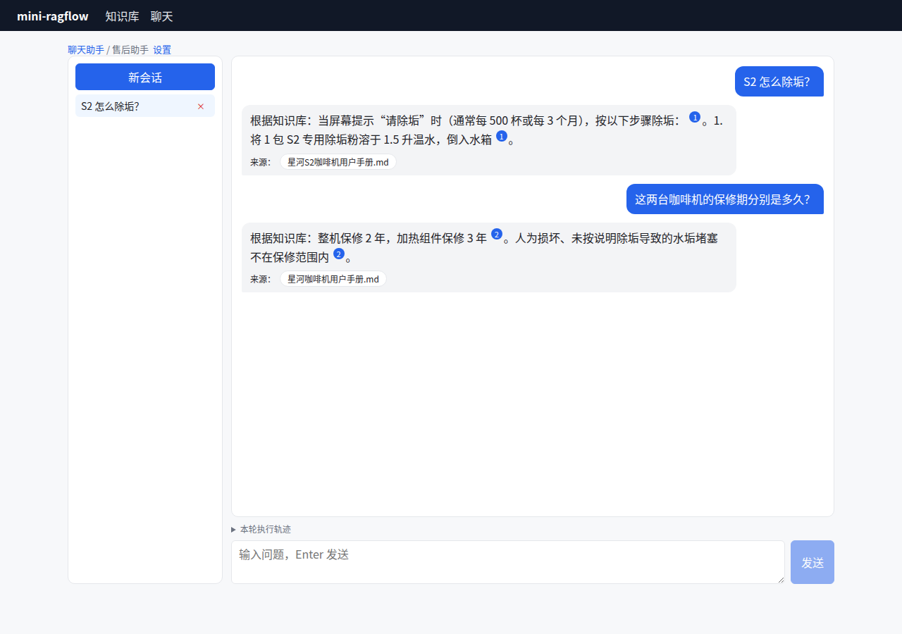

# 第 19 章 元数据过滤与标签

> 本章目标：让检索先按"文档属性"缩小范围，再在范围内找内容。涉及元数据的存储、过滤条件的运算符、让 LLM 从问题里推出过滤条件，以及 RAGFlow 的"标签"排序特征。
> 前置：第 13、18 章。对应代码：`v0.5` 的 `backend/internal/metadata/`（`v1.0` 有一处修复）。

## 19.1 问题：型号混淆

第 1 章的例子：S1 和 S2 两份手册的结构几乎一样，问"S1 的保修期多久"，检索把两份手册的保修段落一起送进了提示词，模型就把 S2 的"研磨器保修 5 年"安到了 S1 头上。

相似度解决不了这个问题："S1 的保修"和"S2 的保修"在语义上本来就很近。需要的是一个**硬条件**：只在"产品型号 = S1"的文档里检索。

## 19.2 RAGFlow 的做法

### 元数据存在哪

每个文档的元数据是一个键值字典，存在检索引擎里一个单独的"文档元数据"索引中（`DocEngine` 接口里的 `CreateMetadataStore / InsertMetadata / SearchMetadata`，`engine.go:52` 起）。来源有两个：Extractor 自动抽取（第 18 章），或者用户在界面上手动编辑。

### 三种过滤模式

`ApplyMetaDataFilter`（`internal/service/metadata_filter.go`）的注释：

```go
// ApplyMetaDataFilter applies metadata filtering rules and returns filtered doc_ids
// Supports three modes:
// - auto: generate filter conditions via LLM
// - semi_auto: generate conditions using selected metadata keys only via LLM
// - manual: directly filter based on provided conditions
//
// When kbIDs is supplied, metadata filters are pushed down to the doc metadata
// index (ES/Infinity) via FilterDocIdsByMetaPushdown instead of being evaluated
// in-memory. The in-memory meta_filter path remains the fallback.
```

- **manual**：聊天助手上配置固定的条件，比如这个助手只回答 S1 的问题；
- **auto**：让 LLM 读问题和元数据，自己生成条件；
- **semi_auto**：同样由 LLM 生成，但只允许使用指定的几个键。

条件能下推到检索引擎时就下推，否则在内存里求值。

### LLM 怎么生成条件

提示词是 `rag/prompts/meta_filter.md`，Go 运行时从这个文件读取（`metadata_filter.go:96` 的 `getMetaFilterTemplate`）。它把元数据组织成"键 → 值 → 文档 id 列表"给模型看：

```text
1. **Metadata Structure**:
   - Metadata is provided as JSON where keys are attribute names (e.g., "color"), and values are objects mapping attribute values to document IDs.
   - Example:
     {
       "color": {"red": ["doc1"], "blue": ["doc2"]},
       "listing_date": {"2025-07-11": ["doc1"], "2025-08-01": ["doc2"]}
     }
```

可用的运算符有 14 个：`contains`、`not contains`、`in`、`not in`、`start with`、`end with`、`empty`、`not empty`、`=`、`≠`、`>`、`<`、`≥`、`≤`。提示词里还写了几条推理规则，比如"七月份"要转成 `≥ 2025-07-01 且 < 2025-08-01` 两个条件、"不要蓝色的"要用 `≠`。输出是 `{"logic": "and"|"or", "conditions": [...]}`。

模板最后一段是当前任务，元数据和问题都放在这里，user 消息只有一句 `"Generate filters:"`：

```text
**Current Task**:
- Today's date: {{ current_date }}
- Available metadata keys: {{ metadata_keys }}
- User query: "{{ user_question }}"
```

### 一条都没匹配上

如果过滤条件一份文档都没匹配上，不能把 `doc_ids` 设成空列表，因为空列表在检索里的意思是"不限制"。RAGFlow 用一个哨兵值（`NoMatchDocIDSentinel = "-999"`，`metadata_filter.go:91`）：检索范围限定在一个不存在的文档上，结果自然就是空的。

### 标签：另一种"属性"

元数据是**硬过滤**；RAGFlow 还有一种**软加权**，叫标签（tag）。数据集可以配置一份"标签文件"：一些示例文本和它们对应的标签。

- 入库时，Extractor 按这份文件给每个 chunk 打上带权重的标签，写进 `tag_feas` 字段（ES 里的 `rank_features` 类型）；
- 检索时，`LabelQuestion`（`internal/service/tag.go:99`）用同一份文件给**问题**打标签，得到一组标签权重，作为 `RankFeature` 传给检索；
- 第二阶段打分时，`applyRankFeatureScores` 计算问题标签和 chunk 标签的余弦，乘以 10 加到 `sim` 上（第 13 章 13.4 节）。

标签不会把任何东西排除出去，只是让"同一类"的 chunk 往前排。mini-ragflow 没有实现标签，这一节只读源码。

## 19.3 从零实现

### 存储

文档表加了一列 `meta_fields`（JSON），store 启动时自动补列。`store.ListDocMeta(kbIDs)` 一次读出所有文档的元数据，在内存里求值。mini-ragflow 的数据集规模不大，没有做下推。

### 条件求值

`metadata.Match`（`backend/internal/metadata/metadata.go`）实现了上面的 14 个运算符。一个实用的细节：**能解析成数字就按数字比较，否则按字符串比较**。ISO 格式的日期（`2026-07-15`）按字符串比较时顺序恰好是对的，所以日期也不需要特殊处理：

```go
cmp := func() int {
	a, errA := strconv.ParseFloat(val, 64)
	b, errB := strconv.ParseFloat(want, 64)
	if errA == nil && errB == nil {
		...
	}
	return strings.Compare(val, want)
}
```

文档根本没有这个键时，`≠`、`not contains`、`not in` 算满足，其余的都算不满足。"不是蓝色的"当然包括没有标颜色的。

### 三处接入

1. **检索接口**：`POST /api/v1/retrieval` 增加 `metadata_condition` 参数，先算出允许的文档 id，再和请求里的 `document_ids` 取交集，一份都不剩就用哨兵 `"-999"`；
2. **聊天助手**：`meta_data_filter: {method: "auto"|"manual", manual: [...]}`，在检索之前生成或应用条件，执行轨迹里会记一行 `metadata filter … → N documents`；
3. **元数据汇总**：`GET /api/v1/datasets/{id}/metadata/summary` 返回"键 → 值 → 文档 id"，既给 LLM 当输入，也给检索测试页做下拉选项。

`metadata.Generate` 用的是 RAGFlow 的 `meta_filter.md` 原文（通过 `go:embed` 嵌入，Apache-2.0）。生成出来的条件里，**不存在的键会被丢掉**，这是一道防止模型乱编的保险。

### 踩坑记录 1：精简过的提示词，小模型不买账

最初为了省 token，`Generate` 用的是一个自己精简过的提示词。用 qwen2.5:3b 测试"S2 怎么除垢？"，它一个条件都没生成。于是换成 RAGFlow 的原版提示词（带详细示例）。复制过来以后 mock 测试却失败了：mock 模型在提示词里找不到 `- User query: "…"\n` 这一行。原因是 RAGFlow 的这个文件是 **CRLF 换行**：

```text
$ file rag/prompts/meta_filter.md
rag/prompts/meta_filter.md: Unicode text, UTF-8 text, with CRLF line terminators
```

另外，提示词的示例里也有 `- User query:` 字样，mock 要找的是最后一个（`LastIndex`），而不是第一个。

### 踩坑记录 2：git 又把 CRLF 换了回来

写这一章时，作者在一个新的 worktree 里检出 v0.5 重跑测试，结果两个测试失败了：

```text
--- PASS: TestOperators (0.00s)
--- FAIL: TestGenerateWithMock (0.00s)
--- FAIL: TestMetadataExtractionAndFilters (0.04s)
```

仓库里存的明明是 LF，检出后却又变成了 CRLF：

```text
$ git config --get core.autocrlf
true
$ file backend/internal/metadata/meta_filter.md     # 新 worktree 里
backend/internal/metadata/meta_filter.md: Unicode text, UTF-8 text, with CRLF line terminators
```

作者的全局 git 配置是 `core.autocrlf=true`，检出时会把 LF 转成 CRLF。v1.0 的修法是"不信任文件的换行符"：加载提示词时先统一成 LF，同时加了 `.gitattributes`（`* text=auto eol=lf`）。修复后，在同一个 CRLF 的 worktree 里测试通过：

```text
--- PASS: TestOperators (0.00s)
--- PASS: TestGenerateWithMock (0.00s)
ok  	mini-ragflow/internal/metadata	0.002s
--- PASS: TestMetadataExtractionAndFilters (0.07s)
ok  	mini-ragflow/internal/api	0.076s
```

所以，如果你的 git 也开启了 `autocrlf`，`v0.5` 这个标签上会有两个测试失败，请使用 `v1.0`，或者先执行 `git config core.autocrlf false` 再检出。

### 真实模型下的结果

mock 模型能准确生成条件（它只是在问题里查找元数据的值）。真实的 qwen2.5:3b 用原版提示词，表现是这样的（真实输出节选，第一段省略了前面的长篇解释，第二段压缩了 JSON 里的空白）：

~~~~text
S2 怎么除垢？ → '...the available metadata does not provide any information that directly relates to the query...
```json
{
  "logic": "and",
  "conditions": []
}
```'
S1 的保修期多久？ → '```json
{ "logic": "and", "conditions": [
    {"key": "empty", "value": "", "op": "not empty"},
    {"key": "product_model", "value": "S1", "op": "="},
    {"key": "warranty_period", "value": "", "op": "not empty"} ] }
```'
~~~~

第一个问题它认为"元数据和问题无关"；第二个问题它把键名"产品型号"**翻译**成了 `product_model`，还凭空编了两个键。后者被"丢弃不存在的键"这道保险全部拦了下来，结果是一个条件都没生成。**auto 模式需要更强的模型**。同样的模型配合 manual 模式（固定条件 `产品型号 = S1`）则工作正常：

```text
A: 根据知识库中的信息，整机保修期为2年，加热组件保修期为3年。……[ID:0]
   ['metadata filter {"logic":"","conditions":[{"key":"产品型号","op":"=","value":"S1"}]} → 1 documents']
```

这一次回答里没有再混入 S2 的"研磨器保修 5 年"。

## 19.4 运行与验证

用 mock 模型完整地走一遍（UI 脚本 `e2e/ui-v05.mjs` 的第二部分，真实输出）：

```text
Q: S2 怎么除垢？
A: 根据知识库：当屏幕提示"请除垢"时（通常每 500 杯或每 3 个月），按以下步骤除垢： 1。1. 将 1 包 S2 专用除垢粉溶于 1.5 升温水，倒入水箱 1。
   本轮执行轨迹 | metadata filter {"logic":"and","conditions":[{"key":"产品型号","op":"=","value":"S2"}]} → 1 documents | retrieved 5 of 5 chunks …
```



*图 19-1：开启了 auto 元数据过滤的聊天助手（mock 模型）。*

## 19.5 练习

1. **巩固**：给《员工休假制度》加一个元数据 `生效日期: 2026-01-01`，用检索测试页的元数据过滤试试 `生效日期 ≥ 2026-01-01` 和 `< 2026-01-01`。
2. **扩展**：实现 RAGFlow 的 `semi_auto` 模式：只把用户指定的键交给 LLM。想一想，它能不能缓解 qwen2.5:3b 乱翻译键名的问题？
3. **读源码**：读 `internal/ingestion/component/tag_query.go`（`LabelQuestion` 调用的 `LoadTagQueryIndex` / `MatchTagQuery` 在这里），弄清楚"给问题打标签"用的是什么算法：向量？关键词？

## 19.6 延伸阅读

- `internal/service/metadata_filter.go`、`internal/service/tag.go`
- `rag/prompts/meta_filter.md`
- Elasticsearch 文档：`rank_features` 字段与 `rank_feature` 查询
