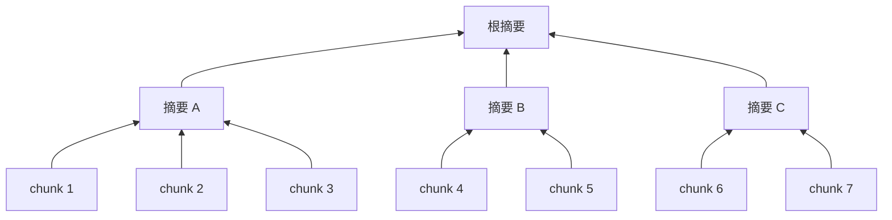

# 第 20 章 RAPTOR 与知识编译：递归摘要树、思维导图、结构图、Wiki

> 本章目标：理解"知识编译"要解决的问题，即很多问题需要的不是某一个 chunk，而是对一大片内容的概括。读懂 RAGFlow 的 RAPTOR 树（watershed 聚类），实现它，并概览其他几种编译产物。
> 前置：第 18 章。对应代码：`v0.5` 的 `backend/internal/pipeline/raptor.go`。

## 20.1 问题：chunk 太"碎"

前面所有的检索都是在 chunk 这一层做的。可有些问题根本不对应任何一个 chunk：

- "这本手册主要讲了什么？"
- "两款机器的维护方式有什么不同？"
- "公司的假期政策总体上有几类？"

答案散落在十几个 chunk 里，没有一个 chunk 单独"像"这个问题。检索只能捞回其中几块，模型看到的是碎片。

**知识编译**的思路是：入库时就用 LLM 把内容组织成更高层的形态，比如摘要树、图谱、思维导图、Wiki，并且把这些产物也当作可检索的内容存起来。RAGFlow README 里的说法是："Compile content at the document and dataset levels into structured knowledge artifacts"，产物包括 Wikis、Graphs、Trees、PageIndex、Mind Maps、Timelines 和 Skills。

## 20.2 RAPTOR 的思路

RAPTOR（Recursive Abstractive Processing for Tree-Organized Retrieval，2024 年的论文）：



1. 把 chunk 按向量聚类；
2. 每一簇让 LLM 写一段摘要；
3. 摘要也算 embedding，作为新的一层再聚类、再摘要；
4. 直到只剩一个根节点。

所有层的节点都进入索引。问细节，命中叶子；问概括，命中摘要。

## 20.3 RAGFlow 的 RAPTOR

`internal/ingestion/component/knowledge_compiler/tree/`。包注释：

```go
// Package tree implements the "tree" variant of KnowledgeCompiler: a
// recursive abstractive summarization tree (RAPTOR). It builds a clustering of
// chunk embeddings and summarizes each cluster with the LLM, recursing upward
// until a single root summary remains.
//
// Clustering uses a single method, watershed (raptor.go::watershed): a 1D
// watershed over the document-ordered embeddings. ...
```

### watershed：不是聚类，是"找话题切换点"

原论文用 UMAP 降维加高斯混合模型（GMM）聚类。RAGFlow 的 Go 实现用的是一种简单得多的方法，`watershed`（`watershed.go:45`）：

```go
// watershed performs a 1D watershed over the sequence of embeddings: it scans
// adjacent pairs only and starts a new cluster whenever the cosine similarity
// between two consecutive embeddings falls below a percentile threshold.
//
// The cut points are contiguous segments of the input in its given order.
// Callers pass document-ordered embeddings, so the boundaries correspond to
// topic shifts in the text. This is a cheap, deterministic text-segmentation
// heuristic (not a semantic clustering), and is O(N) in the number of chunks.
...
	// Adjacent cosine similarities (n-1 pairs).
	adj := make([]float64, n-1)
	for i := 0; i < n-1; i++ {
		adj[i] = dot(normalized[i], normalized[i+1])
	}
	clusterRatio := 100.0 / float64(treeOrder)
	threshold := percentile(adj, clusterRatio)
	...
	for i := 1; i < n; i++ {
		if adj[i-1] >= threshold {
			labels[i] = clusterID
		} else {
			clusterID++
			labels[i] = clusterID
		}
	}
```

按文档顺序计算相邻两个 chunk 的余弦，相似度低于某个百分位数的地方就是"话题切换点"，在那里切一刀。百分位数是 `100 / tree_order`：`tree_order` 默认是 4（`DefaultTreeOrder`，`:22`），也就是切在相似度最低的 25% 的位置，每簇平均 4 个 chunk。文件头的注释说明，这个算法在 Python 版里叫"AHC"（`raptor.py::_get_clusters_ahc`），但它做的并不是凝聚式层次聚类，所以 Go 版按它真正做的事改了名。

这个取舍很有意思：它放弃了"把文档中相隔很远但话题相同的段落聚到一起"的能力，换来了 O(N) 的复杂度、确定性的结果，而且每一簇都是**连续的一段**，读起来自然。对按章节组织的文档来说，这几乎就是我们想要的。

### 不只是摘要

`buildTree`（`raptor.go:181`）在构建摘要树之外，还做了几件事：

- **抽取论断（claims）**：默认开启（`resolveExtractClaims`，对应 Python 的 `extract_claims` 默认 `True`），每次 LLM 调用处理 4 个 chunk（`claimBatchSize`），抽出事实性陈述。论断在聚类**之前**抽取，于是每一簇的摘要基于成员的论断而不是被截断的原文；论断本身也作为单独可检索的行写入；
- **改写重名标题**（`duplicate_titles.go`）：两个摘要节点标题相同、内容不同时，先让 LLM 改名，再用确定性的 ` (n)` 后缀兜底，因为下一步投影成图时标题就是实体名；
- **投影成图**：把树的父子关系转换成"实体/关系"的结构图，供 `/structure/graph` 接口展示。

### 其他几种编译产物

`knowledge_compiler/` 下的其他目录：

| 目录 | 产物 | 一句话 |
|---|---|---|
| `tree/` | RAPTOR 摘要树 | 本章 |
| `mindmap/` | 思维导图 | LLM 输出 Markdown 大纲，再解析成树 |
| `structure/` | 结构图、时间线、列表 | 抽取实体与关系；`chain.go` 校验列表/时间线的顺序 |
| `wiki/` | Wiki 页面 | 按主题规划页面、控制每页篇幅、支持增量更新 |

这些是**文档级**的产物。数据集级的合并由 `internal/ingestion/knowledge_compile/` 负责：一个消费者从调度表里认领"某个数据集有一批文档编译完了"的任务，把各文档的产物合并、去重（`dedup.go`、`topic_merge.go`、`wiki_merge.go`）。NATS 在这里只负责唤醒，MySQL 才是调度状态的权威来源。这和第 6 章"消息只是叫醒手段"是同一种设计。

## 20.4 从零实现

`backend/internal/pipeline/raptor.go` 是流水线里的一个可选组件，放在 Tokenizer **之后**，因为它需要 chunk 的向量。参数：`use_raptor`（默认关闭）、`tree_order`（默认 4）、`llm_id`。

```go
for level := 1; level <= c.maxLevels && len(layer) > 1; level++ {
	...
	labels := Watershed(vecs, c.treeOrder)
	...
	if len(order) == len(layer) {
		// Nothing merged at this level (always the case for two nodes,
		// which watershed splits): summarize everything into one root.
		order = []int{0}
		groups = map[int][]node{0: layer}
	}
	...
	for _, l := range order {
		g := groups[l]
		if len(g) == 1 {
			next = append(next, g[0]) // a singleton climbs as is
			continue
		}
		...
		sum, ok := c.deps.Cache.GetText(chat.ID(), key)
		if !ok {
			sum, err = llm.Complete(ctx, chat, []llm.Message{
				{Role: "system", Content: fmt.Sprintf(raptorPrompt, c.maxTokens)}, {Role: "user", Content: text}}, ...)
```

摘要块的 `ck_type` 是 `raptor`，`extra.raptor_level` 记录它在第几层，分词和向量当场算好，和普通 chunk 一起写进索引。

两处和 RAGFlow 不同，都是测试中发现的：

1. **一定要有根**。只剩两个节点时，`watershed` 会把它们分到两簇（RAGFlow 的注释："the Python reference always splits two points into two clusters"），递归就停在了"两个半棵树"。mini-ragflow 的做法是：某一层一个都没合并，就把这一层全部合成一个根摘要。测试里，4 个叶子 → 2 个一级摘要 → 1 个根，共 3 个摘要块；
2. **摘要不算进文档的 chunk 数**。第一次跑出来的日志是"Indexed 11 chunks"，可那份文档只有 7 块正文。RAGFlow 的 `countOriginalChunkIDs` 会跳过知识编译的产物（带 `compile_kwd` 的行），mini-ragflow 也改成了只统计原始块，日志变成 `Indexed 11 chunks (4 derived)`，回归测试是 `TestRaptorSummariesAreNotCounted`。

## 20.5 运行与验证

mock 模型（摘要就是截取前 60 个字，只用来验证结构）：

```text
RAPTOR level 1: 7 nodes → 3 clusters, 2 summaries.
RAPTOR level 2: 3 nodes → 2 clusters, 1 summaries.
RAPTOR level 3: 2 nodes → 1 clusters, 1 summaries.
Indexed 11 chunks, 1066 tokens in 0.02s.
```

（这是修复计数之前的日志；修复后同一份文档显示 `Indexed 11 chunks (4 derived)`。）第一层 7 个节点切成了 3 簇，其中一簇只有 1 个节点，它直接升到上一层，所以只写了 2 份摘要。

真实模型（qwen2.5:3b）给 S2 手册生成的三个摘要块：

```text
#4 raptor  星河S2全自动咖啡机，2.2升水箱，250克豆仓，选意式、美式、拿铁，自动研磨9g咖啡豆，研磨粗细5档，出厂设第3档。
#5 raptor  星河S2用户手册：每日清空渣盒和滴水盘，每500杯或3个月除垢一次，用1包S2专用粉，加温水，35分钟自动循环，完成后清洗水箱。保修3年，研磨器5年，售后热线400-800-5678。
#6 raptor  星河S2咖啡机2.2升水箱250克豆仓可选意式美式拿铁，9g咖啡豆自动研磨，5档可调。每500杯或3个月除垢一次，用S2专用粉，35分钟自动循环，清洗水箱。保修3年，研磨器5年，售后400-800-5678。
```

#6 是根，它把两个一级摘要又压缩了一遍。数字和原文一致，没有编造。

这些摘要在检索里有用吗？用 v1.0 打开这份数据（真实模型 bge-m3），问两个宽泛的问题：

```text
Q: S2 这台咖啡机有哪些特点？ total 18
  0.512 (t 0.425 v 0.715) text   ## 1. 产品简介 星河 S2 是一台全自动咖啡机，内置研磨器……
  0.502 (t 0.425 v 0.683) raptor 星河S2全自动咖啡机，2.2升水箱，250克豆仓，选意式、美式、拿铁……
  0.493 (t 0.425 v 0.653) text   ## 2. 制作咖啡 在触摸屏上选择"意式浓缩""美式"或"拿铁"……
  0.489 (t 0.425 v 0.639) raptor 星河S2咖啡机2.2升水箱250克豆仓可选意式美式拿铁……（根）
Q: 两台咖啡机的维护保养有什么区别？ total 18
  0.486 (t 0.448 v 0.576) text   ## 7. 保修 整机保修 2 年，……（S1）
  0.427 (t 0.378 v 0.543) text   ## 4. 打奶泡 ……（S1）
  0.367 (t 0.272 v 0.590) text   ## 3. 清洁与除垢 ……（S2）
  0.332 (t 0.202 v 0.636) raptor 星河S2咖啡机……（根）
```

第一个问题，两个摘要块进了前 4，模型拿到的上下文更完整。第二个问题是"比较两份文档"，而 RAPTOR 是**文档内**的树，没有一个节点同时覆盖 S1 和 S2，所以摘要帮不上忙，S1 的块还占了前两名。跨文档的问题需要数据集级的编译（RAGFlow 的 `knowledge_compile`），或者 Agentic 的多步检索（第 21 章）。

## 20.6 练习

1. **巩固**：把 `tree_order` 改成 2 和 8，数一数同一份文档会生成几层、几个摘要块。
2. **扩展**：实现原论文的 GMM 聚类（可以先不做 UMAP），和 watershed 比较摘要的质量和 LLM 调用次数。
3. **读源码**：RAGFlow 的 `mindmap` 编译器（`knowledge_compiler/mindmap/mindmap.go`）怎么把 LLM 输出的 Markdown 转成树？包注释里说"the Markdown source is the LLM's reply, NOT the source"，是什么意思？

## 20.7 延伸阅读

- Sarthi et al., *RAPTOR: Recursive Abstractive Processing for Tree-Organized Retrieval*, ICLR 2024
- `internal/ingestion/component/knowledge_compiler/`、`internal/ingestion/knowledge_compile/`
- Edge et al., *From Local to Global: A Graph RAG Approach to Query-Focused Summarization*, 2024（GraphRAG）
