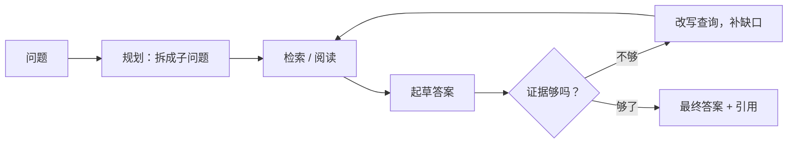

# 第 21 章 Agentic RAG 一瞥：多跳检索与 Deep Research

> 本章目标：理解为什么"检索一次、生成一次"会在某些问题上失效，看清 RAGFlow 的两条 Agentic 检索路径：思考等级 1~4 走的研究循环，等级 5 走的 ReAct 探索者。这一章**以读源码为主**，mini-ragflow 不实现 Agentic 检索，只用它现有的接口手工演示一次"拆分问题"。
> 前置：第 13、15、19、20 章。

## 21.1 一次检索不够的时候

第 15 章的聊天管线是一条直线：改写问题 → 检索一次 → 装进提示词 → 生成。第 20 章末尾已经看到它的软肋。问"两台咖啡机的维护保养有什么区别？"，用 v1.0 + bge-m3 检索（真实输出，前 3 条）：

```text
Q: 两台咖啡机的维护保养有什么区别？ | filter: - | total 18
  0.486 text   星河咖啡机用户手册. | # 星河 S1 咖啡机用户手册 ## 7. 保修 整机保修 2 年，加热组件保修
  0.427 text   星河咖啡机用户手册. | # 星河 S1 咖啡机用户手册 ## 4. 打奶泡 将蒸汽旋钮转到蒸汽档，等待蒸
  0.367 text   星河S2咖啡机用户手 | # 星河 S2 全自动咖啡机用户手册 ## 3. 清洁与除垢 每天清空渣盒和滴水
```

S1 的"清洁与除垢"不在前 3 名里。问题本身是一个**比较**，真正需要的是两次检索：一次找 S1 的保养，一次找 S2 的保养。人会自然地把问题拆开，单次检索不会。

用 mini-ragflow 已有的接口手工"拆一次"：给两份手册设置元数据 `产品型号`（`PUT /documents/{id}`，`meta_fields`），然后用同一个子问题、不同的过滤条件各检索一次（真实输出）：

```text
Q: 咖啡机的维护保养：清洁与除垢 | filter: S1 | total 7
  0.593 text   星河咖啡机用户手册. | # 星河 S1 咖啡机用户手册 ## 5. 清洁与除垢 每天使用后清洗手柄和滤网
  0.421 text   星河咖啡机用户手册. | # 星河 S1 咖啡机用户手册 ## 7. 保修 整机保修 2 年，加热组件保修
  0.351 text   星河咖啡机用户手册. | # 星河 S1 咖啡机用户手册 ## 4. 打奶泡 将蒸汽旋钮转到蒸汽档，等待蒸
Q: 咖啡机的维护保养：清洁与除垢 | filter: S2 | total 3
  0.618 text   星河S2咖啡机用户手 | # 星河 S2 全自动咖啡机用户手册 ## 3. 清洁与除垢 每天清空渣盒和滴水
  0.316 raptor 星河S2咖啡机用户手 | 星河S2咖啡机2.2升水箱250克豆仓可选意式美式拿铁，9g咖啡豆自动研磨，5档
  0.299 raptor 星河S2咖啡机用户手 | 星河S2用户手册：每日清空渣盒和滴水盘，每500杯或3个月除垢一次，用1包S2专
```

两份"清洁与除垢"都排在了第一。（S2 过滤后只有 3 条，是因为 S2 的其余块分数低于阈值。）这里拆问题、选过滤条件的是人；**Agentic RAG 就是让模型来做这件事**，并且在信息不够时再查一轮。



## 21.2 入口：思考等级

聊天请求里的 `reasoning` 参数（或者助手 `prompt_config` 里的同名字段）是一个整数。`resolveReasoningLevel`（`internal/service/chat_pipeline.go:5312`）的注释：

```go
// resolveReasoningLevel mirrors Python's rag_agent: the requesting reasoning
// level is taken from the request kwargs first, falling back to the chat
// prompt_config, and is an integer 0..4 (0 = off, 1..4 = low/medium/high/
// ultra), or reasoningLevelAgentic for the smart-reasoning agent.
```

| 等级 | 走向 | 代码 |
|---|---|---|
| 0 | 普通聊天管线（第 15 章） | |
| 1~4 | 研究循环，`harnessModeForLevel` 映射到 low/medium/high/ultra | `chat_pipeline.go:5337`、`:732` |
| 5（`reasoningLevelAgentic`，`:5305`） | smart-reasoning 智能体，接管整个回合 | `chat_pipeline.go:265-268` |

两条路径的实现是两个不同的包：`internal/rag/agentic-rag/`（研究循环）和 `internal/agentic_rag/`（ReAct 探索者）。

## 21.3 路径一：研究循环（等级 1~4）

### 四种模式

`THINKING_MODES`（`internal/rag/agentic-rag/runtime/config.go:91`）：

```go
// THINKING_MODES
//
//   - low: one hybrid-search pass through direct_search. No action session,
//     so no tool loop — the model never sees tools in this mode.
//   - medium: agentic, SCA review on, no planner decomposition.
//   - high: adds planner + prefetch fan-out over the same tool surface.
//   - ultra: deeper sessions, more SCA rounds, and the relational tool.
```

| 模式 | 工具循环 | SCA 审查轮数 | 规划拆分 | 每轮最多工具调用 | 每个查询保留片段 |
|---|---|---|---|---|---|
| low | 无 | 0 | 否 | 4 | 默认 |
| medium | 有 | 3 | 否 | 8 | 6 |
| high | 有 | 3 | 是 | 8 | 8 |
| ultra | 有（多一个 `graph_explore`） | 5 | 是 | 10 | 10 |

工具清单 `allTools`（`config.go:32`）里有 `retrieve`、`search_chunks`、`metadata_search`、`list_chunks`、`calculate`、`web_search`，还有 `navigate_tree` 和 `navigate_structure`。后两个工具读的正是第 20 章知识编译的产物：模型可以沿着 RAPTOR 树或结构图往下找。编译不只是为了"多几条可检索的摘要"，也是给智能体准备的地图。

"每个查询保留片段"随模式增加，代码注释给出了理由：引擎每路返回 30~60 个候选，包含关键事实的段落往往排在后面，固定只留 4 条会把它丢掉。

### 五段式流水线

`agentic_rag_graph.go` 的包注释画出了整张图：

```go
//	formalize_question → [planner → prefetch] → rag_agent → draft → sca
//	    ├─ sufficient ──────────────────────────→ formalize_answer
//	    └─ insufficient → query_rewrite ────────→ rag_agent (next round)
//
// The graph is Eino's compose.NewGraph, compiled in Pregel mode (the research loop is a
// cycle: sca → query_rewrite → rag_agent).
```

- **formalize_question**：把多轮对话整理成一个独立的问题（`Formalize`，`agentic_rag.go:334`）；
- **planner → prefetch**（只有 high/ultra）：把问题拆成若干"扇出"子查询，构建一张"槽位表"（slot table），然后程序化地并行检索，把结果先放进片段池；
- **rag_agent**：一个带工具的行动会话，自己决定再搜什么、读哪篇文档；
- **draft**：针对每个论点（claim）起草一段带证据的中间结论；
- **sca**（Sufficient Context Agent，`runtime/orchestrator/sufficient_context.go:127`）：审查证据够不够；不够就进 **query_rewrite**，根据缺口改写查询，回到 rag_agent 开始下一轮。研究轮数默认最多 3 轮（`NewAgenticState`，`agentic_rag_graph.go:199`）。

low 模式走的是另一张小图 `BuildLowGraph`（`:281`）：formalize → direct_search → answer，没有规划，也没有审查循环。

### SCA 只看报告，不看原文

SCA 的注释里有一条很实际的经验：

```go
// The SCA reviews ONLY the claims' reports, never the raw retrieved chunks.
// Each report is an evidence-backed finding already distilled from that claim's
// evidence; sending raw chunks ballooned the prompt to 20k-100k chars, which
// degraded the LLM (empty claims) or timed it out.
```

审查员拿到的是"每个论点的结论 + 总体草稿"，而不是几十个原始 chunk。这和第 15 章 `messageFitIn` 的道理一样：上下文窗口是稀缺资源，越往后的环节越要用压缩过的信息。

还有一个关于"不知道"的设计。审查可能没跑成（超时、回复解析不了），这和"审查后认为证据不足"不是一回事。代码里专门有一个 `VerdictUnknown`，注释记录了把两者混为一谈的代价：一次审查超时，被兜底成"证据不足"，答案就被标成了"部分回答"，而这个判断根本没有依据。**没有做出的判断，不能在下游看起来像一个判断。**

## 21.4 路径二：smart-reasoning 智能体（等级 5）

等级 5 不走上面的流水线，而是把整个回合交给 `agenticRag`（`internal/service/agentic_pipeline.go`），它运行 `internal/agentic_rag` 包里的 ReAct 智能体。注释的描述是："an eino-ADK ReAct explorer whose toolset is the corpus itself"。

智能体的系统提示词和工具清单是配置出来的，在 `conf/agentic_rag.yaml` 的 `smart-reasoning` 模板里：

```yaml
    tools:
      - think
      - todo_write
      - grep_chunks
      - search_bm25_chunks
      - search_semantic_chunks
      - list_chunks
      - run_javascript
```

这套工具的设计很像一个程序员在读一个陌生的代码库：

- **定位**有三种角色：`grep_chunks`（正则匹配，相当于 `grep -E -i`）、`search_bm25_chunks`（纯关键词）、`search_semantic_chunks`（纯向量，用于"语料的说法和问题的说法不一样"的情况）；
- **深读**只有一个：`list_chunks` 按阅读顺序读**一篇**文档的 chunk，可以以某几个 chunk 为锚点，向前后各扩展 N 块；
- 辅助工具：`think`（想一想）、`todo_write`（多步研究时记待办）、`run_javascript`（ES5.1 沙箱，只做算术和 JSON 处理，碰不到语料和网络）。

提示词里反复强调一条规则："Search snippets locate; only the deep read proves"：搜索结果只用来定位，事实必须来自深读。这正好对应了单次检索 RAG 的一个根本缺陷：模型只看到了切碎的片段，没有读到上下文。

引用方式也不一样：模型在每个陈述的行尾写上 `chunk_id: <id>`，管线再把它们转换成界面上的引用编号（`buildAgenticReference`）。智能体自己决定读了什么，所以不能像第 16 章那样事先给 chunk 编好号。

## 21.5 两条路径怎么选

| | 研究循环（1~4） | smart-reasoning（5） |
|---|---|---|
| 控制方式 | 固定的五段式图 + 审查循环 | 模型自由决定工具调用 |
| 拆分问题 | planner 显式拆分（high/ultra） | 模型在 `think`/`todo_write` 里自己拆 |
| 停止条件 | SCA 判定充分，或轮数/时间预算用完 | 模型判断"再读也不改变答案了" |
| 可预测性 | 高：每轮花费几个节点是可计算的 | 低：取决于模型 |
| 对模型的要求 | 中 | 高：要能稳定地调用工具 |

一个经验判断：模型越强，越适合把控制权交给它；模型越弱，越需要固定的流程兜底。第 19 章里 qwen2.5:3b 连生成过滤条件都不稳定，让它自由调用七个工具，结果可想而知。

## 21.6 mini-ragflow 为什么不做

一个可用的 Agentic RAG 至少需要：可靠的工具调用、轮数和时间预算、证据充分性判断、跨轮去重的片段池、按 chunk_id 回填引用。每一项都不难，但合起来是一个独立的子系统（RAGFlow 的 `internal/rag/agentic-rag/` 和 `internal/agentic_rag/` 两个包的非测试 Go 代码约 38000 行，而 mini-ragflow v1.0 的整个后端约 9700 行），而且只有搭配足够强的模型才有意义。本书只用 21.1 节那样的手工实验说明它解决的问题。练习 2 给出了一个最小版本的路线。

## 21.7 练习

1. **巩固**：在 RAGFlow 的界面上把同一个比较类问题分别用思考等级 0、2、5 提问，对比执行轨迹里检索了几次、读了哪些文档。
2. **扩展**：给 mini-ragflow 做一个最小的"拆分检索"：先让 LLM 输出 `{"sub_queries": [...]}`，对每个子查询各检索一次，按 chunk id 去重后合并成一个知识块列表，再走第 15 章的生成步骤。用 21.1 节的问题验证效果。
3. **读源码**：`agentic_rag_graph.go` 里的 `ExtendDeadline` 只允许"每个问题延长一次"，并且只有枚举类的槽位表才会请求延长。读注释，说说为什么不是每轮都追加时间。

## 21.8 延伸阅读

- `internal/rag/agentic-rag/`（`agentic_rag.go`、`agentic_rag_graph.go`、`runtime/config.go`、`runtime/orchestrator/`）
- `internal/agentic_rag/`、`conf/agentic_rag.yaml`
- Yao et al., *ReAct: Synergizing Reasoning and Acting in Language Models*, ICLR 2023
- Trivedi et al., *Interleaving Retrieval with Chain-of-Thought Reasoning for Knowledge-Intensive Multi-Step Questions*（IRCoT），ACL 2023
