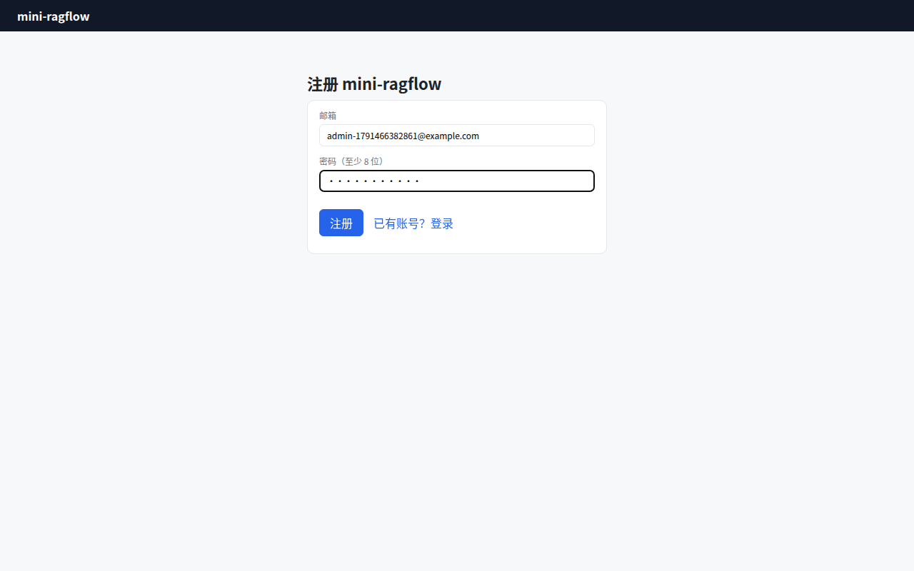
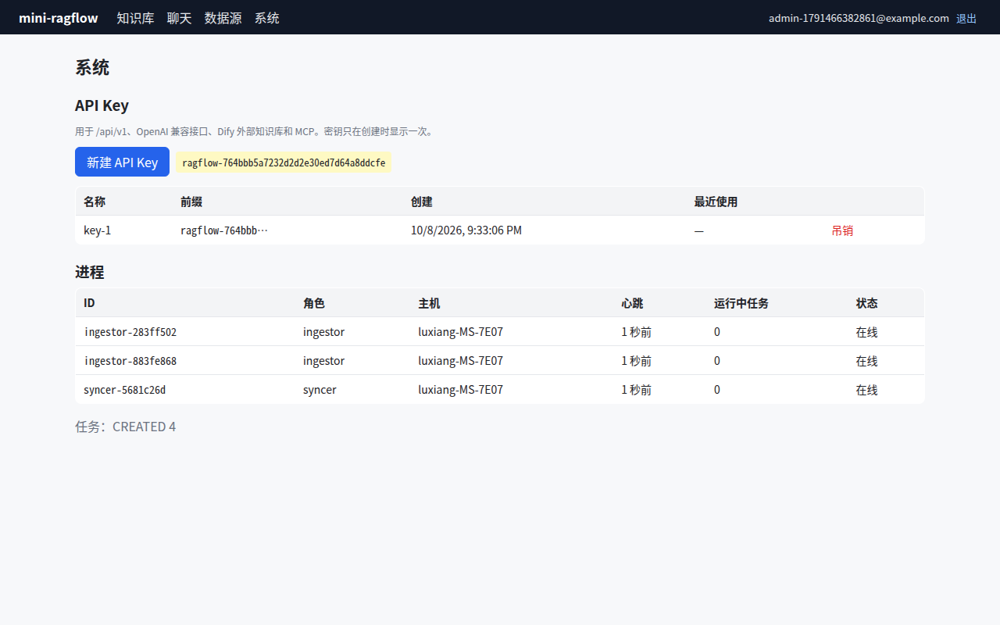

# 第 22 章 多租户、权限与 API Key

> 本章目标：给 mini-ragflow 加上用户、登录、租户隔离和 API Key，并且弄清楚 RAGFlow 的"租户"到底是什么、一个请求是怎样被认出身份的。
> 前置：第 4 章（数据模型）。对应代码：`v1.0` 的 `backend/internal/auth/`、`internal/store/user.go`、`internal/api/auth.go`。

## 22.1 到 v0.5 为止的问题

v0.1~v0.5 里所有数据都属于一个叫 `default` 的租户，任何人只要能访问端口，就能看到、删除所有知识库。平台化的第一步是回答三个问题：

1. **你是谁**（认证）：登录用的会话令牌、程序调用用的 API Key；
2. **数据属于谁**（租户）：知识库、文档、助手都挂在某个租户下面；
3. **你能碰什么**（授权）：只能访问自己租户的数据，或者被团队共享给你的数据。

## 22.2 RAGFlow 的做法

### 用户就是租户

注册时（`UserService.Register`，`internal/service/user.go:106`），RAGFlow 一次事务里创建三样东西（节选）：

```go
tenant := &entity.Tenant{
	ID:        userID,
	LLMID:     llmID,
	EmbdID:    embdID,
	...
}
userTenant := &entity.UserTenant{
	ID:        userTenantID,
	UserID:    userID,
	TenantID:  userID,
	Role:      "owner",
	...
```

**租户的 id 就等于用户的 id**，用户是自己租户的 owner。租户上挂着这个团队默认使用的各类模型（LLM、embedding、rerank、ASR、OCR……）。其他人加入团队，是在 `user_tenant` 表里多一行 `(user_id, tenant_id, role)`（`entity/user_tenant.go:20`）。

### 授权：私有还是团队共享

知识库有一个 `permission` 字段，`me`（默认，只有创建者所在租户能访问）或 `team`。`KnowledgebaseDAO.Accessible`（`internal/dao/kb.go:344`）：

```go
	// User is the owner tenant itself
	if kb.TenantID == userID {
		return true
	}

	// Fail closed for unknown, missing, or private permissions.
	if kb.Permission != string(entity.TenantPermissionTeam) {
		return false
	}

	var count int64
	err = db.WithContext(ctx).Table("user_tenant").
		Where("tenant_id = ? AND user_id = ? AND status = ?", kb.TenantID, userID, string(entity.StatusValid)).
		Count(&count).Error
```

`kb.TenantID == userID` 这个比较之所以成立，正是因为"租户 id = 用户 id"。注意 "fail closed"：权限字段是未知值或者为空时，按私有处理。删除另有一个更严的检查 `Accessible4Deletion`（`:389`）：只有**创建者本人**能删，团队成员不行。

### 认证：两种令牌

**登录令牌**。用户表里存着一个随机的 `access_token`（UUID 去掉横线），发给浏览器的是它的签名版本：`DumpAccessToken`（`internal/utility/token.go`）用服务端的密钥签名，格式和 Python 的 itsdangerous 一致（连派生签名密钥用的 `"itsdangerous" + "signer"` 盐都照搬了，`token.go:172`），有效期 86400 秒（`accessTokenExpireSeconds`）。服务端收到后先验签、解出 `access_token`，再去用户表里查（`GetUserByToken`，`service/user.go:492`）。退出登录时把用户表里的 `access_token` 改成 `"INVALID_" + 随机串`，旧令牌立刻失效。

**API Key**。格式是 `"ragflow-" + 32 字节随机数的 base64`（`GenerateAPIToken`，`utility/token.go:218`），存在 `api_token` 表里，**明文**：

```go
type APIToken struct {
	TenantID string  `gorm:"column:tenant_id;size:32;not null;primaryKey" json:"tenant_id"`
	Token    string  `gorm:"column:token;size:255;not null;primaryKey" json:"token"`
	...
```

查找就是 `Where("token = ?", token)`（`dao/api_token.go:55`）。

### 中间件：一个个试

`BetaAuthMiddleware`（`internal/handler/auth.go:89`）按顺序尝试三种身份：

```go
		// AUTH_JWT
		if u, code, err := h.userService.GetUserByToken(ctx, auth); err == nil && code == common.CodeSuccess {
			...
		}
		// Then try a regular API token (non-beta public bot flow).
		if u, code, err := h.userService.GetUserByAPIToken(ctx, auth); err == nil && code == common.CodeSuccess {
			...
		}
		// Fall back to beta API token (public bot access).
		if u, code, err := h.userService.GetUserByBetaAPIToken(ctx, auth); err == nil && code == common.CodeSuccess {
```

第三种 `beta` 令牌是给"嵌入网页的聊天机器人"用的：它和某一个助手或 Agent 绑定（`DialogID`），中间件会把这个 id 放进上下文。另一个中间件 `AuthMiddleware`（`:136`）只尝试前两种，并且会拒绝超级管理员访问普通接口（"Super user shouldn't access the URL"），管理功能在 `--admin` 模式的服务里。

### 密码

浏览器先用 RSA 公钥加密密码再发送，服务端 `DecryptPassword` 解密（`common/password.go:175`）。存储用 scrypt（N=32768, r=8, p=1），格式和 Python 的 werkzeug 相同（`GenerateWerkzeugPasswordHash`，`:151`），验证时同时兼容 werkzeug 旧的 pbkdf2 格式。Go 和 Python 两套后端共用一张用户表，所以格式必须一致。

## 22.3 从零实现

### 表和对应关系

```sql
CREATE TABLE IF NOT EXISTS user (
  id TEXT PRIMARY KEY,
  email TEXT NOT NULL UNIQUE,
  nickname TEXT NOT NULL,
  password_hash TEXT NOT NULL,
  created_at INTEGER NOT NULL
);
CREATE TABLE IF NOT EXISTS user_token (
  token_hash TEXT PRIMARY KEY,
  user_id TEXT NOT NULL,
  expires_at INTEGER NOT NULL
);
CREATE TABLE IF NOT EXISTS api_token (
  id TEXT PRIMARY KEY,
  tenant_id TEXT NOT NULL,
  name TEXT NOT NULL,
  prefix TEXT NOT NULL,
  token_hash TEXT NOT NULL UNIQUE,
  ...
```

沿用 RAGFlow 的"租户 id = 用户 id"，但没有团队、角色和 `team` 权限：一个用户就是一个租户。

### 令牌只存哈希

和 RAGFlow 不同的一处，`internal/auth/auth.go` 的包注释写明了：

```go
// Passwords use PBKDF2-SHA256 with a per-user salt. Session tokens and API
// keys are random 128-bit secrets stored only as SHA-256 hashes, so a leaked
// database does not leak usable credentials. RAGFlow stores api_token values
// in clear text in MySQL (entity.APIToken); hashing them is the one place
// mini-ragflow is deliberately stricter.
```

- **会话令牌**：32 个十六进制字符的随机数，数据库里只存 SHA-256，7 天过期。不需要签名：令牌本身就是一个随机的、不可猜测的查找键，服务端每次都要查表，签名并不能省掉这次查询。退出就是删掉那一行；
- **API Key**：`ragflow-` 前缀加随机数，同样只存哈希。创建时**只返回一次**明文，界面上之后只显示前 14 个字符（`prefix`）用来辨认；
- **为什么令牌用 SHA-256 而密码用 PBKDF2**：密码是人选的，熵很低，需要慢哈希来抵抗暴力破解；令牌是 128 位随机数，暴力破解本来就不可行，快哈希就够了，而且每个请求都要算一次，必须快；
- **密码**：PBKDF2-SHA256，21 万次迭代（OWASP 2023 的建议值），用 Go 1.24 标准库的 `crypto/pbkdf2`，比较时用 `subtle.ConstantTimeCompare`。

### 中间件和授权

`resolveTenant` 按前缀区分两种令牌：以 `ragflow-` 开头的查 `api_token`，否则查 `user_token`。`requireAuth` 把租户 id 放进请求的 context，之后所有的处理函数都通过 `s.tenant(r)` 取得它。

授权集中在一个地方：`loadKB`（`internal/api/datasets.go:16`）加载知识库时比较 `kb.TenantID != s.tenant(r)`。不存在和不属于你，返回的是**同一条**错误（"You don't own the dataset …"，措辞和 RAGFlow 相同），这样就不会泄露"这个 id 的知识库是存在的"。登录也一样：邮箱不存在和密码错误返回同一句话。

### 从 v0.5 升级

v0.5 的数据都属于 `default` 租户。`CreateUser` 在同一个事务里检查：如果这是**第一个**用户，就把 `default` 租户的知识库和助手全部过继给他，并在响应里返回 `adopted_default_data: true`。所以从 v0.5 升级到 v1.0 后，第一个注册的人会看到原来的数据。

### 关闭注册

`--disable-registration`：已有用户之后，`/user/register` 一律拒绝。对外部署时，先注册好自己的账号，再带上这个参数重启。

## 22.4 运行与验证

`TestAuthAndTenantIsolation` 覆盖了匿名请求 401、两种登录错误返回同一条消息、跨租户访问知识库和任务被拒、API Key 的使用和吊销。下面用一份从 v0.5 升级上来的真实数据，起一个 v1.0 服务，再跑一个脚本（真实输出）：

```text
A login token: c0808068… 32 chars
wrong password: {'code': 109, 'message': 'Email and password do not match!'}
unknown email : {'code': 109, 'message': 'Email and password do not match!'}
B registered, adopted_default_data: False
B lists datasets: 0
B reads A's docs : {'code': 102, 'message': "You don't own the dataset be38ebfc67f559a400e868bc7f992963."}
B retrieves A's  : {'code': 102, 'message': "You don't own the dataset be38ebfc67f559a400e868bc7f992963."}
A new API key   : ragflow-89d032… info: {'id': '0de61a8e…', 'tenant_id': 'f5438355…', 'name': 'script', 'prefix': 'ragflow-89d032', ...}
key retrieval   : 0 12
no token        : {'http': 401, 'code': 109, 'message': 'Authentication error: API key is invalid!'}
B after logout  : {'http': 401, 'code': 109, 'message': 'Authentication error: API key is invalid!'}
api_token row   : ('58ae3f0b2931eb2a', 'ragflow-89d032')
raw key in db?  : 0
deleted key     : {'http': 401, 'code': 109, 'message': 'Authentication error: API key is invalid!'}
```

（id 已截短。）A 是升级后第一个注册的用户，之前注册时拿到了 `adopted_default_data: True`。B 是第二个，看不到 A 的任何东西。数据库里的 `api_token` 只有哈希和前缀，用明文 key 去查一条也查不到。



*图 22-1：v1.0 的登录页。*



*图 22-2：系统页。API Key 创建后只显示一次，列表里只有前缀。*

## 22.5 练习

1. **巩固**：给 API Key 加上"最后使用时间"：`api_token` 表里已经有 `last_used_at` 列，在 `resolveTenant` 里更新它。想一想，每个请求都写一次库合不合适？（提示：第 6 章"进度每秒最多写一次"。）
2. **扩展**：实现 RAGFlow 的团队：`user_tenant` 表、邀请、`permission: team` 的知识库，以及"只有创建者能删除"。
3. **读源码**：RAGFlow 的登录令牌有 86400 秒的签名有效期，用户表里的 `access_token` 却一直有效直到退出登录。两者一起起什么作用？如果密钥泄露了，攻击者能做什么？

## 22.6 延伸阅读

- `internal/handler/auth.go`、`internal/service/user.go`、`internal/dao/kb.go`、`internal/utility/token.go`
- OWASP Password Storage Cheat Sheet
- RFC 6750：OAuth 2.0 Bearer Token Usage
