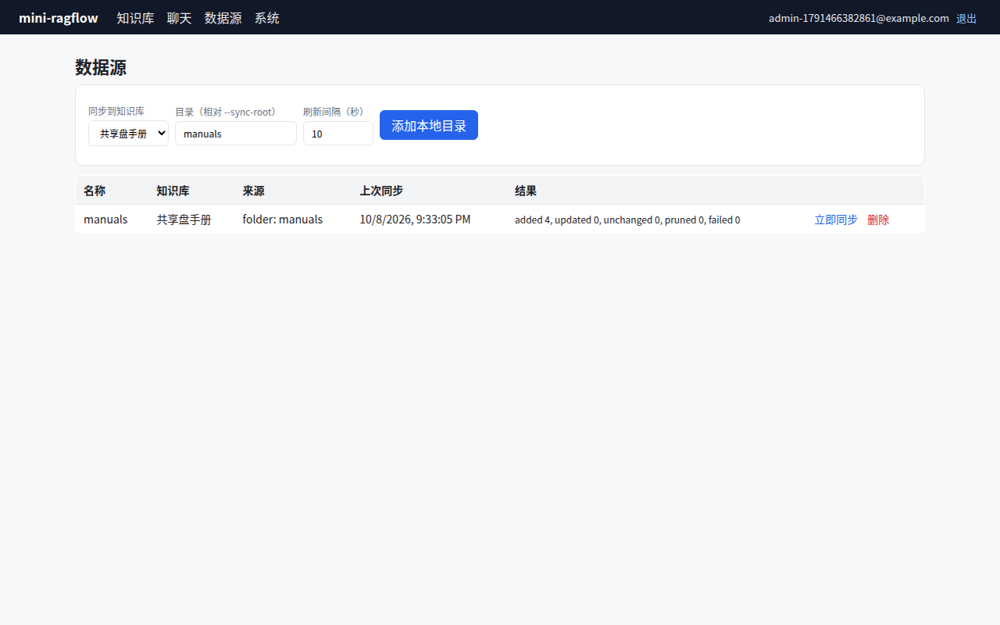

# 第 25 章 数据源同步：Syncer 与增量入库

> 本章目标：让知识库自动跟上外部数据源的变化：新增的文件自动入库，修改过的文件重新解析，删除的文件从知识库里移除，没变的文件什么都不做。
> 前置：第 5、6、24 章。对应代码：`v1.0` 的 `backend/internal/syncer/`、`internal/store/connector.go`。

## 25.1 问题：知识库会过期

到目前为止，文档都是手工上传的。真实的企业知识散落在网盘、Confluence、Notion、Git 仓库和数据库里，而且每天都在变化。手工上传一次，过一周知识库就和源头对不上了。

同步要回答四个问题：

1. **找出变化**：源里有什么、哪些变了？逐个下载比较太贵，要用**指纹**（fingerprint）；
2. **对上号**：源里的一项对应知识库里的哪个文档？要有稳定的**源 id**（SourceID）；
3. **删除**：源里没了的，知识库里也要删掉，但不能误删；
4. **调度**：谁、什么时候去同步，多个同步进程不能同时处理同一个连接器。

## 25.2 RAGFlow 的 Syncer

RAGFlow 的 Go 同步服务在 `internal/syncer/`，附带一份 580 行的开发者文档 `internal/syncer/README.md`，本节的大部分内容出自它。

### 连接器

`internal/syncer/connector/` 下有 41 个数据源（不算 `ssrf.go` 等辅助文件），从 S3、Google Drive、OneDrive、SharePoint、Dropbox，到 Confluence、Notion、Jira、GitHub、GitLab，再到 Slack、Teams、Gmail、IMAP、MySQL、PostgreSQL、RSS、Sitemap、REST API。它们都实现同一个接口：

```go
type Connector interface {
    Validate(ctx context.Context) error
    OpenSync(ctx context.Context, request SyncRequest) (SyncSession, error)
    OpenPrune(ctx context.Context, request PruneRequest) (PruneSession, error)
}
```

- `Validate` 在每个任务开始前调用，只做轻量的检查（README 的警告："It must be a lightweight probe"）；
- `OpenSync` 打开一个**固定时间窗口**的会话，`NextBatch` 一批一批地返回 `SourceDocument`。窗口是固定的：重试时不能把"当前时间"带进来，否则同一个任务每次重跑的边界都不一样。增量窗口的下界是开区间：`WindowStart < UpdatedAt <= WindowEnd`；
- `OpenPrune` 返回源里**全部**项目的 SourceID（不下载内容），用来做删除。不能提供全量快照的数据源返回 `ErrPruneUnsupported`，这时删除同步什么也不做，而不是冒险乱删。

**同步和删除是两个独立的任务**。增量同步只看窗口内变化了的项目，它不可能知道哪些项目被删了；要知道"什么没了"，必须拿到完整的清单。

### 源文档

`SourceDocument` 的几个关键字段：

- `SourceID`：在源系统内稳定且唯一。RAGFlow 的文档 id 由服务层根据 `kb_id + connector_id + SourceID` 推导出来，不由连接器生成。README 强调：它是"delete-sync、ID 兼容和幂等 upsert 的核心"；
- `Fingerprint`：内容或远端版本的指纹，和库里存的一致就跳过。`connector/fingerprint.go:40` 用的是 xxh3-128；
- `Blob` 或 `FetchRef`：内容可以直接给，也可以只给一个"怎么下载"的引用，由 runner 决定真的需要写入时再下载（懒下载）。列表接口能拿到元数据和版本号、但下载很贵的数据源（比如 Google Drive）应该用后者。

### 调度和断点续传

- 任务状态存在数据库的 `sync_logs` 表，NATS 只负责唤醒和跨进程投递，"DB remains the source of truth"（和第 24 章完全一样的分工）；
- 一个进程里默认 5 个 TaskWorker，每 10 秒 `InProgress` 续租；
- 按 `(connector_id, kb_id)` 加锁（`ConnectorLock`），拿不到锁就 3 秒后重试，防止两个任务同时往同一个知识库写同一个数据源；
- **断点续传**：每批成功提交之后，runner 保存一个检查点（connector 自己的游标 + 最后一个 SourceID + 更新时间）。任务失败重跑时，从上次提交的批次之后继续。这要求每批的输出顺序稳定，否则续传可能重复处理大量数据，甚至漏掉数据。检查点只能由 runner 在批次成功后保存，连接器自己不能记"同步到哪了"；
- 重试分两层：文档级（可重试的错误指数退避）和任务级（瞬时错误重试 3 次，其他错误重试 2 次）。

README 最后的"Common pitfalls"值得抄下来：SourceID 不稳定会导致重复文档或删除时误删；批次顺序不稳定会导致续传重复或漏数据；`OpenPrune` 不是增量接口；连接器不能直接写 RAGFlow 的数据库，也不能自己解析文件；指纹算法在不同进程间必须稳定。

## 25.3 从零实现：一个文件夹连接器

mini-ragflow 只做一个连接器：服务器上的一个目录（比如挂载进来的 NAS）。它不需要任何外部账号，读者在本机就能跑起来。RAGFlow 本身没有这种"本地目录"连接器。

### 接口

```go
type SourceDocument struct {
	SourceID    string // stable id inside the source (relative path)
	Name        string
	Fingerprint string // changes iff the content changed; "" = unreadable now
	Load        func() ([]byte, error)
}

type Connector interface {
	List(ctx context.Context) ([]SourceDocument, error)
}
```

比 RAGFlow 简单得多：没有时间窗口，没有分批，每次都列出全部文件。对一个目录来说，列出全部文件本来就不贵，这样一次 `List` 既能用于同步，也能用于删除。`Load` 相当于 `FetchRef`：只有需要写入的文件才会读取内容。

- SourceID = 相对路径；
- 指纹 = 文件内容的 SHA-256。（用修改时间 + 大小会更快，但 `touch` 一下或者复制文件都会改变修改时间，导致不必要的重新解析。）

### 同步一次

`SyncOnce` 拿 `List` 的结果和 `connector_doc` 表（连接器 id + SourceID → 文档 id + 指纹）对比：

| 情况 | 动作 |
|---|---|
| 新的 SourceID | 创建文档，排队解析 |
| SourceID 已知，指纹变了 | 替换文件内容，排队重新解析 |
| SourceID 已知，指纹相同 | 跳过 |
| 表里有，`List` 里没有 | 删除文档（及其 chunk 和文件） |
| 文件在，但读不了或者太大 | 记为失败，**不删除** |

结果写成一行摘要：`added 1, updated 0, unchanged 2, pruned 0, failed 0`。

### 调度

连接器表本身就是调度表，和第 24 章的任务认领一样，用一条 `UPDATE … RETURNING`：

```go
	c, err := scanConnector(s.DB.QueryRow(`UPDATE connector SET lease_owner = ?, lease_until = ?
	  WHERE id = (SELECT id FROM connector WHERE lease_until < ? AND last_sync_at + refresh_seconds * 1000 <= ?
	              ORDER BY last_sync_at LIMIT 1)
	  RETURNING `+connCols, owner, now+ttl.Milliseconds(), now, now))
```

"到期了"（距上次同步超过 `refresh_seconds`）并且"没有被别人租着"的连接器才能被认领，起多个 Syncer 进程也不会同时同步同一个连接器（`TestOnlyOneSyncerClaimsAConnector`）。"立即同步"按钮只是把 `last_sync_at` 清零，让它马上到期。

### 安全：文件夹连接器是一个任意读取接口

一个"读取服务器上某个目录"的接口，如果不加限制，就是一个任意文件读取漏洞：在多租户的环境里，任何用户都能建一个指向 `/etc` 或者其他租户数据目录的连接器，把文件读进自己的知识库。mini-ragflow 的限制：

- 必须启动参数 `--sync-root` 指定一个根目录，不指定就禁用文件夹同步；
- `FolderPath` 先用 `EvalSymlinks` 解析符号链接，再检查结果在根目录之内。`../..` 和"指向外面的符号链接目录"都会被拒绝；
- 遍历时只读普通文件，跳过符号链接（目录里一个指向 `/etc/passwd` 的链接不会被跟随），跳过隐藏目录，单个文件不超过 64 MB。

RAGFlow 面对的是同一类问题的网络版本：`rest_api`、`sitemap`、`rss` 这类连接器会去请求用户给的 URL，于是有 `connector/ssrf.go` 来防止它们访问内网地址。

### 踩坑记录

写这一章时，对照 RAGFlow 的 `FetchRef` 和 README 的常见陷阱重读了 `Folder.List`，发现并修复了三个问题：

1. **内存**（自查发现，未实际观测到）：原来 `List` 把每个文件都读进内存，用闭包一直持有到同步结束。一个几 GB 的目录会把几 GB 都放进内存。现在列表阶段流式计算哈希，只有要写入的文件才在 `Load` 时再读一次；
2. **误删**（测试复现）：读不了的文件（权限变了、临时的 I/O 错误）会从 `List` 的结果里消失，于是它对应的文档被当成"源里已删除"删掉了。新增的测试 `TestUnreadableFileIsNotPruned` 在修复前的输出：

   ```text
       syncer_test.go:126: unreadable sync: "added 0, updated 0, unchanged 0, pruned 1, failed 0"
   ```

   修复后，这样的文件仍然会出现在列表里，只是指纹为空，同步时记为失败。这正是 RAGFlow 把 `OpenPrune` 定义为"完整快照"的原因：**"我没看到"不等于"它不存在"**；
3. **泄露服务器路径**（实际运行发现）：用一个不存在的相对路径创建连接器，错误信息里带着服务器上的绝对路径：

   ```text
   connector path ../../etc          -> lstat /tmp/claude-1000/…/scratchpad/etc: no such file or directory
   ```

   现在只返回 `folder "../../etc" does not exist under the sync root`。顺带一提，作者给这个问题写的第一版测试在修复前也能通过：它检查的是错误信息里有没有根目录本身，可泄露的是根目录的**上一级**。改成 `../nope` 并检查上一级目录之后，测试才在修复前失败、修复后通过。

## 25.4 运行与验证

```bash
mkdir -p /tmp/nas/manuals/sub
cp samples/星河咖啡机用户手册.md samples/faq.md /tmp/nas/manuals/
cp samples/员工休假制度.txt /tmp/nas/manuals/sub/
cp /bin/true /tmp/nas/manuals/tool.exe          # 不支持的格式，应被忽略
go run ./cmd/mini-ragflow --sync-root /tmp/nas
```

然后用脚本（`sync.py`）依次：用三个越界的路径尝试创建连接器、创建一个指向 `manuals` 的连接器、等第一次自动同步、什么都不改再触发一次、修改 `faq.md` 并删除休假制度再触发一次、把 `faq.md` 的权限改成 000 再触发一次。真实输出：

```text
connector path /etc               -> folder is outside the sync root
connector path ../../etc          -> folder "../../etc" does not exist under the sync root
connector path manuals/../../..   -> folder is outside the sync root
first (automatic)            added 3, updated 0, unchanged 0, pruned 0, failed 0 | docs: faq.md, sub_员工休假制度.txt, 星河咖啡机用户手册.md
trigger, nothing changed     added 0, updated 0, unchanged 3, pruned 0, failed 0 | docs: faq.md, sub_员工休假制度.txt, 星河咖啡机用户手册.md
edit faq, delete leave policy added 0, updated 1, unchanged 1, pruned 1, failed 0 | docs: faq.md, 星河咖啡机用户手册.md
faq.md unreadable            added 0, updated 0, unchanged 1, pruned 0, failed 1 | docs: faq.md, 星河咖啡机用户手册.md
```

服务端日志里一共有 4 次 `task claimed`：3 个新文档各解析一次，修改过的 `faq.md` 再解析一次。"什么都没改"的那次同步没有触发任何解析。`tool.exe` 始终没有出现。子目录里的文件以 `sub_员工休假制度.txt` 的名字入库，路径分隔符换成了下划线。

（作者第一次跑这个脚本时，"什么都没改"那一行打印的还是第一次同步的结果。原因在脚本：它用 `last_sync_at` 有没有变化来判断同步是否完成，而"立即同步"会先把 `last_sync_at` 清零，循环立刻就退出了。改成等待 `last_sync_at` 大于触发前的值之后，输出才正确。）



*图 25-1：数据源页面，每个连接器显示上次同步的时间和结果摘要。*

## 25.5 练习

1. **巩固**：在 Docker Compose 部署里（第 26 章），往 `./samples` 里放一个新文件，等多久它会出现在知识库里？由哪些参数决定？
2. **扩展**：实现一个 `s3` 连接器（可以用 MinIO 测试）：SourceID 用对象的 key，指纹用 ETag，`Load` 时再下载。ETag 什么时候不等于内容的 MD5？这对指纹有什么影响？
3. **读源码**：读 RAGFlow 的 `SyncRunner` 处理 `ErrSyncResumeInvalid` 的逻辑：检查点所指的那个文档在源里被删了，会发生什么？为什么最多只重来 2 次（`MaxAnchorRestartCount`）？

## 25.6 延伸阅读

- `internal/syncer/README.md`（强烈推荐通读）
- `internal/syncer/connector/interface.go`、`models.go`、`fingerprint.go`、`ssrf.go`
- OWASP：Path Traversal、Server Side Request Forgery
