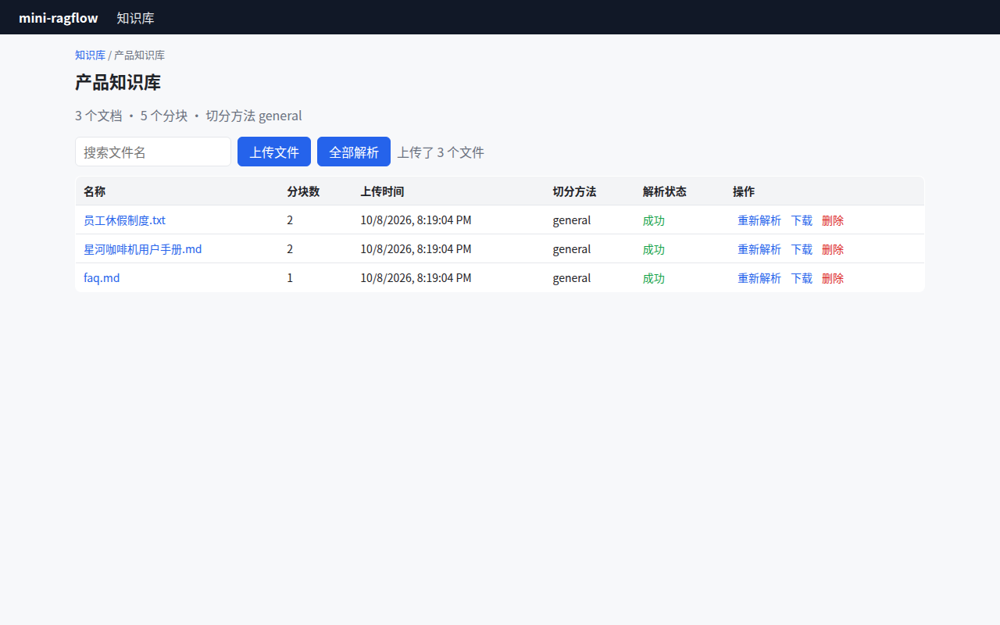

# Lab 1：mini-ragflow v0.1——建知识库、上传、后台解析、前端看进度

> 目标：从空目录开始写出 v0.1，或者直接 `git checkout v0.1` 对照阅读。这个版本已经有了完整的"入库带"骨架：数据集 → 文档 → 任务 → worker → chunk，只是解析和切分还很朴素。
> 前置：第 4~6 章。

## 1. 这一版有什么

| 能力 | 文件 |
|---|---|
| 实体 | `backend/internal/model/model.go` |
| SQLite 存储（数据集、文档、任务） | `backend/internal/store/{store,kb,document,task}.go` |
| 本地对象存储 | `backend/internal/storage/storage.go` |
| chunk 存储（DocEngine 的雏形） | `backend/internal/docengine/engine.go` |
| 纯文本解析 | `backend/internal/parser/parser.go` |
| 按分隔符切开、按 token 合并 | `backend/internal/chunker/naive.go` |
| token 计数（中文字符 + 英文单词） | `backend/internal/tokenize/tokenize.go` |
| worker 池（租约 + 心跳 + 停止） | `backend/internal/ingest/{worker,runner}.go` |
| HTTP API | `backend/internal/api/{server,datasets,documents}.go` |
| 前端：数据集列表、文档表、分块页 | `web/src/pages/{Datasets,Dataset,Chunks}.tsx` |

```bash
cd code/mini-ragflow
git checkout v0.1
find backend -name '*.go' -not -name '*_test.go' | xargs wc -l | tail -1   # 2116 行（含测试 2590 行）
```

## 2. 一步步搭起来

建议按依赖顺序写，每一步都能单独测试：

1. **`util` 和 `model`**：id 生成、时间戳，再加四个实体。
2. **`store`**：建表 SQL、数据集和文档的 CRUD，以及第 6 章的任务表三件套 `CreateTask / ClaimTask / Heartbeat`。先写 `task_test.go` 里的三个测试，再写实现。
3. **`storage`**：本地目录版本，别忘了路径校验（第 5 章）。
4. **`docengine`**：现在只需要 `InsertChunks / DeleteChunks / ListChunks / GetChunk / UpdateChunk / DropKB`。
5. **`tokenize` 和 `chunker`**：`Count` 和 `Naive`，各配一个单测。
6. **`ingest`**：先写 `Runner.Run`（读文件 → 解析 → 切分 → 删旧 chunk → 写新 chunk → 更新计数），再写 `Pool`。
7. **`api`**：统一的响应信封 `{code, message, data}`，错误码沿用 RAGFlow 的取值（`internal/common/error_code.go:24`：0 成功、100 异常、101 参数错误、102 数据错误、109 鉴权错误）。
8. **`main.go`**：打开数据库、启动 worker 池、启动 HTTP 服务、处理 SIGTERM。

接口路径照抄 RAGFlow 的 `/api/v1`：

| 方法 | 路径 | 说明 |
|---|---|---|
| GET/POST/DELETE | `/api/v1/datasets` | 列表 / 创建 / 批量删除 |
| GET/PUT | `/api/v1/datasets/{id}` | 详情 / 修改 |
| GET/POST/DELETE | `/api/v1/datasets/{id}/documents` | 文档列表 / 上传 / 删除 |
| POST | `/api/v1/datasets/{id}/documents/parse` | 开始解析 `{"document_ids": [...]}` |
| POST | `/api/v1/datasets/{id}/documents/stop` | 停止 |
| GET | `/api/v1/datasets/{id}/documents/{doc}/chunks` | 分块列表 |
| PUT | `/api/v1/datasets/{id}/documents/{doc}/chunks/{chunk}` | 编辑 / 启用禁用分块 |

## 3. 前端

`web/` 是 `npm create vite@6 web -- --template react-ts` 生成的，额外装了 `react-router-dom`。开发时用 Vite 的代理把 `/api` 转到后端（`web/vite.config.ts`）：

```ts
server: {
  port: 5173,
  proxy: { '/api': 'http://localhost:9380' },
},
```

文档表最重要的交互是**轮询**：只要有文档处于 RUNNING 状态，就每秒重新拉一次列表，全部结束后停止轮询：

```tsx
const running = docs.some((d) => d.run === 'RUNNING')
useEffect(() => {
  if (!running) return
  const t = setInterval(load, 1000)
  return () => clearInterval(t)
}, [running, load])
```

## 4. 跑起来

```bash
cd backend && go test ./... && go run ./cmd/mini-ragflow --data ./data
cd web && npm install && npm run dev        # 另一个终端，打开 http://localhost:5173
```

或者用作者的 UI 脚本，从头点一遍并截图（需要 Chrome）：

```bash
cd web && npm run build
cd ../backend && go run ./cmd/mini-ragflow --data /tmp/v01 --static ../web/dist &
cd ../web && node e2e/ui-v01.mjs http://localhost:9380 /tmp/shots ../samples
```



*图 L1-1：v0.1 的文档表。三份示例文档都解析成功，分块数分别是 2、2、1。*

脚本的真实输出：

```text
progress log:
Task claimed by ingestor-d84e0af5/1.
Start to parse 员工休假制度.txt (attempt 1).
Parsed 623 characters.
Split into 2 chunks (chunk_token_num=512).
Indexed 2 chunks, 559 tokens.
Done.
chunks on page: 2 | 共 2 个分块
```

## 5. 检查点

- [ ] `go test ./...` 全绿；
- [ ] 上传 `.exe` 会被拒绝，同名文件会被拒绝（第 5 章）；
- [ ] 解析中点"停止"，状态变成"已取消"；
- [ ] 重新解析同一份文档，数据集的分块总数不会翻倍；
- [ ] 打开《星河咖啡机用户手册》的分块，你会看到 #1 块从"当除垢指示灯亮起时"开始。记住这个问题，第 9 章会解决它。

## 6. 这一版的局限（下一版解决）

- 只能解析纯文本，PDF、Word、表格都不行；
- 切分只有一种，不认识标题、条款和问答结构；
- 没有分词和向量，chunk 还**无法被检索**，"分块中搜索"只是一个 `LIKE` 查询；
- 处理逻辑写死在 `Runner.Run` 里，不能按数据集配置。

```bash
git diff v0.1 v0.2 --stat | tail -1
```

```text
 59 files changed, 3796 insertions(+), 282 deletions(-)
```
