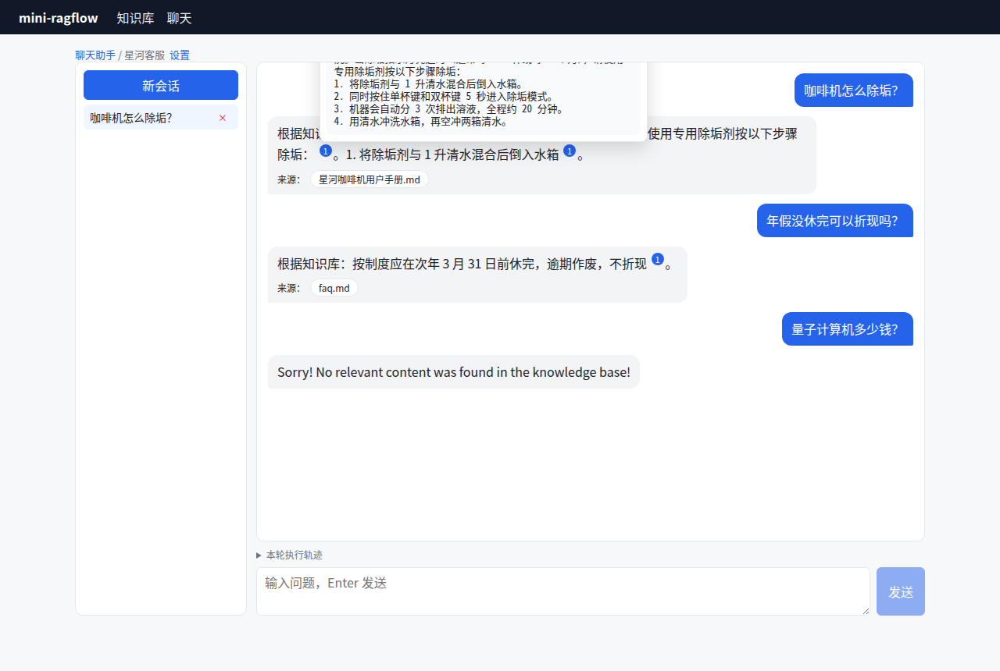
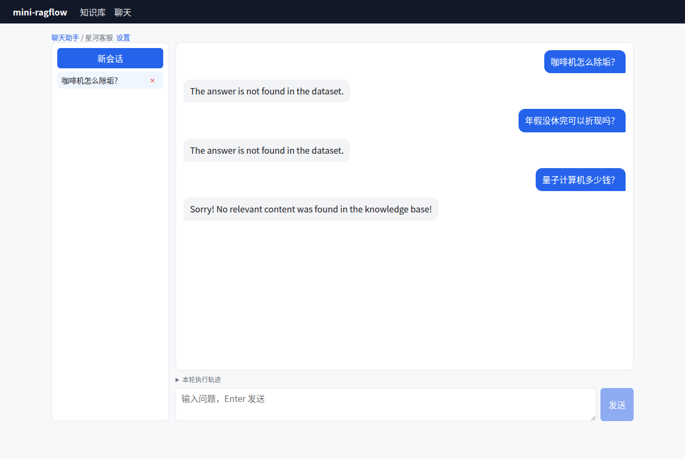

# Lab 4：mini-ragflow v0.4——带引用的流式知识库问答

> 目标：在 v0.3 的检索之上加一条问答管线：聊天助手、会话、多轮改写、提示词装填、SSE 流式、引用的解析/修复/回填，再加一个能悬停查看引用的聊天界面。
> 前置：第 15~17 章。

## 1. 这一版改了什么

```bash
git diff v0.3 v0.4 --stat | tail -1
```

```text
 25 files changed, 2244 insertions(+), 38 deletions(-)
```

| 新增/改动 | 文件 | 章节 |
|---|---|---|
| Chat 模型接口：OpenAI 兼容流式 + 确定性 mock | `internal/llm/chat.go` | 15 |
| 实体：Chat、Session、Message、Reference | `internal/model/model.go` | 15 |
| 存储：chat / session 表 | `internal/store/chat.go` | 15 |
| 提示词：默认模板、KbPrompt、改写模板、MessageFitIn | `internal/chat/prompt.go` | 15 |
| 引用：修复、校验、向量回填、拒答识别 | `internal/chat/citation.go` | 16 |
| 管线：7 步 + trace | `internal/chat/pipeline.go` | 15、16 |
| 接口：chats、sessions、completions（SSE） | `internal/api/chats.go` | 16 |
| 前端：助手列表/设置、会话、流式、引用悬停、来源 | `web/src/pages/{Chats,ChatSettings,ChatView}.tsx` | 17 |

## 2. 接口

| 方法 | 路径 | 说明 |
|---|---|---|
| GET/POST | `/api/v1/chats` | 助手列表 / 创建（`dataset_ids`、`llm_id`、`prompt_config`、`top_n`……） |
| GET/PUT/DELETE | `/api/v1/chats/{chat_id}` | |
| GET/POST | `/api/v1/chats/{chat_id}/sessions` | 会话列表 / 新建（开场白作为第一条消息） |
| GET/DELETE | `/api/v1/chats/{chat_id}/sessions/{session_id}` | |
| POST | `/api/v1/chats/{chat_id}/completions` | `{"question", "session_id"?, "stream"?}`；不传 `session_id` 就新建一个会话 |

创建助手时会校验：数据集属于自己、几个数据集的 embedding 模型相同、LLM 和 rerank 模型的 id 能被解析。

## 3. 跑起来

```bash
cd backend && go test ./... && cd ../web && npm run build
cd ../backend && go run ./cmd/mini-ragflow --data /tmp/v04 --static ../web/dist --mock-delay 5ms &
cd ../web && node e2e/ui-v04.mjs http://localhost:9380 /tmp/shots ../samples
```



*图 L4-1：mock 模型下的聊天页。三个问题分别命中手册、FAQ，以及"什么也没找到"。*

接真实模型：

```bash
ollama pull bge-m3 && ollama pull qwen2.5:3b
go run ./cmd/mini-ragflow --data /tmp/v04real --static ../web/dist --openai-base-url http://localhost:11434/v1
```

在助手设置里，LLM 选 `qwen2.5:3b@openai`；数据集的 embedding 选 `bge-m3:latest@openai`。模型 id 以 Ollama `/v1/models` 返回的为准，带 `:latest` 后缀。如果 bge-m3 在你的 GPU 上返回 NaN，可以单独起一个纯 CPU 的 Ollama 实例：

```bash
CUDA_VISIBLE_DEVICES="" OLLAMA_HOST=127.0.0.1:11435 OLLAMA_MODELS=/usr/share/ollama/.ollama/models ollama serve
```

## 4. 两个小模型的对比（真实输出）

| 问题 | qwen2.5:0.5b | qwen2.5:3b |
|---|---|---|
| 咖啡机怎么除垢？ | The answer is not found in the dataset. | 列出 4 个步骤，引用"清洁与除垢" |
| 年假没休完可以折现吗？ | The answer is not found in the dataset. | "不可以折现……逾期作废"，引用 FAQ |
| 量子计算机多少钱？ | 助手配置的 `empty_response`（检索为空，没有调用 LLM） | 同左 |



*图 L4-2：qwen2.5:0.5b 的聊天页（修复"拒答被挂上引用"之后的截图）。*

0.5b 的模型面对英文默认提示词和中文知识，一律选择拒答，所以第 16 章修复的"拒答被挂上引用"才会在它身上暴露出来。3b 的模型已经能正常使用。

## 5. 检查点

- [ ] `TestChatCompletionsSSE`：帧格式、增量拼接、引用、会话持久化；
- [ ] 关闭"显示引用"后，流式输出和最终答案里都没有 `[ID:` 字样；
- [ ] 开启"多轮对话优化"，问"咖啡机怎么除垢？"再问"多久做一次？"，执行轨迹里出现 `refined question`；
- [ ] 问一个知识库里没有的问题，返回空回复，并且没有调用 LLM（执行轨迹：`no knowledge: empty_response`）；
- [ ] 真实模型拒答时，回答下面没有"来源"。

## 6. 本版的踩坑汇总

| 现象 | 原因 | 处理 | 章节 |
|---|---|---|---|
| 新会话的帧里 `session_id` 为空 | 会话在生成结束后才保存 | 流式开始前先保存 | 16 |
| 聊天页卡在"生成中" | effect 返回了 `scrollIntoView` 的 Promise | effect 加花括号 | 17 |
| 引用卡片被裁掉 | 容器 `overflow: auto` | 改为向下弹出 | 17 |
| mock 回答把问题原样念了出来 | QA 块里的 `\t` 没拆开 | mock 跳过 `Question:` 行 | 17 |
| 拒答被挂上引用 | 拒答识别只有中文短语 | `ReportsNoAnswer` + 英文短语 | 16 |
| qwen2.5:3b 不在下拉列表里 | 模型列表是写死的 | 改为读取 `/v1/models` | 17 |

## 7. 下一版

v0.5 进入"让知识更好找"的进阶功能：用 LLM 给 chunk 补关键词和问题、给文档抽取元数据并按元数据过滤、用 RAPTOR 生成多层摘要。

```bash
git diff v0.4 v0.5 --stat | tail -1
```

```text
 37 files changed, 1758 insertions(+), 34 deletions(-)
```
