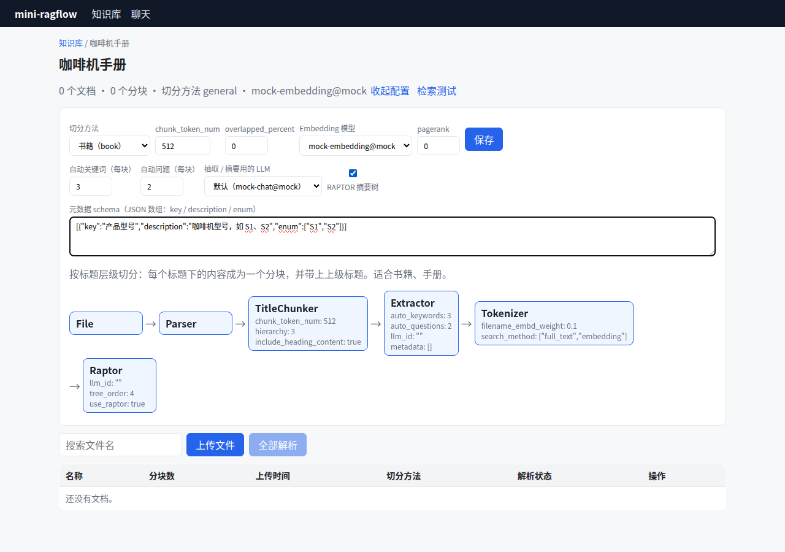
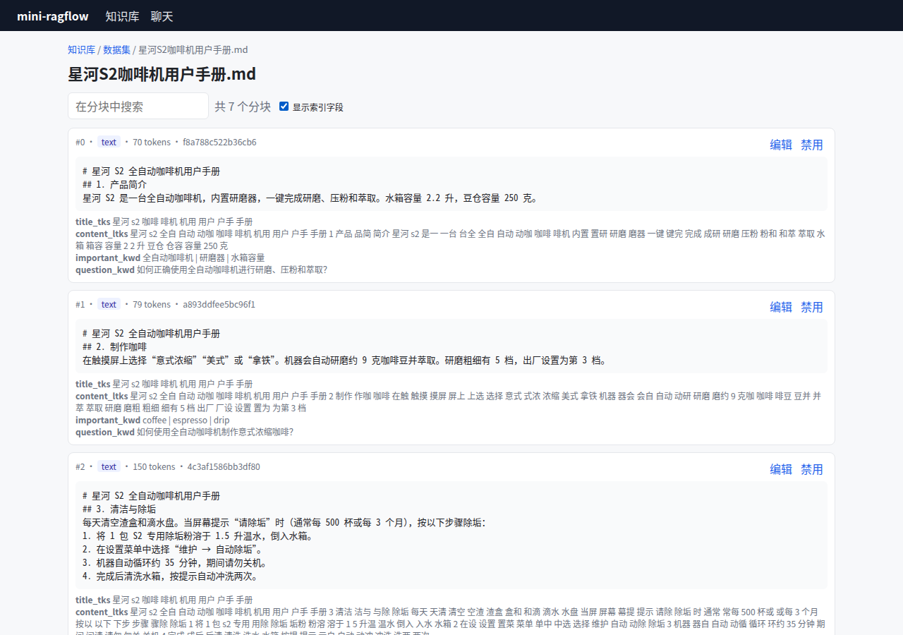

# Lab 5：mini-ragflow v0.5——LLM 增强、元数据过滤、RAPTOR

> 目标：入库时用 LLM 给 chunk 补关键词和问题、给文档抽取元数据，按元数据过滤检索，并生成 RAPTOR 多层摘要。
> 前置：第 18~20 章（第 21 章只读源码，没有对应代码）。

## 1. 这一版改了什么

```bash
git diff v0.4 v0.5 --stat | tail -1
```

```text
 37 files changed, 1758 insertions(+), 34 deletions(-)
```

| 新增/改动 | 文件 | 章节 |
|---|---|---|
| Extractor 组件：关键词、问题、元数据（JSON Schema）、`FirstJSONObject` | `internal/pipeline/extractor.go` | 18 |
| RAPTOR 组件：`Watershed`、逐层摘要、一定有根 | `internal/pipeline/raptor.go` | 20 |
| 6 个流水线模板加上 Extractor 和 Raptor 节点（默认关闭） | `internal/pipeline/templates/*.json` | 18、20 |
| LLM 结果缓存（`llm_cache`） | `internal/pipeline/cache.go` | 18 |
| 摘要不计入文档 chunk 数 | `internal/ingest/runner.go` | 20 |
| 元数据：14 个运算符、汇总、LLM 生成条件（嵌入 `meta_filter.md`） | `internal/metadata/` | 19 |
| 文档表 `meta_fields` 列 | `internal/store/document.go` | 19 |
| 接口：`meta_fields`、`metadata/summary`、`metadata_condition`、助手的 `meta_data_filter` | `internal/api/` | 19 |
| 前端：增强配置、元数据编辑、检索测试的元数据过滤、助手的过滤设置 | `web/src/pages/` | 18、19 |

## 2. 接口变化

| 方法 | 路径 | 变化 |
|---|---|---|
| PUT | `/api/v1/datasets/{id}/documents/{doc_id}` | 新增 `meta_fields`；只改元数据时不需要重新解析 |
| GET | `/api/v1/datasets/{id}/metadata/summary` | 新接口：键 → 值 → 文档 id |
| POST | `/api/v1/retrieval` | 新增 `metadata_condition: {logic, conditions:[{key, op, value}]}` |
| POST/PUT | `/api/v1/chats` | 新增 `meta_data_filter: {method: "auto"\|"manual", manual: [...]}` |

数据集的 `parser_config` 新增：`auto_keywords`、`auto_questions`、`metadata`（字段定义数组）、`use_raptor`、`raptor.tree_order`、`llm_id`。

## 3. 跑起来

```bash
git checkout v0.5
cd backend && go test ./...
cd ../web && npm run build
cd ../backend && go run ./cmd/mini-ragflow --data /tmp/v05 --static ../web/dist &
cd ../web && node e2e/ui-v05.mjs http://localhost:9380 /tmp/shots ../samples
```

> **注意**：如果你的 git 开启了 `core.autocrlf=true`，检出 v0.5 后 `meta_filter.md` 会变成 CRLF，`internal/metadata` 和 `internal/api` 各有一个测试失败（第 19 章踩坑记录 2）。作者在写本节时重新检出 v0.5，复现了这个现象：
>
> ```text
> --- FAIL: TestGenerateWithMock (0.00s)
>     metadata_test.go:53: filter {Logic:and Conditions:[]}
> FAIL	mini-ragflow/internal/metadata	0.002s
> ```
>
> 用 `git -c core.autocrlf=false checkout -- backend/internal/metadata/meta_filter.md` 重新检出这个文件后，所有包都通过了。v1.0 已经修复。

UI 脚本做的事：建知识库 → 在配置面板里设"自动关键词 3、自动问题 2"、勾选 RAPTOR、填元数据字段 `产品型号（enum S1/S2）` → 上传两份手册并全部解析 → 查看 S2 的元数据和摘要块 → 建一个开启 auto 元数据过滤的助手并提问。重新运行时的真实输出（mock 模型）：

```text
--- 星河S2咖啡机用户手册.md
Task claimed by ingestor-bcdaac8e/0.
Start book pipeline for 星河S2咖啡机用户手册.md (attempt 1).
Parsed as markdown: 10 sections map[list:1 text:4 title:5].
Chunked by title into 4 chunks.
Extractor: 3 keywords / 2 questions per chunk with mock-chat@mock.
Extracted metadata map[产品型号:S2].
Embedded 4 chunks with mock-embedding@mock (dim 256, 0 cache hits).
RAPTOR level 1: 4 nodes → 2 clusters, 2 summaries.
RAPTOR level 2: 2 nodes → 1 clusters, 1 summaries.
Indexed 7 chunks (3 derived), 517 tokens in 0.01s.
Done.
S2 metadata: { "产品型号": "S2" }
raptor chunks: 3
  ……（三个摘要块的内容，省略）
Q: S2 怎么除垢？
A: 根据知识库：当屏幕提示"请除垢"时（通常每 500 杯或每 3 个月），按以下步骤除垢： 1。1. 将 1 包 S2 专用除垢粉溶于 1.5 升温水，倒入水箱 1。
   本轮执行轨迹 | metadata filter {"logic":"and","conditions":[{"key":"产品型号","op":"=","value":"S2"}]} → 1 documents | retrieved 5 of 5 chunks (pass 1: kNN filtered by full-text, min_match=0.3, 5 hits) | ...
Q: 这两台咖啡机的保修期分别是多久？
A: 根据知识库：整机保修 2 年，加热组件保修 3 年 2。人为损坏、未按说明除垢导致的水垢堵塞不在保修范围内 2。
   本轮执行轨迹 | retrieved 5 of 5 chunks (pass 1: kNN filtered by full-text, min_match=0.3, 5 hits) | ...
```

第二个问题值得多看一眼：它问的是"两台"，回答只有 S1 的保修（"整机保修 2 年"）。问题里没有出现任何一个型号的值，auto 过滤没有生成条件（执行轨迹里没有 `metadata filter` 一行），这本身是对的。检索到的 5 块里，mock 模型只引用了 `[1]`（S1 的保修段）。这就是第 21 章讨论的"比较类问题"：单次检索、单次生成，天然倾向于只回答一半。



*图 L5-1：知识库配置面板里的 LLM 增强、元数据字段和 RAPTOR。*



*图 L5-2：真实模型（qwen2.5:3b）补充了关键词和问题，最后三块是 RAPTOR 摘要。*

接真实模型，和 Lab 4 一样：

```bash
node e2e/ui-v05.mjs http://localhost:9380 /tmp/shots ../samples bge-m3:latest@openai qwen2.5:3b@openai
```

作者的一次真实运行（CPU 上的 Ollama）：S1 手册 `Indexed 11 chunks (4 derived), 1374 tokens in 77.84s`，大部分时间花在 LLM 调用上。Extractor 和 RAPTOR 都先查 `llm_cache`（`extractor.go:110`、`raptor.go` 里的 `GetText`），键是提示词加输入文本，所以同一份文档内容不变时重新解析，按设计不会再调用模型。作者没有单独测量重新解析的耗时。

## 4. 检查点

- [ ] `TestExtractorAndRaptor`：4 个叶子块都有关键词和问题，生成 3 个摘要块（2 个一级 + 1 个根），元数据 `产品型号 = S2`；
- [ ] `TestRaptorSummariesAreNotCounted`：文档的 `chunk_count` 只算原始块；
- [ ] `TestOperators`：8 组条件，覆盖大小写不敏感的 `=`、缺键时 `≠` 为真、数字比较、ISO 日期、`in`、`empty`、`or`；
- [ ] `TestFirstJSONObject`：能从"一个对象后面再跟一个 Markdown 代码块"的回复里取出第一个对象；
- [ ] `TestMetadataExtractionAndFilters`：`metadata_condition` 过滤到 S2；条件一份文档都不匹配（`S9`）时返回空结果，而不是全库结果（哨兵 `"-999"`）；
- [ ] 助手开启 manual 过滤（`产品型号 = S1`）后，问"保修期多久"，回答里不再出现 S2 的"研磨器保修 5 年"。

## 5. 本版的踩坑汇总

| 现象 | 原因 | 处理 | 章节 |
|---|---|---|---|
| 抽取出的元数据是 `{}` | 把字段定义原样塞给模型 | 转成 JSON Schema（`Turn2JSONSchema`） | 18 |
| 解析模型回复失败 | 回复是 `{}` 再跟一个代码块 | `FirstJSONObject` 取第一个完整对象 | 18 |
| 小模型生成不出过滤条件 | 自己精简的提示词 | 改用 RAGFlow 原版 `meta_filter.md` | 19 |
| mock 测试找不到 `User query` | 原版提示词是 CRLF；示例里也有这一行 | 统一换行；用 `LastIndex` | 19 |
| qwen2.5:3b 的 auto 过滤无效 | 键名被翻译成英文、编造键 | 丢弃不存在的键；建议 manual 或更强模型 | 19 |
| RAPTOR 没有根 | 两个节点总被 watershed 分开 | 某层没合并就全部合成根 | 20 |
| 文档 chunk 数比正文块多 | 摘要也被计数 | 只统计原始块 | 20 |
| 新检出的 v0.5 有两个测试失败 | `core.autocrlf=true` | v1.0 加载时统一换行 + `.gitattributes` | 19 |

## 6. 下一版

v1.0 是"平台化"：用户和 API Key、OpenAI 兼容接口、Dify 外部知识库和 MCP、多个 Ingestor 进程之间的租约与故障转移、文件夹同步，以及 Docker Compose 一键部署。

```bash
git diff v0.5 v1.0 --stat | tail -1
```

```text
 56 files changed, 3004 insertions(+), 179 deletions(-)
```
